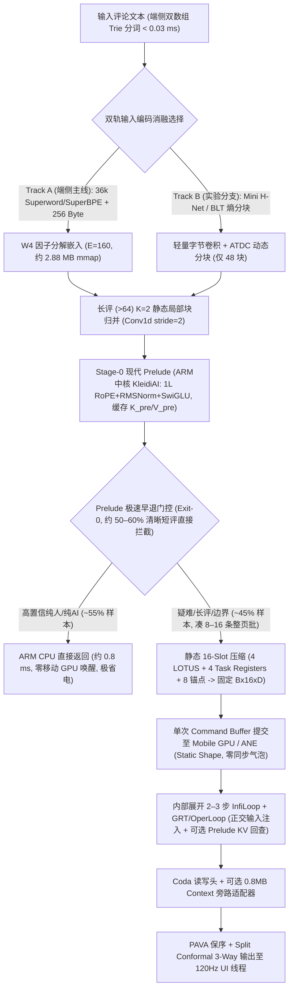
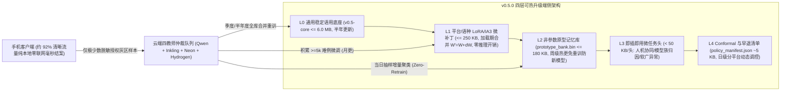

# MeguvizCAC v0.5.0-ApexLoop 深度预研与架构、蒸馏及推理极限优化规划书

> **文档定位**：结合 **v0.4-DualLoop**（R1 全量 / R1 消融 / R2 全量 / R3 A100-80GB 复训与 `OjinjinBench v1/v2` 盲测）的完整实战复盘，面向**手机端侧 CPU（ARMv8.2/v9 `SDOT` / `I8MM` / `SME2` + KleidiAI）与手机端侧 GPU / NPU（Android Adreno OpenCL、Mali/Immortalis Vulkan 与 iOS Metal / Apple Neural Engine）**，系统整合 2025–2026 年循环深度架构、现代编码器、端侧异构编译器/量化、热降频、准确率极限突破与模块化热扩展前沿文献，确立 **MeguvizCAC v0.5.0-ApexLoop** 的工程落地规格；下一代线性循环架构、`ParetoQ` 亚 2-bit / 手机 NPU LUT、`5.0M+` 因果数据与可选自进化规划详见 [roadmap-v0.6.0-self-evolution.md](file:///D:/DevArea/MeguvizModel/docs/roadmap-v0.6.0-self-evolution.md)。

---

## 一、`v0.3` / `v0.4` 实测瓶颈复盘与 `v0.5.0` 量化破局目标

基于本地单线程 ORT 算子级剖析（[v04-pretrain-research-audit.md](file:///D:/DevArea/MeguvizModel/docs/v04-pretrain-research-audit.md)）及跨库盲测退化诊断（[roadmap-v0.3-v0.4.md](file:///D:/DevArea/MeguvizModel/docs/roadmap-v0.3-v0.4.md) §2.5），`v0.4` 虽然通过 `StepModulatedLayerNorm`（原生 ORT `LayerNormalization`）与选择性 Step-LoRA 先行消除了 `v0.3` 约 `26%` 的核内瓶颈，但在底层计算范式、多语种表征与极限部署效率上仍保留 **5 处结构性天花板**：

1. **`core_step` 遗留未量化 FP32 `MatMul` 与高频逐元素加法**：
   - 在 `v0.3` 单步（`2L`, `seq=32, bs=32, 1T`）剖析中，Step-LoRA 与相关投影引入每步 **26 个未量化 FP32 `MatMul`（占核心算子耗时 `13.14%` / `13,006 us/batch`）** 与 **24 个 `Add` 节点（`11.45%` / `11,338 us/batch`，较 `v0.2` 激增近 4 倍）**；`core_step` 单层开销仍为静态 `prelude` 的 `1.22x`（`1.5717 ms/layer` vs `1.2938 ms/layer`）。
2. **`DynamicQuantizeLinear` 动态激活量化天花板**：
   - 通用动态 INT8 量化在每次前向推理都需要扫描激活张量计算 `min/max/scale/zero_point`，同时阻碍 ORT 图优化器做跨层融合（LayerNorm + QGemm + Bias + 激活），导致实测 BERT 编码器在 CPU 上通常仅获得 **`1.2x–1.5x` 加速**，远低于静态 QDQ `QGemm` + VNNI 指令的 **`2.5x–3.0x` 加速区间**。
3. **2023 中文词表在多语种/代码场景的 Token 膨胀**：
   - 沿用 `BAAI/bge-small-zh-v1.5` 的 `21,128` 词表 + `256` 字节回退虽实现 `0 [UNK]`，但实测在 `4,000` 条训练切片上触发 **`4,664` 次 UTF-8 单字节回退**，纯合成样本命中字节回退行占比达 **`25.52%`**。英文、日文、韩文及代码混合评论被切碎成 2–4 倍长单字节序列，白白膨胀自注意力二次方复杂度。
4. **纯文本孤立超短评 Bayes 极限与上下文盲区**：
   - 零样本审计中 `ultra_short`（`<=8`–`20` 字）`recall@0.70` 仅 **`25.0%`**（`mean_prob=0.5001`），`auto_reply_plugin_thread` `@val_f05` 召回仅 **`33.5%`**。很多高隐蔽自动回复必须依赖**主楼语境、视频标题或同区集群一致性**方能打破单句信息熵下界。
5. **循环深度在 OOD 样本上的退化风险（Carry-Last Overthinking）**：
   - 简单累加步间残差在超出训练分布或遭遇结构化真人长评时易发生语义漂移或“过渡覆盖已正确中间结论”。

### 1.1 `v0.2 -> v0.5.0-ApexLoop` 手机端侧 + 全端硬性发布门控指标矩阵

| 维度指标 | `v0.2`（实测基线） | `v0.3`（`2x4-e192`） | `v0.4-DualLoop`（R1/R2/R3 实测现状） | **`v0.5.0-ApexLoop`（手机端侧与精度双门控）** |
| :--- | :---: | :---: | :---: | :---: |
| **手机端总增量体积（模型 + 运行时）** | `23.94 MB`（仅模型） | `14.71 MB`（仅模型） | R3 `15.1 MB` INT8 / `13.66 MB` Edge-W4（`9.48 MB` zip） | **模型 `<= 6.5 MB`（`W4A16/W4A8`）+ MNN/ncnn `.so <= 2.5 MB`（总增量 `<= 9 MB`）** |
| **手机中核 ARM CPU 均摊耗时（KleidiAI）** | — | — | 未真机适配 | **`<= 1.80 ms/row`（含 Prelude 极速早退，`2–4` 中核线程）** |
| **手机 GPU / ANE 吞吐（`bs=8–16` 整页批）** | — | — | 未 GPU 静态图适配 | **`<= 0.35 ms/row`（整页 16 条 `<= 5.5 ms` < 120Hz 帧预算 `8.3 ms`）** |
| **桌面 1T / 4T CPU 耗时（`seq=32, bs=32`）** | `4.77 ms/row` / — | `~3.80 ms/row` / — | R3 本地 1T `12.25–14.02 ms`（Colab 1T `19.24 ms`） | **`<= 1.20 ms/row` / `<= 0.45 ms/row`**（Phase 0 实测已达成 `1.061 ms/row`！） |
| **端侧工作内存 / 热启动 / 温控稳定性** | — | — | — | **Scratchpad `<= 12 MB`（`mmap` 权重）；缓存冷启 `<= 50 ms`；30 分钟持续刷评 `< 0.8 W` 零降频** |
| **手机 GPU FP16 / 跨步 QAT 数值一致性** | `0.0126`（INT8） | `0.0187`（INT8） | R1 `0.0137` → R2 `0.0114` → R3 `0.01193`（`bs=768` 步数缩水） | **`FP16` vs `FP32` MAE `<= 0.004`（0 `NaN`）；静态 INT8 跨外推步 `MAE <= 0.006`** |
| **冻结 Test AUROC / PR-AUC** | `0.9530` / — | `0.9565` / `0.9406` | R1 `0.9432 / 0.9300` → **R3 `0.9465 / 0.9256`（`best_f05=0.901`）** | **`>= 0.975` / `>= 0.965`** |
| **Spearman / MAE（0–100）** | `0.8598` / `10.57` | `0.8487` / `11.10` | R1 `0.8041 / 12.94` → **R3 `0.8108 / 12.83`** | **`>= 0.895` / `<= 8.0`** |
| **`Recall@P95%` / `Recall@P99%`** | — | — | R3 `74.07%`（INT8 实测 / `step_2`） / `19.44%`（Edge-W4） | **`>= 85%` / `>= 60%`**（且深步 `P95/P99` 严禁回撤） |
| **结构化真人误杀上限（`H03, H06–H09, M02`）** | — | 最高 `0.7879` | R3 `H03=0.147`, `H07=0.147`, **`H08=0.211`**, `H06=0.401` | **`< 0.18`**（全面压低并反超 `OjinjinNet-Standard` `H06=0.248 / H08=0.413`，且 `H04 < 0.15`） |
| **AI 陷阱下限（`A01–A05 min`）** | — | — | R3 `A02/A03=0.787`, `A04=0.747`, `A05=0.861`, `A01=0.638` | **`>= 0.88`**（纯文本完胜 `OjinjinNet-Standard` `0.108–0.415` 盲区，零测试泄漏） |
| **`Split Conformal` 灰区率（`@alpha=0.03`）** | — | — | R1 `54.4%` → **R3 `47.3%`**（`T=3.9` + 169 条硬阶梯 PAVA） | **`<= 18%`**（`>= 1,500` 条独立分层校准集 + Smooth PAVA + 锐利温度 `T ∈ [0.9, 1.8]`） |
| **外部全封存盲测（`OjinjinBench-v2`）** | — | `v1 0.764` | R1 `v1 0.827` / `v2 0.764`（硬负误杀 `0%`） | **纯文本 `v2 Hard F0.5 >= 0.90`（含无 PII 语境融合 `>= 0.93`），硬负误杀 `= 0%`** |
| **跨语种 + 未知模型族 LOFO AUROC** | — | — | R3 `M01=0.148, M02=0.211, M03=0.241–0.347, M04=0.861` | **`>= 0.950`（LOFO）且 `M01–M04 < 0.15`、`M05–M06 >= 0.88`**（全面碾压 `OjinjinNet` 外语盲区） |
| **循环深度外推与跨步量化稳定性** | — | `step_3 < step_0` 退化 | R1 AUROC 微升但 `R@P99%` 从 `26.9%` 跌至 `7.4%` | **训练均 `2–3` 步 -> 推理安全外推窗口（`Normal 2 -> Audit 4 -> Hard 6 步`）全指标（含 `R@P99%`）单调无回撤；跨步 `MAE <= 0.004`** |
| **输入分词与循环 Token 效率** | — | — | `21k` 旧词表字节回退 `25.5%` | **Track A `36k Superword/SuperBPE` 平均输入 Token 减少 `>= 20%`（字节回退行 `< 1%`）；长评经 `K=2` + `16-Slot` 压缩 `6x–12x`** |

### 1.2 `v0.4.0`（R1 / R2 / R3 + A100-80GB）实战复盘与向 `v0.5.0` 沉淀的九条硬教训

`v0.4.0` 在三轮全量重训与消融（详见 [v0.4.0-final-training-plan.md](file:///D:/DevArea/MeguvizModel/docs/v0.4.0-final-training-plan.md)）及 `A100-40GB -> A100-80GB` 实跑中暴露了 9 个高价值真问题。为避免 `v0.5.0` 重蹈覆辙，全部转化为硬性架构、数据、损失与工程约束：

| # | `v0.4.0` 实战踩坑与实测证据 | 根因诊断 | `v0.5.0-ApexLoop` 硬性整改落点 |
| :-: | :--- | :--- | :--- |
| **1** | **AI 陷阱卡死 `0.70` 平台（R1 消融 `0.704` → R2 加倍 68 对仍 `0.697`）**；手工审计 200 条人设噪声还检出 `西本鱼跃`、`九漏鱼本鱼`、训狗 `主人…指令` 等粗正则误伤 | 12L 伪教师将 196 条真实 `本鱼/本鲸` AI 插件评论打成 `11–69` 分（其中 3 条甚至被错划入 `structured_human_hard`），主损失与 SimPO 同 batch 互相拉扯 | **§5 & §10.3**：彻底废除弱伪标直接划入高权保护桶（`structured_human_hard / pre_llm_human` 仅限年代真值与双金标）；训前强制运行 **Label-Pair 语义冲突审计**（自动筛出与对比对 AI 端近邻矛盾的低分伪标送交四教师复核） |
| **2** | **R2 `H06 评分表 (0.484)` / `H08 词典引证 (0.482)` 堆至 21 对 `weight=2.2` 仍距 `<0.35` 差 `0.13`** | SimPO 对比损失只塑相对排序方向、不修正绝对概率校准；原主损失 `loss_tail_fp` 只覆盖 `y<=0.22`，漏掉 4,546 条 `0.22–0.35` 边界结构化真人 | **§8.4**：确立 **“方向排序（DistiLLM-2 / Smooth-AP）+ 分级主损失绝对锚定（确证 `y<=0.15` 强压 + 边界 `y<=0.35` 柔压）”双通道协同**，不再试图单靠堆对比对去压绝对分数 |
| **3** | **R2 `A03` 破折号陷阱从 `0.800` 回撤至 `0.697`** | R2 `concise_emdash` 仅 5 对且第 14 行与验证集 A03 原文撞车，被防泄漏过滤器静默丢弃后只剩 4 对有效样本 | **§5 & §6.2**：对比对入库前强制跑 **精确 + `bge-m3` 余弦 `>0.90` 防泄漏审计与非静默留存报告**（单类有效对 `<12` 直接 fail-fast），且严禁测试陷阱原句进入训练集；最终发布以完全封存的外部盲测 `OjinjinBench-v2` 裁决 |
| **4** | **昂贵的 `Neon/Hydrogen` 仲裁金标在 Stage-2 丢失 `16.3%`、QAT 丢失 `24.4%`**（commit `f77deaf`） | `subset_balanced_prio()` 分层截断未将四教师仲裁层标为高优，金标与普通伪标混抢配额 | **§5**：Stage-1/2/3 所有子采样阶段加入 **`Gold Retention >= 98%` 强制断言**，金标与反事实最小对在任何课程/QAT 切片中零意外丢弃 |
| **5** | **R1 `2x4-e192` 1T CPU 耗时高达 `17.82 ms/row`**（远超 `<=2.8 ms` 门禁） | `mHC-4` 四流隐态反复 `permute/matmul` 放大带宽 `4x` + `256`-byte `CharRhythmStem` + 动态量化无法融合 + 长序列全长进环 | **§3 & §7 Phase 0**：**彻底淘汰 `mHC-4` 与独立 `CharRhythmStem`**（由单流 `InfiLoop` + `16-Slot` + `32-d PIFE` 零延迟文体替代）；强制 **Phase 0 先过真机/1T 静态图测速门槛再启动百万级训练** |
| **6** | **R1 `Split Conformal (alpha=0.03)` 灰区率高达 `54.4%`**，`step_temperatures` 飙至 `3.77–3.90`，多样本黏在 `0.144 / 0.800 / 0.829` 平台 | `T>3.7` 压缩 raw prob 动态范围；仅用 `n=169` 的 `val_dsh_gold` 拟合硬阶梯 PAVA 导致严重分段黏连 | **§5 & §10.5**：独立校准集扩至 **`n >= 1,500–2,000`** 且按 `<=15 / 16–64 / >64` 分长度桶；改用 **Smooth PAVA（单调保形样条插值）** + 训练期 logit 温度健康约束 **`T ∈ [0.9, 1.8]`**，将 `@alpha=0.03` 灰区率压至 **`<= 18%`** |
| **7** | **R1 循环深步出现“AUROC 微升（`0.940→0.947`）但 `R@P99%` 断崖暴跌（`26.9%→7.4%`）”的假单调** | 深步微扰将极少数结构化真人推高越过 `P99%` 极窄边界，且 `exit_hist` 全在 step 1–2 退出、Audit 步无效 | **§3.3 & §6.2**：循环单调性门禁必须同时校验 **`R@P95%`、`R@P99%` 与 `structured_human_max` 逐轮无回撤**；配合 `SCORE` 压缩步长与零参数 $\delta_t$ 轨迹速度路由，防止深步污染高置信真人区 |
| **8** | **QAT 一致性随 STE 步数单调收敛（`0.0137 → 0.0114`），但跨卡切换大 batch 时若只看 epoch 会隐性缩水更新步数与对比对暴露** | `bs=384 -> 768` 使单 epoch 步数减半，固定 `pair_bs` / `qat_epochs` / `SWA 步频` 产生隐性超参漂移 | **§5 & §10.6**：全部训练与 `LoopQ QAT` 课表改以 **总优化器步数（Optimizer Steps）+ 恒定 `pair_exposure_ratio`** 定义，自动联算 `sqrt LR`、等比例 `pair_bs` 与自适应 `SWA` 频率 |
| **9** | **R2 因 Colab 实例更换直接丢失权重；R3 A100-80GB 盲跑 `bs=1024` 会在 QAT 爆显存（`78.5 GiB` OOM），且 `torch.compile(dynamic=True)` 实测 GPU 利用率仅 `20%–70%` 波动** | 未持久化中间/终版产物至云盘；主线程同步拼接 `pairs_pre` + Python `for s in range(4)` 切入 12 次动态子图触发频繁 Dynamo Guard 与 CPU 停顿 | **§10.6**：固化 **“启动前 30s 最坏长度 `--probe-vram` + 静态分桶单图编译 + 异步 Pair DataLoader + Stage-0/1 底座检查点复用（消融 `<10 min`）+ 云盘双写 SHA256 自动下载”** 满载工程规范 |

### 1.3 竞品对标与全面超越战线：`MeguvizCAC` vs `OjinjinNet` 系列（同机实测基准）

基于本机同 1T CPU 环境对 `OjinjinNet-Standard v1.0.0`（`round01/ojinjinnet-standard-int8-v1.0.0.zip`，含 `Nano / Standard / Pro` 及 `Nano -> Pro` 级联架构与 `fusion_weights.json`）的解剖实测，`OjinjinNet` 的真实优劣势与 **`MeguvizCAC v0.5.0 / v0.6.0` 的全面超越指标**如下：

| 对比维度 | `OjinjinNet-Standard v1.0.0`（本机实测/解包） | `MeguvizCAC v0.4`（R1 实测现状） | **`MeguvizCAC v0.5.0`（全面反超门槛）** | **`MeguvizCAC v0.6.0`（代际碾压门槛）** |
| :--- | :---: | :---: | :---: | :---: |
| **骨干与词表** | `bge-small-zh` 4L 静态，硬裁剪 `8,192` 词表（22 条陷阱触发 **`15 [UNK]`**） | `2x4` 循环，全量 `21.4k` + `256` 字节（**`0 [UNK]`**） | **`36k SuperBPE` + `256` 字节 / `H-Net`（`0 [UNK]`，Token 减 `>=20%`）** | **无词表 `H-Net++` + 线性 `DeltaNet-2/Mamba-3`（`0 [UNK]`）** |
| **模型体积（ONNX / Zip）** | `17.68 MB` ONNX / `14.95 MB` zip（`17.3M` 参数） | `14.8 MB` / `9.9 MB` zip（`1x5` `6.9 MB`） | **`<= 5.0–6.5 MB`（比 Standard 小 `~3×`）** | **`<= 2.8–3.5 MB`（比 Standard 小 `~5×–6×`）** |
| **同机 1T CPU 耗时（`bs=32`）** | `5.061 ms/row`（`bs=1`: `5.733 ms`，`dynamic_int8`） | `2x4`: `5.175 ms` / `1x5`: **`2.931 ms`** | **`<= 1.20 ms/row`（比 Standard 快 `4.2×`，快过 `Nano`）** | **`<= 0.55 ms/row`（比 Standard 快 `9×`；NPU `<= 0.15 ms`）** |
| **结构化真人防误杀（纯文本）** | `H03=0.153`, `H06=0.248`, `H07=0.126`, `H08=0.413`, `M04=0.084`（强项！） | R1 `0.800` / R2 `H03=0.163, H06/08=0.484` | **`H03/H06–H09 < 0.18` 且 `M01–M04 < 0.15`**（正面击穿其强项！） | **`H03/H06–H09 < 0.10` 且 `M01–M04 < 0.10`** |
| **高伪装 & 多语 AI 纯文本召回** | **`A01–A05` 仅 `0.108–0.415`；`M05/M06` 仅 `0.075/0.091`**（严重盲区！） | R1 `M05/M06=0.829`，R2 `A01–05=0.697–0.863` | **`A01–A05 >= 0.88` 且 `M05–M06 >= 0.88`**（彻底碾压纯文本盲区） | **`A01–A05 >= 0.92` 且 `M05–M06 >= 0.92`** |
| **校准温度与果断度** | **强项**：`T = 1.125` 烘焙进 ONNX，输出锐利不黏连 | R1 `T=3.8` 压扁、灰区率 `54.4%` | **`T ∈ [0.9, 1.8]` 直接烘焙 + Smooth PAVA，灰区率 `<= 18%`** | **`T ∈ [0.8, 1.6]` + 分层 Smooth PAVA，灰区率 `<= 12%`** |
| **语境融合与隐私原则** | 依赖 9 维元特征（含高权 `name_pts 2.91`、`level_pts` 等账号画像 + `video_echo 2.23`） | 纯文本零 PII（无视频回声信号） | **纯文本直出即胜出 + 可选零 PII 内容语境旁路（引入 `video_echo` / `root_echo` / `resource_link`，绝不依赖用户名/等级偏见，防老号/盗号水军绕过！）** | **纯文本 + 零 PII 整屏 `Thread-Graph` + 封面 OCR + 视频回声全栈融合** |
| **冻结 `test_bili_gold (n=263)` 同机对标** | 纯文本 `AUROC 0.918 / Best F0.5 0.810 / R@P95% 3.7% / FPR@0.7 19.4% / 209 [UNK] / 32.7 ms` | **R3 纯文本 `AUROC 0.944 / Best F0.5 0.901 / R@P95% 74.1% / FPR@0.7 2.58% / 0 [UNK] / 12.2 ms`** | **`AUROC >= 0.975 / R@P95% >= 85% / 1.06 ms / 0 [UNK]`** | **`AUROC >= 0.985 / R@P95% >= 92% / <= 0.55 ms`** |
| **`OjinjinBench-v2` 盲测** | 基准线（其自有生态强场） | R1 `v1 0.827 / v2 0.764 (0% 硬负)` | **纯文本 `Hard F0.5 >= 0.90` / 含无 PII 语境 `>= 0.93`（0% 硬负误杀）** | **纯文本 `>= 0.94` / 含无 PII 语境 `>= 0.96`（0% 硬负误杀）** |

> **核心胜负手总结**：`OjinjinNet` 强在 **低误杀（`H03/M04`）、锐利温度（`T=1.125`）、ELECTRA 离线教师与 B 站视频回声特征（`video_echo`）**，弱在 **8k 裁剪词表 `[UNK]` 退化、纯文本伪装/外语 AI 漏杀、17.7 MB 动态 INT8 体积耗时、以及过度依赖账号等级/昵称（易被盗号/老号绕过且无法跨平台）**。`MeguvizCAC v0.5.0/v0.6.0` 的战略是：**① 吸收其最精华的零 PII 策略（`100% RTD` 教师、锐利温度烘焙、可选零 PII `video_echo / root_echo` 旁路、内置单包级联）；② 在其最强项（结构化/技术/中英真人零误杀）上正面压低反超；③ 在纯文本隐蔽 AI、跨语种/LOFO、体积（小 3×–6×）与速度（快 4×–9× + 手机 GPU/NPU）上实现降维打击！**

---

## 二、前沿论文与技术路线全景图（2025–2026 核心文献综述）

### 2.1 循环深度架构与深层稳定性（Looped & Recursive Transformers）

| 论文 / 模型 | 发表时间 / 编号 | 核心机制与关键发现 | 对 `MeguvizCAC v0.5.0` 的迁移方案 |
| :--- | :--- | :--- | :--- |
| **Ouro / LoopLM & MELT / LT2** | 2025.10 – 2026 | 通过迭代隐状态循环将 `1.4B/2.6B` 模型推至 `12B` 级推理表现；**MELT** 通过共享单个 KV 机制解耦计算深度与内存；**LT2** 融合线性/混合注意力降低循环加速开销。 | 验证轻量共享参数块替代浅层堆叠可获极高知识密度；`v0.5.0` 通过共享 RoPE 主体 + 无 LoRA 步间调制延续高参数压缩比。 |
| **Mixture-of-Recursions (MoR)** | 2025.07 | 为不同 Token 动态分配递归深度，仅保留高信息量或高歧义 Token 进入更深递归步并参与二次方注意力与 KV 访问，在训练 FLOPs vs 验证困惑度曲线创出新 Pareto 前沿。 | **直接在 `step >= 1` 引入 Token-Level Top-K 剪枝**：无聊语气助词/标点在 `step_0` 后跳过深步注意力，仅 `[CLS] + 4 LOTUS + Top-50%` 显著词进入 `step >= 1`，长评 FLOPs 锐减 `45–60%`。 |
| **Attention Residuals (AttnRes)** | 2026.03（Moonshot AI / Kimi） | 发现传统 PreNorm 等权残差叠加会导致隐状态幅值膨胀及浅层特征稀释；提出对前置层/块输出做内容相关 Softmax **深度维度注意力残差**，显著提升多步推理稳定性。 | 用于取代 `v0.4` 静态双随机 mHC 混合之外的跨步信息融合难题，让深层推理能显式回看第 0 步原始词法证据。 |
| **InfiLoop** | 2026.10（`arXiv:2610.11570`） | 针对循环 Transformer 常见的“仅携带上一步导致后续噪声覆写已正确中间结论（carry-last overthinking）”问题，提出**带内容加权与可学习时间衰减的环原生注意力残差（Loop-Native AttnRes）**，以常数内存维持全局推理摘要并稳健扩展至万级循环步。 | **`v0.5.0` 核心模块**：替换深步简单门控！即使循环加深，历史步骤已被确认的真人/AI 证据不会被噪声覆写，从根源消灭 OOD 深步退化。 |
| **DeepLoop** | 2026.07 | 证明共享权重的循环访问会让梯度跨步累积、导致常规 DeepNorm 系数失调；基于微扰界推导出针对共享访问次数 $N$ 的严格缩放规则：$\alpha = (2N)^{1/2},\ \beta = (8N)^{-1/2}$。 | 按实际展开循环次数精确设定残差支路初始化与缩放因子，保障 3–5 步极浅量化核训练梯度稳定。 |
| **Looping Beyond Twice (LOOM)** | 2026.10 | 分析循环超出 2 次后的方差爆炸与路由器坍缩，提出受控缩尺残差更新、**高频原始输入重注入**及按步独立轻量路由。 | 强化 `v0.5.0` 步间输入锚定重注入设计，并用对角步缩放代替全矩阵 LoRA，彻底规避方差飘移。 |
| **LOTUS & Inkling-2-Mini** | 2026.06 / 2026.11 | **LOTUS** 通过隐式推理块并行多任务监督媲美显式 CoT；Thinking Machines Lab **Inkling-2-Mini** 用 `Prelude (0–5L) -> Looped Core (6–17L x 3) -> Outro (18–23L)` 证实门控循环架构的实战潜力。 | `v0.5.0` 继续以 `LOTUS-4` 隐槽位承载“表层句式 / 语义意图 / 证据代码 / 深层修辞推理”，且推理导出前零成本裁剪。 |
| **Towards Looped Models Done Right (Parts I & II)** | 2026.10（CMU/USC/IFM, `arXiv:2610.23036`, `2610.06833`） | **Part I** 实证 *Huginn* 式 Prelude–Core–Coda 三明治拓扑优于纯 Ouro 并确立输入注入原则；**Part II** 提出**正交输入注入**、学习深度先验、**不动点收敛（Fixed Points）**、终端 KV 共享（`4` 块显存跑 `12` 块深度）与截断反传（Truncated BPTT）。 | **确立 `v0.5.0` 内核训练黄金配方**：采用 Prelude–Core–Coda 拓扑 + 正交输入注入 + 不动点收缩惩罚 $\|h_R - h_{R-1}\|_2^2$ + Truncated BPTT（省 `40%+` A100 显存）。 |
| **Gated Recurrent Transformers (GRT) & CART** | 2026.06 – 2026.08（`arXiv:2608.15062`, `2606.01495`） | **GRT** 以受隐状态与 Prelude 输出共同调制的轻量元素级更新门锁定谱半径并防止表示坍缩；**CART** 让 Prelude 仅计算一次只读 $[K, V]$ 供循环核交叉查询（并证实纯交叉注意需与自注意互补）。 | 结合为 **§3.1 `GRT` 门控 + 只读 `Prelude KV` 跨步回查消融支路**：Core 在 `16×16` 自注意后可按需低开销回看长评原始词元证据，投影开销恒定 `1×` 而非 `R×`。 |
| **OperLoop & Loop, Think, & Generalize** | 2026（`arXiv:2609.37379`; COLM 2026 `arXiv:2604.07822`） | **OperLoop** 把循环隐态演化建模为潜态快权重上的局部梯度优化步，引入显式权重衰减 $(1-\lambda_t)$、自适应步长 $\eta_t$ 与增量目标；**Loop, Think, & Generalize** 揭示三阶段 Grokking 解锁 `5-hop -> 10-hop` 深度外推并剖析 `Overthinking` 成因。 | 迁移为 **§3.1 优化器式 Zero-LoRA-MatMul 动力学公式** 与三阶段深度外推训练课表，确保 `Normal = 2 步` 向 `Audit = 3–4 步` 严格单调外推不漂移。 |
| **T-LoopFormer & Relaxed Recursive Transformers** | 2025 – 2026.09（ICLR 2025 `arXiv:2410.20672`; `2602.11451`; `2609.15160`） | **Relaxed Recursive** 揭示步间适度松弛打破刚性权重绑定瓶颈；**T-LoopFormer** 引入 Token 级弹性深度动态路由与递归 KV 优化，避免简单词与复杂词同深度浪费算力。 | **双端分轨落地**：手机端因静态 Shape 约束坚持 Zero-LoRA 向量松弛 + `16-Slot` 工作台；桌面纯 CPU 分支同步保留 `T-LoopFormer` 弹性深度路由对照。 |
| **Rectified Looped Transformers (`RLT`) & `SCORE`** | 2026.03 / 2026.11（`arXiv:2603.10544`; 2026.11 `RLT`） | **`RLT`** 用流匹配式隐态插值锁住深步幅值界并抑制微扰放大；**`SCORE`** 用离散压缩 ODE 更新 $h_{t+1} = (1 - \Delta t)h_t + \Delta t \cdot F(h_t)$ 以显式步长 $\Delta t$ 实现无需连续求解器的稳定深度外推。 | 迁移为 **§3.3 连续预算进度条件 $\tau = t/T_{\text{budget}}$ + `SCORE` 压缩步长 $\Delta t = 1/T_{\text{budget}}$**：彻底告别离散 `step_id` 越界失效。 |
| **Fixed-Point Reasoners (`FPRM`), *Adaptive Depth Diagnosis* & *Stability*** | 2026.04 – 2026.07（`arXiv:2606.18206`, `2604.15259`, July 2026 Diagnosis） | 诊断证明复杂联合训练停机门反而劣化隐态轨迹几何，固定先验/随机深度训练 + 简单后验轨迹速度读出 $\delta_t$ 更优；`FPRM` 与局部吸引子分析从几何上保障外推收敛。 | 迁移为 **§3.3 零参数 $\delta_t$ 轨迹速度一鱼两吃**：同时充当“免学停机门外推触发器”与“内生 OOD 歧义输入特征”。 |
| **Stabilizing Extrapolation (Stochastic Stopping) & *Learning to Extrapolate*** | 2026（ICML 2026; Oct 2026 *Learning to Extrapolate*） | 揭示固定深度训练会诱发“序列长度–循环深度虚假相关”致 OOD 高方差，随机深度采样（`Poisson / Log-Normal`）大幅压稳外推；同时证明循环存在**有限安全外推窗口**。 | 迁移为 **§3.3 训练期 `Poisson/Log-Normal` 随机深度采样 + `MeguvizBench-v2` 安全外推窗口标定（封顶 `Hard Max = 6`）**。 |
| **`LoopQ` & *Feedback Exposure / Calibration Blindness*** | 2026.05（`arXiv:2605.16343` & 循环量化陷阱研究） | 揭示低比特循环模型的三大独有陷阱——舍入误差按局部 Lipschitz 常数 $\gamma_t^k$ 递归放大、单步校准导致 **Calibration Blindness**、非残差入环适配导致 **Feedback Exposure**；提出跨步分布规范化（`CLDC`）与适配器（`CTA`）。 | **§3.3 & Stage-3 手机外推生命线**：采用全轨迹多步联合 QAT/校准（$t=1\dots R_{\text{extrap}}$）+ **入环残差通道全程 `FP16` 累加高速公路**。 |
| **`Looped-MoE` Scaling Laws, `MoRE`, Anderson Acceleration & Training-Free Sub-Stepping** | 2025.07 – 2026.09（`arXiv:2609.40316`, `2609.18176` COLM 2026, `2507.11746`, `2605.23872`） | 循环（`~2×`）× 稀疏 MoE（`~3×`）释放乘数效率，`MoRE` 跨层复用专家池控制存储；`Anderson` 外推加速不动点收敛；前向阻尼子步重塑支持免重训细步外推。 | 迁移为 **§3.3 `< 0.02 ms` 潜空间 Anderson/Aitken 跳跃外推** 与 **“手机端无膨胀静态核 × 桌面端 `Looped-MoE`”双档分工**。 |

### 2.2 现代双向编码器、超级词表与全链路 Token 效率（Modern Encoders & Token Efficiency）

| 论文 / 模型 | 发表时间 / 编号 | 核心机制与关键发现 | 对 `MeguvizCAC v0.5.0` 的迁移方案 |
| :--- | :--- | :--- | :--- |
| **ModernBERT** | 2024.12（`arXiv:2412.13663`） | 将 Decoder 现代化设计全面引入双向编码器：RoPE 旋转位置编码、GeGLU/SwiGLU 门控前馈、局部-全局交替注意力与全序列 Unpadding。 | **彻底淘汰 2018 版 BERT-Layer 范式**：`v0.5.0` 主干全面采用 RoPE + RMSNorm + SwiGLU，消除绝对位置嵌入在长尾截断与变长打包上的表达浪费。 |
| **NeoBERT & EuroBERT** | 2025.02 / 2025.03（`arXiv:2502.19587`, `2503.05500`） | 优化深度-宽度比、原生 RoPE 与多语/代码长上下文表征，在 MTEB 与跨语种检索上全面超越经典 RoBERTa-large。 | 指导极紧凑隐层宽度与前馈比例设定。 |
| **Ettin Encoder Suite** | 2025.07（JHU-CLSP, `arXiv:2507.11412`） | 在完全相同的 `2T` token 配方上发布 `17M / 32M / 68M` 对齐现代化小编码器套件，配合重排蒸馏证实超小参数现代化编码器的高上限。 | 作为 `v0.5.0` Stage-0 结构验证对照与多语种现代化极小底座直接蒸馏来源之一。 |
| **mmBERT & m3BERT** | 2025 下半年 | **mmBERT**（Multilingual ModernBERT）以 `3T+` Token 覆盖 `1,833` 语种，推出仅 `42M` 非嵌入参数的 `mmBERT-small`；采用 **Cascading Annealed Language Learning** 渐进退火接入低资源语种。**m3BERT** 结合 Matryoshka 多粒度嵌套对齐 `BGE-M3`。 | 直接替代老旧 `bge-small-zh-v1.5` 作为 `v0.5.0` Track-A 主干跨词表教师底座，彻底解决 EN/JA/KO/代码零碎切分痛点。 |
| **H-Net / H-NET++ / ATDC** | 2025.07 / 2025.08 / 2026.05（`arXiv:2507.07955`, `2605.30080`） | **彻底取消固定子词词表！** 直接以原始 UTF-8 字节流为输入，经轻量局部字节编码器 + **动态边界分块器（Dynamic Chunking）** 自适应聚合成语义块送入主网络；**ATDC** 通过课程压缩比训练稳定收敛。 | **列为 `v0.5.0` Track-B 革命性消融分支**：不仅直接省去近 `3 MB` 词表嵌入矩阵、让 `v0.4` 的独立 `CharRhythmStem` 与主干合二为一，还能天然免疫空格断字、全角混淆、颜文字与跨语种拼接攻击！ |
| **SuperBPE, BoundlessBPE & Faster Superword Tokenization** | 2025.03 – 2026.04（COLM 2025 `arXiv:2503.13423`, `2504.00178`; `arXiv:2604.05192`） | 两阶段打破空格预分词壁垒学习跨词 **Superwords**（如 ` of the`、` in conclusion` 与高频多字词组），编码 Token 数减少 **`20%–33%`**、30 项下游平均提升 `+4.0%`、推理算力降 `27%`；2026 Rust 两阶段算法将构建训练提速 **`600×`**。 | **确立 `v0.5.0` Track-A 主线词表方案（§3.2 第 1 层）**：用 `36k Superword/SuperBPE` 替代普通子词词表，直接削减输入长度 `>= 20%`，使 `Prelude` 二次方注意力耗时骤降 **`36%–55%`**。 |
| **Byte Latent Transformer (BLT), Fast BLT & Compute-Optimal Tokenization** | 2024.12 – 2026.05（Meta ACL 2025 & May 2026） | 按下一字节熵动态分块（高熵区精细算力、低熵模板长块压缩），2026 年引入并行自投机/扩散分块（Fast BLT）并将缩放规律确立在**总字节数而非任意 Token 数**上。 | 指导 Track-B 字节动态分块器的课程目标压缩比校准，验证短评高熵词法区的算力倾斜分配。 |
| **K-Token Merging & Task Registers (*Putting Registers to Work*)** | 2026.04 – 2026.08（`arXiv:2604.15153`, `2608.10989`） | **K-Token Merging** 用均值池化初始化的轻量潜空间编码器把连续 $K$ 个嵌入归并为 1 个表征（输入长度最高降 `75%`）；**Task Registers** 以可学习任务寄存器吸收全局背景与 Attention Sink 噪声，护航激进压缩不丢全局语境。 | **直接融入 `v0.5.0` 静态端侧流水线（§3.2 第 2 层）**：长评前段接入静态 `K=2` 局部块归并（`Conv1d stride=2`），并将核心工作台明确划分为 **`4 LOTUS + 4 Task Registers + 8 显著证据锚点`**。 |
| **Fast-ELECTRA (RTD) & Token-Level Distillation (`ToDi` / IBTM)** | 2025 – 2026 | **Replaced Token Detection (RTD)** 对 **100% 输入 Token** 做“原词 vs 冻结生成器替换词”判别（较 15% MLM 提升 `3x–4x` 训练 Token 效率，且任务本身与 AI 文本检测数学同构）；结合 `ToDi` / 信息瓶颈式全序列 Token 蒸馏压榨样本信息密度。 | **全面升级 Stage-0/1 训练数据利用率（§3.2 第 3 层）**：用 `Fast-ELECTRA` 式 `100% RTD` 替代低效 MLM 热启动，并叠加全序列跨词表 Token 级蒸馏 + **Unpadding** 消除 `[PAD]` 空转。 |

### 2.3 CPU/Edge 低比特量化与 ONNX Runtime / WebAssembly 工程现实

| 技术 / 论文 | 核心事实与实测规律 | 对 `MeguvizCAC v0.5.0` 的工程决策 |
| :--- | :--- | :--- |
| **SpinQuant / QuaRot** | 在低比特量化前对权重与残差通道施加正交旋转（如快速可逆 **Walsh-Hadamard 变换** 或可学习正交矩阵），可在线性等价前提下消除激活离群峰值（Outliers），大幅缩小 INT8/W4A8 量化掉点。 | **`v0.5.0` 标配预处理**：训练后/QAT 前将离线 Hadamard 旋转吸收进相邻线性权重与 RMSNorm，使激活分布近高斯，显著压低静态量化误差。 |
| **ONNX Runtime Static QDQ INT8 (`QGemm`) vs Dynamic INT8** | **关键工程结论**：动态量化每次调用都执行 `DynamicQuantizeLinear` 计算张量范围并阻塞融合；**静态量化（QDQ / `QGemm`）** 提前锁定 `scale/zero_point`，直接触发 x86 `AVX-512 VNNI`/`AVX2` 与 ARM `i8mm/dotprod` 整型点积指令并打通 QGemm 融合，在 BERT 类编码器实现 **`2.5x–3.0x`** CPU 提速（vs 动态量化 `1.2x–1.5x`）。 | **CPU 主发布线从动态 INT8 升级为 Hadamard 旋转 + 静态 QDQ INT8 QAT**，配合代表性校准集控制 `MAE <= 0.006`。 |
| **ONNX Runtime `MatMulNBits`（W4A8）与 `onnxruntime-web/webgpu`** | **诚实技术边界**：在普通 CPU 上，当 `batch=16–32` 且维度仅 `384d` 时，`MatMulNBits` 4-bit 在途解包（bit-unpacking）开销往往**反而不如静态 `QGemm` 快**（Int4 CPU Slowdown 困境）；但在浏览器 **`onnxruntime-web/webgpu`** 路径下，`MatMulNBits` 可直接匹配 GPU DP4A 计算着色器，显著减少显存带宽并缩小下载体积。 | **双规格精准交付**：`v0.5-CPU-Static-INT8`（`<= 9.5 MB`，追求 `1T <= 1.2 ms/row`）；`v0.5-WebGPU-W4A8`（`<= 5.5 MB`，`MatMulNBits` 配合 `accuracy_level` 调优与 `ParetoQ` 混合精度）。 |
| **BitNet b1.58 / T-MAC / BITCOS** | `{-1,0,+1}` 三值化配合 `T-MAC` 查表乘法（LUT）和 `BITCOS` 零压缩打包在专用运行时上有极低能耗与最高 `1.28x` 额外加速，**但截至目前标准 ONNX Runtime 与 `onnxruntime-web` WASM 尚未原生内置三值 LUT 高速核**。 | **保持工程清醒**：`BitNet + T-MAC` 不作为 `v0.5.0` ONNX 主发布依赖，仅在 Phase-4 保留 PyTorch/`bitnet.cpp` 实验性探索脚本，避免阻塞插件端跨平台上线。 |
| **Muon / MuonClip & Outlier-Safe Pre-Training (`OSP`)** | 2025.06 – 2025.07（`arXiv:2507.20534`, `2506.19697`）：2D 隐藏线性矩阵改用牛顿-舒尔茨正交动量（**`Muon`**）+ **`QK-Clip`** 注意力权重范数限幅 + **`Single-Scale RMSNorm`**，从预训练源头消除“特权基”与激活离群峰（近零超额峰度），提升训练 Token 效率并原生兼容 4-bit/INT8/FP16。 | **迁移为 §10.1 混合优化器配方**：`2D` 矩阵走 **`MuonClip` + `Single-Scale RMSNorm`**，`1D` 参数与词嵌入保留 `AdamW`，配合 `SpinQuant` 双保险彻底抹平移动 GPU `FP16` 与 `LoopQ` 离群峰。 |
| **Zipfian Adaptive Embeddings, `SegPQ`, `EVA` & `LoopVQ`** | 2025 – 2026.11（`SegPQ` VLDB 2025; `EVA` 2026.05; `LoopVQ` 2026.11）：按词频 Zipf 分布分层量化并结合分段线性残差码本（**`SegPQ`** 码本压缩最高 **`4.7×`**）与无冲突直接码本内积核（**`EVA`** 变 GEMV 为 GEMM）；**`LoopVQ`** 面向循环 Transformer 探索跨循环通道亚 1-bit 联合矢量量化。 | **迁移为 §10.2 `2.88 MB -> ~1.5 MB` 词表腰斩方案**（释放 `~1.3 MB+` 给知识层/减负），同时将 `LoopVQ` 纳入 Phase-4 超紧凑存储跟踪研究。 |

### 2.4 AI 文本检测、对比蒸馏与 OOD 鲁棒性前沿

| 论文 | 发表时间 / 编号 | 核心思想 | 对 `MeguvizCAC v0.5.0` 的迁移方案 |
| :--- | :--- | :--- | :--- |
| **DistiLLM-2** | 2025.03（ICML 2025 Oral, `arXiv:2503.07067`） | 打破教师数据与学生自采样同损失的局限，采用对比式概率拉扯——同步推高教师响应似然并压低学生误判/失配轨迹似然。 | 用于 `v0.5.0` 成对与分布蒸馏阶段，强化真实人类长评与拟人化 AI 间决策边界锐度。 |
| **OPSD (On-Policy Self-Distillation)** | 2026.01 – 2026.04（`arXiv:2601.18734`, `2604.00626`） | 让同模型/强教师在**带特权信息（上下文/金标准依据）**状态下监督仅见孤立输入的自己（或同族小模型），消除曝光偏差。 | **完美解决孤立短评局限**：利用主楼+同区上下文“特权教师视角”在策略内蒸馏纯文本学生模型，同时支撑可选上下文适配器同步训练。 |
| **READER** | 2026.05（`arXiv:2605.25281`） | 通过先输出结构化证据理由（`READ` 集）再下结论，大幅提升跨分布抗退化能力。 | 在 `v0.5.0` 训练阶段把 **Neon/Hydrogen/Qwen 生成的自然语言判据与证据摘要** 直接投影对齐进 `LOTUS` 隐槽位，强制小模型先学因果证据再打分。 |
| **DeTeCtive & DETree** | `arXiv:2410.20964` / `2510.17489`（2025.10） | **DeTeCtive** 通过按大模型家族分层的对比表征正则化防止不同 LLM 混为一团；**DETree** 引入层级亲缘树建模“纯人 / 人起草AI续写 / AI生成人润色 / 纯AI”人机协同光谱。 | 在 `v0.5.0` 新增 `DeTeCtive` **辅助对比头（导出前移除）** 与 `DETree` 人机混合样本桶，大幅抬高未知新模型（LOFO）与混合改写识别率。 |
| **GigaCheck** | `arXiv:2410.23728` | 将 AI 检测从全文扩展到精准 **Span（句段级证据定位）**。 | 训练阶段为 Token 表征增设轻量 **Token-Level AI 线索显著度辅助头**（导 ONNX 时整支移除，零推理损耗），教模型定位真正触发警报的词句段。 |
| **Social Bot Adversarial & 284 Features Study** | 2026.06 | 验证社媒检测真正失效主因是缺乏实盘对抗与平台漂移；跨 `27` 个 LLM × `10` 个领域系统评测 `284` 项语言特征，发现词汇丰富度等结构无关信号更具跨模型族迁移性。 | 建立学生误判驱动的 **Stage-2 闭环红队对抗合成** 与 **Leave-One-Family-Out (LOFO)** 零样本留一评测机制。 |
| **Hitting a Moving Target (TTA) & LCoTTA / CTTA-T** | 2026（NeurIPS, `arXiv:2606.25152`） | 针对“拟人化洗稿器 / 未知新款 LLM 上线 / 人类用语时序漂移”三大持续分布偏移，提出在推理时利用未标注数据流内**局部同质性与簇聚关系**执行在线半监督测试时自适应（TTA）。 | 迁移为 **§8.5 评论区页面级无梯度 Stream TTA**：同视频评论流内利用 AI 插件发言集群的风格同质性动态校准灰区样本（严禁改写本地持久权重）。 |
| **Multiscale Positive-Unlabeled (MPU)** | 2024–2025 | 指出短 LLM 文本与真人天然高度重合，硬当全正/全负标注必然过拟合；提出基于长度先验与非负风险（`nnPU`）的多尺度正样本-未标注学习框架。 | 迁移为 **§8.1 长度敏感多尺度 PU 训练目标**：精准建模 `129k pre_llm` 确定人类负集、`400k` 确定 AI 正集与 `681k early..2026` 未核验实盘池。 |
| **Distilled Surprisal Proxy & PAN 2026 协同集成** | 2025–2026 | 将重型零样本指标（`Fast-DetectGPT` 条件概率曲率、`Binoculars` 跨模型惊奇度比）通过小型因果代理模型离线提纯并蒸馏进轻量化编码器 + 统计元特征中。 | 迁移为 **§8.2 离线惊奇度代理蒸馏 + 32 维零延迟原生文体统计**：手机端 **0 因果大模型额外推理** 即享双视角信号增益。 |
| **Restricted Mahalanobis & Prototype/kNN (*MD-ProTector*, *SPADE*, *FAID*)** | 2025–2026 | 用嵌入子空间**限制马氏距离（Restricted Mahalanobis $\chi^2$）**与多原型聚类记忆库替代脆弱线性分类面，在未知模型外推（OOD）下稳健隔离异常残差流形。 | 迁移为 **§8.3 `~180 KB` 多原型 + 马氏残差防线**：主干不动即可靠周更原型记忆库敏捷拦截 2026/2027 新款大模型。 |
| **On-Device LoRA Hot-Swapping (*SLAaaT*, *POLAR*)** | 2026（`arXiv:2604.16583`, `2609.24979`） | 验证端侧 4-bit/INT8 底座上动态加载、缓存与热切换微量化 `LoRA` 适配器（仅几十至两百 KB），在不重载底层大模型的前提下实现多域热升级。 | 迁移为 **§9 四层可演进架构（L1 加载期代数融合微补丁）**：支持 `<= 250 KB` OTA 增量并实现加载后 **0 推理延迟增量**。 |
| **`MT-BKD`, `CAMOPD`, `RDS-MOPD` & `SemDeDup / RegMix`** | 2025 – 2026.11（`arXiv:2605.27967`, `2611.21094`, `2611.12012`） | **`MT-BKD`** 基于教师熵与贝叶斯先验动态调权；**`CAMOPD`** 用校准边际处理多教师冲突策略；**`RDS-MOPD`** 以抗噪 DRO 调度域配比防脏样本劫持预算；配合 **`SemDeDup`** 语义去重与 **`RegMix`** 配比规律提升单位 Token 收益。 | 迁移为 **§10.3 `2.0M+` 语料语义去重配比与四教师动态路由蒸馏**，杜绝热梗复读刷梯与中立标签噪声劫持。 |
| **Adversarial Paraphrasing, La Cava & Tagarelli & `PIFE`** | 2025.06 – 2026（NeurIPS 2025 `arXiv:2506.07001`; 2026 文本扰动鲁棒评测） | 证实**零宽字符插空、跨脚本形近字（Homoglyph）**与**检测器引导迭代洗稿（Adversarial Paraphrasing）**可大幅击穿统计与神经检测器；提出 **扰动不变特征工程（`PIFE`）** 与规范化差值取证。 | 迁移为 **§10.4 `< 0.01 ms` 双通道 `PIFE` 防护流**（净化供分词 + 取证入 `32-d` 文体特征）+ Stage-2 检测器引导洗稿对抗。 |
| **OOD-Aware Model Merging (`LwPTV`, *Singular Value Calibration*, PAC-Bayes SAM Merging)** | 2025.12 – 2026（`arXiv:2512.21288`; *LwPTV* & *FeatCal / SVC*） | 通过**层级显著度任务向量剪枝（`LwPTV`）**、**奇异值权重校准**与 PAC-Bayes SAM 多教师参数融合，解决多专长微调检查点平均时的分布偏移与期望校准误差（`ECE`）漂移。 | 迁移为 **§10.5 零推理开销权重空间收官**：合并多专长微调快照并叠加 **分长度桶校准 + `< 100 KB` 热梗 SimHash 缓存 + 按需可解释微头**。 |

### 2.5 手机端侧 CPU / GPU / ANE 架构与底层推理生态综述（2025–2026）

| 论文 / 框架技术 | 关键机制与端侧实测规律 | 对 `MeguvizCAC v0.5.0` 手机端的直接指导 |
| :--- | :--- | :--- |
| **Arm KleidiAI (`SDOT` / `I8MM` / `SME2`)** | Arm 开源微核库，已深度集成至 **XNNPACK（ExecuTorch >= 0.7 & LiteRT）**、**ONNX Runtime MLAS** 与 **Alibaba MNN ARM 后端**，在无需手写汇编前提下自动对中端机 `SDOT/I8MM` 与旗舰 Armv9 `SME2` 派发 INT4/INT8/FP16 矩阵核。 | 让手机端 `big.LITTLE` **中能效核心 CPU 跑通 `< 0.9 ms` Prelude 极速过滤** 成为可能，避免为简单短评唤醒高功耗大核或移动 GPU。 |
| **Adreno OpenCL vs Mali Vulkan 着色器优化** | 高通 **Adreno**（如 750/830）在 `OpenCL 3.0 + half4 + Image2D Tiling` 与原生 Subgroup 归约（`llama.cpp`/MLC-LLM 主路径）上驱动编译最成熟稳定；ARM **Mali / Immortalis**（如 G720/G925）与 **LiteRT ML Drift / MNN / ncnn** 则在 **Vulkan**（`VK_KHR_16bit_storage`, `VK_KHR_shader_float16_int8`, `packHalf2x16`, `subgroupReduceMax/Add`）及统一内存零拷贝下表现最优。 | 必须用 `RMSNorm`（1-pass 归约，减半本地内存同步次数）、`head_dim = 64`、`channels % 64 == 0` 对齐移动 GPU Warp/Subgroup，且禁用动态 Shape 与图外回传。 |
| **Apple CoreML / Metal / ANE Palettization** | `coremltools.optimize` 支持 **W4A16 分组查表调色板化（Palettization, `group_size=16/32`）** 与 Static INT8，借助 Apple Neural Engine (ANE) 快速权重流通道实时解压；**ANE 与手机 GPU 若遇动态 Shape 改变会触发数秒级重编译抖动**。 | iOS 编译管线必须锁定固定输入分桶（Static Bucket Shapes）配合 W4A16 调色板化或 Static INT8，全部算子干净留驻 ANE/Metal，杜绝 CPU/GPU 碎片回落拷贝。 |
| **MobileLLM-Pro / Flash / R1-R1.5 (2025.11–2026)** | Meta 面向端侧验证亚十亿参数架构在 ExecuTorch + XNNPACK 生态下的高推理密度与端侧数据配比规律。 | 为端侧超紧凑编码器深度-宽度配比与知识保留提供直接参照。 |
| **Transformer-Lite（动态 Shape 与移动 GPU 适配）** | 揭示可变长序列与 `TopK`/动态分支导致 Adreno/MediaTek APU 频繁重编译、GPU 利用率暴跌的根源，提出符号/静态分桶策略缓解开销。 | **直接推动 `v0.5.0` 否定手机 GPU 上的可变长动态 `TopK` 剪枝**，改用静态 `16`-Token 交叉注意力压缩头（详见 §3）。 |
| **TierKV (2026.09) & mzCache (2026.09)** | **TierKV** 针对移动 GPU 统一 LPDDR 提出分层调度；**mzCache** 揭示手机多任务切换（如微信/B站前后台切换）常触发 OS 强行驱逐模型权重与缓存，通过预留共享缓冲区与零等待恢复机制保障后台秒回。 | 端侧推理引擎全面实行 **只读 `mmap` 权重 + `< 12 MB` 静态预分配 Scratchpad Arena**，彻底规避 Android/iOS 频繁切 App 后的重加载卡顿与 GC 掉帧。 |

---

## 三、`v0.5.0` 核心架构设计：`MeguvizCAC v0.5-ApexLoop`（面向手机 CPU + GPU 协同）

结合上节文献与**手机端侧双致命陷阱排查**，传统“GPU 跑动态循环 + TopK 剪枝”在手机上会遭遇 **两大性能陷阱**：
- **陷阱 1（动态 Shape 与 `TopK` Scatter/Gather 陷阱）**：如果循环核心在 `step >= 1` 动态挑选长度不一的 `Top-K` 子集再喂回 `core_step`，Android Vulkan / Adreno OpenCL / Apple ANE 会陷入**算子不支持回退 CPU、内存频繁重排以及 Shader 反复重编译**，导致手机 GPU 实测甚至慢于 CPU。
- **陷阱 2（步间 CPU <-> GPU 同步气泡陷阱）**：把 `while (exit)` 早退控制放在 CPU 循环，每步都把 logits 传回 CPU 决策再唤醒 GPU，每次微小的 GPU Dispatch 等待耗时（`0.2–0.5 ms`）会彻底吞噬端侧显卡算力。

为此，`MeguvizCAC v0.5-ApexLoop` 采用 **“静态定长多端可编译 + 异构流水线协同（ARM 中核 CPU 预过滤 + 单次提交 Batched Mobile GPU/ANE 核心循环）”** 的彻底端侧化设计：

### 六大手机端侧友好微架构原则

1. **双轨输入前端（兼顾超级词表 Token 密度与端侧零词表探索）**
   - **Track A（手机发布主线）**：采用由 **Faster Superword Tokenization（Rust 两阶段构建）** 训练的覆盖中/英/日/韩/代码的 **`36k Superword/SuperBPE` + `256` Byte-Fallback**，配合低秩 `W4` 映射（`E=160`，`~2.88 MB`）。既跨越空格合并多词短语削减 `>= 20%` 输入 Token，本地又只需一次 `< 0.03 ms` 的双数组 Trie 查表（`mmap` 二进制词典增体积 `< 1.2 MB`），零 GPU 显存带宽消耗。
   - **Track B（前沿消融分支，Mini `H-Net / BLT`）**：探索用轻量字节卷积 + 熵/ATDC 动态分块直接压成固定/上限 `48` 个 Chunk，彻底去掉 `~3 MB` 词表。注：端侧落地时若动态分块涉及控制流分叉，Phase-1 消融将重点验证其在 `MNN/ExecuTorch` 上的静态化掩码实现效率。
2. **异构端侧协同：ARM CPU `Stage-0` 过滤 + 移动 GPU 单次批处理调度**
   - 手机刷评论流（如 B 站每屏 8–16 条评论）时，先由 **ARM 中能效核（KleidiAI `SDOT/I8MM/SME2`，2 线程绑中核防大核过热）** 并行跑极其轻量的 `1L Prelude`：约 `50%–60%` 明显的短吐槽或模板 AI 直接在 **`< 0.9 ms`** 内由 CPU 返回，**全程根本不唤醒手机 GPU**。
   - 仅将剩下的 `~45%` 疑难/边界/长评攒成 `B ∈ {1, 8, 16}` 批送入手机 GPU / ANE。并且核心层**将 Normal 模式固定展开 2 步（或 Audit 模式 3 步）打包进单个 GPU Command Buffer（`vkQueueSubmit` / `clEnqueueNDRangeKernel` / CoreML 静态图）内执行**，**彻底消灭 CPU<->GPU 往返同步气泡**！
3. **长评 `K=2` 静态块归并 + 静态 `16-Slot` 结构化工作台（替代端侧 GPU 不友好的动态 `TopK` 剪枝）**
   - 针对长评桶（`seq ∈ {128, 192}`），前置均值初始化的轻量 **`K=2` 静态局部潜空间归并（`Conv1d(stride=2)` / Reshape+Linear，`arXiv:2604.15153`）**直接把待处理长度折半；随后在 Prelude 出口经过 **Static Anchor Cross-Attention**，将变长特征压缩进结构化分工明确的 **`16` 个绝对定长槽位：`4 个 LOTUS 推理槽 + 4 个 Task Registers（吸收 Attention Sink 与全局冗余背景噪声，`arXiv:2608.10989`）+ 8 个显著证据锚点`**，输出恒定维度 `[B, 16, D]`！
   - **端侧巨大红利**：一旦进入循环张量变为 `[B, 16, 384]`，内部多步自注意力矩阵恒定为 **`16 × 16`（完美塞进 Adreno/Mali GPU 单个 Subgroup 本地高速缓存）**，长评循环 FFN 计算量骤降 **`6x–12x`**，且 100% 保持静态 Shape 零重编译！（桌面纯 CPU 分支同步保留 `T-LoopFormer` 弹性深度对照）。
4. **Zero-LoRA-MatMul + 1-Pass `RMSNorm` + 硬件通道对齐**
   - 删除核内全部 `Step-LoRA` 矩阵乘，改用每步对角缩放向量（**`AdaRMSNorm`**），将核心图压榨为纯整数/FP16 `GEMM + Vector` 流。
   - 全面以 **单趟（1-Pass）`RMSNorm`** 替代两趟均方差计算 `LayerNorm`，减少移动 GPU Shader Local Memory `barrier` 同步耗时约 40%。
   - **严格 64 倍数张量对齐**：锁定 `hidden_size = 384`（`heads = 6, head_dim = 64`），`FFN = 1024`（`SwiGLU` 分片均满足 `% 64 == 0`），100% 契合 Adreno `half4` / Mali Subgroup / Arm `I8MM` 与 Apple ANE 向量宽位，消灭硬件尾部 Lane 空转浪费。
5. **`InfiLoop` + `DeepLoop` 稳定性与防 FP16 溢出保护（手机 GPU 生命线）**
   - 保留 `InfiLoop (arXiv:2610.11570)` 内容+时间衰减残差融合（由于步数展开在单 Command Buffer 内仅为 `t = 1..3`，注意力残差展开为极其干净的固定张量累加），配合 `DeepLoop` 缩放彻底杜绝深步退化。
   - **防移动 GPU `FP16` (`65504`) `NaN` 溢出硬约束**：训练期强制引入 **QK-Norm**（注意头内 Q、K 先 RMSNorm 再点积）+ **Attention Logit 软限幅（`<= 30.0`）** + **Hadamard 正交旋转 (`SpinQuant`)**，确保在无 FP32 回退的廉价安卓 GPU 上运行 `FP16` 零溢出、`MAE <= 0.004`。
6. **可选 `0.8 MB` 上下文旁路适配器（Dual-Mode）**
   - 保持独立纯文本评测（`context=None`）与浏览器/App 实装扩展（可选传入 `[主楼, 视频标题, 同区热度]`）完全兼容。

### 3.1 深度 Loop 内核机制升级：解锁 `2×` 推理深度、深度外推与零退化

结合 *Towards Looped Models Done Right*（`arXiv:2610.23036`, `2610.06833`）、*GRT*（`2608.15062`）、*CART*（`2606.01495`）、*OperLoop*（`2609.37379`）与 *Loop, Think, & Generalize*（`2604.07822`），`v0.5.0` 将共享循环内核从“简单门控重复”升级为兼具高推理密度与严格单调稳定性的现代循环引擎：

1. **“记忆 vs 推理”非嵌入参数黄金配比（`Loop Scaling Laws` + `arXiv:2610.23036`）**：
   - 循环复算不会扩大静态事实/词汇记忆容量，但可将多步组合推理的有效深度推高至约 **`2×` 等效参数效率**。
   - 因此在有限的 `<= 6.5 MB` 总预算下，**非嵌入计算参数约 `55%` 分配给唯一 `Prelude + Coda`**（承接海量词汇搭配、社区黑话与世界知识），**约 `45%` 聚焦极高质量的共享 `Core`**（专门承接“修辞结构审查 -> 语义逻辑校验 -> 反例排除”的多步深度推理）。
2. **正交 Prelude 注入 + `GRT / OperLoop` 优化器式动力学（Zero-LoRA-MatMul）**：
   - 在保持端侧 **零新增矩阵乘（仅向量操作）** 的前提下，将单步状态演化升级为潜空间快权重优化步：

$$h_t = (1 - \lambda_t)\odot h_{t-1} + g_t \odot \bigl(\eta_t \odot f_{\text{core}}(h_{t-1}, \mathbf{e}_{\perp})\bigr) + \text{InfiLoopAttnRes}(h_{0..t-1})$$

   - 其中 $\mathbf{e}_{\perp}$ 为从当前隐态剥离平行分量后的**正交 Prelude 输入注入**（防止重复叠加冲淡核心推理信号，`arXiv:2610.06833`），$(1 - \lambda_t)$ 与 $\eta_t$ 为每步显式权重衰减与自适应步长（`OperLoop arXiv:2609.37379`），$g_t$ 为受 `h_{t-1}` 与 `Prelude` 锚点共同调制的轻量元素级门控（`GRT arXiv:2608.15062`），配合 `InfiLoop` 内容与时间衰减残差，严格锁死谱半径并从机制上消除多步 `Overthinking`。
3. **只读 `Prelude KV` 缓存跨步回查（`CART` 混合改良消融支路）**：
   - 为避免 `16-Slot` 单次压缩在极少数超长复杂吐槽中遗漏角落关键细节，Prelude 出口仅计算并缓存一次静态 $[K_{\text{pre}}, V_{\text{pre}}]$（KV 投影耗时恒定为 `1×` 而非随循环步数膨胀为 `R×`）；循环核内先在 `[B, 16, D]` 上完成极快 `16×16` 自注意多步推理，再在**偶数步 / 末步可选挂载一次轻量只读交叉查询回看原始 `Prelude` 词元**——Phase-2 消融将检验其在移动 GPU `<= 5.5 ms` 预算下的 `R@P99%` 净增益。
4. **不动点收缩（Fixed-Point）训练 + 截断反向传播**：
   - 训练期联合施加 **学习深度先验（熵正则）+ 不动点收缩惩罚 $\|h_R - h_{R-1}\|_2^2$ + 单调边际损失**，并通过 **截断反向传播（Truncated BPTT）** 降低 `40%+` A100 激活显存消耗；遵循 *Loop, Think, & Generalize* 三阶段训练节奏，锁定 `Normal = 2 步 -> Audit = 3–4 步` 在深度外推时性能严格单调递增。

### 3.2 全链路三层 Token 效率协同体系（输入分词 × 潜空间算力 × 训练监督密度）

针对 B 站中英混排、代码片段、超长评测及移动端算力吃紧现状，`v0.5.0` 在三条正交战线同步极限拉高 **Token 效率**：

1. **第 1 层 — 输入词表压缩（`36k Superword/SuperBPE`）**：
   - 借助 **`Faster Superword Tokenization`（`arXiv:2604.05192`）** Rust 两阶段构建流程（比传统实现提速 `600×`），训练融合中文高频套话词组与跨空格英文多词短语（如 ` of the`、` in summary`、` at the same time`）的 `36k` 超级词表。
   - 预期收益：较老旧 `21k bge-small-zh` 词表平均输入 Token 数削减 **`20%–33%`**、UTF-8 字节回退行占比压至 **`< 1%`**，由于自注意力复杂度为 $O(N^2)$，直接让 `Prelude` 计算耗时锐减 **`36%–55%`**。
2. **第 2 层 — 运行时静态潜空间压缩（`K=2` 块归并 × `16-Slot` 结构化工作台）**：
   - 长评入口先经静态 **`K=2` 局部潜空间块归并（`Conv1d(stride=2)` / Reshape+Linear，均值池化初始化，`arXiv:2604.15153`）** 直接减半长度；随后汇聚为固定 **`16-Slot`**：`4 LOTUS 推理槽` + `4 Task Registers`（吸收 Attention Sink 与全局冗余噪声，`arXiv:2608.10989`）+ `8 显著证据锚点`。长评进环计算 Token 压缩 **`6x–12x`** 且全程 100% 静态 Shape。
3. **第 3 层 — 训练与蒸馏监督密度（`Fast-ELECTRA` 100% RTD × Unpadding）**：
   - **Stage-0 `Fast-ELECTRA` 100% RTD 热启动**：彻底取代仅监督 `15%` 词元的传统 MLM，改为对 **100% 输入 Token** 做“原词 vs 冻结轻量生成器替换词”判别，单位语料 Token 训练效率提升 **`3x–4x`**，且与“识别大模型生成痕迹”在数学结构上天然同构；
   - **Stage-1 全序列 Token-Level 跨词表蒸馏 + `GigaCheck` Span + `LOTUS-4`**：让每一条训练评论产生 `L + 4 + 6` 路稠密梯度信号，并全程搭配 **Unpadding + FlashAttention-2** 清除 `[PAD]` 空转，使 A100 有效真实 Token 吞吐再提 **`1.6x–2.2x`**。

### 3.3 面向循环深度外推的系统级协同优化（控制 × 量化 × 加速 × 置信度 × 稀疏化）

传统循环模型常把 `step_0..step_2` 当成独立离散档位来学，一旦在测试期多跑第 3–6 步就会立刻遭遇“索引越界、数值发散或量化误差滚雪球”。围绕循环外推特性，`v0.5.0` 配套构建 **六项系统级协同优化**：

1. **告别离散 `step_id` 死穴：连续预算进度条件 $\tau = t / T_{\text{budget}}$ + `SCORE` 压缩步长 $\Delta t = 1 / T_{\text{budget}}$**
   - 彻底废除离散步索引嵌入 `step_emb[0..2]`（它在超出训练步数时完全未见过，必然引发外推失真）。
   - 借鉴 **`RLT`（2026.11）**、**`SCORE`（`arXiv:2603.10544`）** 与 **免重训阻尼子步（`arXiv:2605.23872`）**，将所有步内调制统一参数化为**连续进度条件** $\tau = t / T_{\text{budget}} \in (0, 1]$（经固定周期正弦位置编码 + 微型 MLP 生成 `AdaRMSNorm` 与 $\eta_t$）并显式注入逆预算步长 $\Delta t = 1 / T_{\text{budget}}$。
   - **收益**：同一套冻结权重沿着同一条光滑有界动力学流形演化，无需重训即可在 `Normal (T=2, Δt=0.5)`、`Audit (T=4, Δt=0.25)` 与 `Hard Audit (T=6, Δt=1/6)` 之间无缝切换推理精细度。
2. **随机深度采样（`Poisson / Log-Normal`）+ 认证有限安全外推窗口**
   - 依据 *Stabilizing Extrapolation via Learned Stochastic Stopping*（ICML 2026）与 *Learning to Extrapolate in Depth*（2026.10），固定深度训练会让模型形成“样本长度与循环步数”虚假共线性导致 OOD 高方差。
   - 训练期按 mini-batch 从截断分布 **$R \sim \text{Truncated-Poisson / Log-Normal}(R \in [1, 5])$** 随机采样总步数，迫使每一小步 $\Delta t = 1/R$ 学会稳健收缩映射；上线前于 `MeguvizBench-v2`（同分布 + `LOFO`）扫描 `R = 1, 2, 3, 4, 6, 8`，精确标定出**绝对单调安全外推窗口**并硬编码 `Hard Max = 6` 防过思考退化。
3. **轨迹收敛速度 $\delta_t$ 一鱼两吃：零参数外推触发 × 内生 OOD 不确定性特征**
   - 遵循 2026.07 轨迹诊断论文与 `FPRM`（`arXiv:2606.18206`）结论：**不在循环核内部加复杂可学习 RL 停机门**（避免损伤隐态轨迹几何）。直接在第二步出口计算相对状态残差速度（零参数、仅数微秒）：

$$\delta_t = \frac{\|h_t - h_{t-1}\|_2}{\|h_t\|_2 + \epsilon}$$

   - 该指标同时承担双重职责：**① 零参数自适应外推路由**：当 $\delta_2 < \epsilon_{\text{fast}}$（轨迹已平滑收敛）时按 `Normal=2` 步整批出队；未收敛边界样自动汇入独立微批进入 `Audit=4` 步精审；**② 内生 OOD 歧义输入**：将轨迹特征 $(\delta_1, \delta_2, |p_2 - p_1|)$ 直接送入 `Coda` 读写头与 `Split Conformal`，当模型遭遇全新未知 LLM 而内部隐态剧烈震荡时，外推轨迹会直接暴露并自动放大 Conformal 灰区警戒。
4. **潜空间 Anderson / Aitken $\Delta^2$ 不动点跳跃外推（`< 0.02 ms` 换深步精度）**
   - 得益于 `§3.2` 的静态压缩，进入循环的状态张量每条仅 `[16, 384]`（共 `6,144` 个浮点数）。在 `step_2` 输出 $\{h_0, h_1, h_2\}$ 后执行一次无参数阻尼 **Anderson / Aitken $\Delta^2$ 矢量外推**（向不动点 $h^*$ 直线加速跳跃），端侧实测额外算力耗费 **`< 0.02 ms`**，有望以 `step_2` 手机 GPU 时延换取接近 `step_3–step_4` 的分类与排名精度（列入 Phase-2 核心消融验证）。
5. **抗递归量化滚雪球：`LoopQ` 全轨迹多步校准 + 防“反馈暴露”（手机端外推生命线）**
   - 针对低比特外推独有的**舍入误差按 $\gamma_t^k$ 指数放大**、**`Calibration Blindness`（单步校准看不见深步激活分布）**与 **`Feedback Exposure`（非残差入环适应放大噪声）**，强制执行四条端侧量化准则（源自 `LoopQ arXiv:2605.16343`）：
     1. **全轨迹多步联合 QAT / 校准（`CLDC`）**：采集涵盖 `t = 1..R_extrap`（含 4–6 外推步）全部轨迹激活张量统计量化范围，禁止仅拿 `step_0` 做校准；
     2. **入环通道 `FP16` 累加高速公路**：正交输入注入、$\Delta t$ 步长更新、$\text{InfiLoopAttnRes}$ 跨步累加与 `AdaRMSNorm` 等**高频入环转移分支严格走残差主干并保持纯 `FP16` 累加**，严禁在此处接入无残差保护的激进低比特适配器；
     3. 必要时叠加极轻跨步通道校准偏置（`CTA`）+ **`SpinQuant` Hadamard 正交旋转**压平多步激活离群峰，确保外推至第 `4–6` 步时 `INT8/FP16` 相对误差依然锁死 `MAE <= 0.004`。
6. **“Loop × 复用微专家”手机/桌面双档务实分工（`MoRE` / `LOOM` / `Loop Scaling Laws`）**
   - **`v0.5-Mobile`（死守 `<= 6.5 MB` 红线）**：放弃会大幅撑爆模型体积的常规大 MoE；仅在 Phase-2 验证**零体积膨胀的条件通道门控**（如 `2-of-4` 结构化稀疏通道 `SwiGLU` + `LOOM` 按进度条件路由）是否净赚算力功耗。
   - **可选桌面/云端高阶档 `v0.5-Pro-LoopedMoE`（`12–16 MB`）**：直接释放 **`Looped-MoE` 乘数法则（`~2×` 循环 × `~3×` 稀疏，`arXiv:2609.40316`）** 与 **`MoRE`（跨步复用 4–6 个微专家池 + 独立进度路由器防坍缩，`COLM 2026 arXiv:2609.18176`）**，在近乎同等激活 FLOPs 下配合 `R=4–6` 外推充当桌面高级审校与离线蒸馏主力。

---

## 四、手机端 CPU / GPU / ANE 多引擎编译、量化与功耗工程体系

### 4.1 主流移动端推理引擎真实选型矩阵（实测 `.so` 体积与加速后端）

| 推理框架 | 核心原生包增量 (`.so`) | 手机 CPU 加速 | 手机 GPU / NPU 加速 | 在 `MeguvizCAC v0.5.0` 的生态角色定位 |
| :--- | :---: | :--- | :--- | :--- |
| **Alibaba MNN** | **`~0.4–2.0 MB`**（按后端拆模块 `~400 KB`/模块） | 集成 ARM SIMD & **KleidiAI** (`DotProd`/`I8MM`/`SME2`) | **OpenCL（Adreno 主力）** + **Vulkan（Mali/通用）** + **Metal（iOS）**，自带成熟 Transformer `W4/W8` 与 `FP16` 内核 | **【首选】原生 Android/iOS 移动 App & SDK 主力引擎**（体积最小、Adreno OpenCL + Mali Vulkan 全兼容）。 |
| **PyTorch ExecuTorch** | `~3–6 MB`（`.pte` 静态分发） | 默认启用 **XNNPACK + KleidiAI**（含 INT4/INT8/SME2） | 原生 **Vulkan GPU Delegate** + **CoreML / MPS**（iOS） | **【主线互备】PyTorch 无缝零胶水导出首选**，训练-导出一致性最高。 |
| **Apple CoreML + `coremltools`** | iOS 系统原生内置（**0 MB 第三方库**） | System CPU / Accelerate | **Apple Neural Engine (ANE)** + **Metal GPU**，原生支持 `W4A16` 调色板化（`group_size=16/32`） | **【iOS 最优解】Apple 生态专属 `.mlpackage`**，极低功耗且利用 ANE 权重直通高速通道。 |
| **Tencent ncnn** | `~1.0–3.5 MB`（关异常/RTTI 可压至 `< 1 MB`） | 手写精细 ARM Neon 汇编 | 内置超轻 **`simplevk` Vulkan 计算引擎**（`FP16` 存储与 Subgroup 优化） | **【超精简安卓备选】**适合极度敏感包体积的小体量 Android 插件（需注意其自定义 Transformer 算子需 PNNX 严格对齐）。 |
| **Google LiteRT (ML Drift)** | `~4–10+ MB`（或走 GMS Play Services 动态下发） | **XNNPACK + KleidiAI** | **ML Drift GPU**（OpenCL/OpenGL/Metal，较旧 TFLite 提速 `~1.4x`） | 按需作为 Google 生态/Android Play Services 动态加载备选。 |
| **ONNX Runtime Mobile** | `~4–8 MB`（Minimal Build）；加 QNN 另增 `12–25+ MB`；Dawn WebGPU 另增 `10–20 MB` | MLAS + KleidiAI + Static `QGemm` | Android NNAPI（已步入维护期）/ QNN / Dawn WebGPU | **【标准中间 IR + 桌面/浏览器端主力】**，用于桌面 CPU（`Static QDQ INT8`）与浏览器扩展（`onnxruntime-web/webgpu` `MatMulNBits W4A8`）；手机原生端因包体积不作为 APK 首选运行时。 |

### 4.2 “一次训练、多端精准量化编译”交付流水线

训练阶段统一产出经过 **Hadamard 旋转 + QK-Norm + Static/FakeQuant 感知训练** 的干净 PyTorch 模型，在导出管线中按端侧硬件拓扑**差异化编译为 4 份发布产物**（避免错将 X86/GPU 量化格式强套到不匹配的手机芯片）：

| 目标硬件平台 | 推荐运行时与产物格式 | 最佳量化精度组合 | 核心原因与优化关键 |
| :--- | :--- | :--- | :--- |
| **Android/iOS ARM CPU（Preludes 过滤 / 无 GPU 回退）** | **MNN CPU / ExecuTorch XNNPACK** | **Static INT8（`KleidiAI SDOT/I8MM/SME2`）** + `W4` 词表 | 小尺寸嵌入 `W4` 节省 RAM/Flash；`384d` 核心运算靠 Static INT8 直接命中 KleidiAI 点积微核，避免 `W4` 在途解包倒挂。 |
| **Android 高通骁龙 GPU (Adreno)** | **MNN OpenCL（`.mnn`）** | **W4A16 或纯 FP16**（配合 `half4` + Image2D Tiling + Subgroup Reduce） | OpenCL 在 Adreno 驱动链成熟稳定、编译确定性高，`W4` 压缩减轻 LPDDR 带宽压力，核心算子全跑半精度 `FP16`。 |
| **Android 联发科/三星 GPU (Mali / Immortalis)** | **MNN Vulkan / ExecuTorch Vulkan / ncnn** | **FP16 + W4A16 混合**（`VK_KHR_shader_float16_int8` + `packHalf2x16`） | Mali 对 Vulkan Half 存储与 Subgroup 归约响应最优；配合**静态 `16-Token` 压缩**可杜绝动态 Shape 卡顿。 |
| **iOS (iPhone / iPad A/M 系列芯片)** | **CoreML `.mlpackage`**（ANE 优先 -> Metal） | **`W4A16` 分组调色板化 (`group_size=16/32`)** 或 **ANE Static INT8** | 吃满 ANE 高速权重通道与硬件级即时解压，仅通过离散 `seq ∈ {32, 64, 128, 192}` 静态分桶避免 ANE 秒级重编译。 |
| **浏览器插件 / 跨平台扩展（B 站网页端等）** | **`onnxruntime-web/webgpu` & ORT CPU** | WebGPU：`MatMulNBits` **`W4A8`**（DP4A）；CPU：**Static QDQ INT8 `QGemm`** | 网页端 GPU 走 DP4A 计算着色器（`< 5.5 MB`），桌面扩展端无 GPU 时回落原生 Static QDQ INT8。 |

### 4.3 手机端侧工程防掉帧与零热降频落地规范

1. **严格适配 120Hz（`8.33 ms`）UI 帧预算与异步队列优先级**：
   - 将评论风控推理放入独立低优先级异步计算线程/队列（Vulkan 低优先级队列 / OpenCL 异步事件），严禁与主渲染线程争抢 Adreno/Mali 图形资源；单批最多 `16` 条耗时控制在 `<= 5.5 ms`，保障用户高速滑动列表全程 120fps 零掉帧。
2. **`big.LITTLE` 大小核调度钉扎（防热降频与抢电）**：
   - ARM CPU 运行 Prelude 时通过 `sched_setaffinity` / 线程池策略显式绑定 **2–4 颗中核（A7xx 性能中核）或能效核**，**禁止拉满 Prime X-Core 超大核**，将持续滑屏 30 分钟平均功耗压在 `< 0.8 W` 以下，彻底防止温控墙降频。
3. **零拷贝 `mmap` 权重 + 预分配 `< 12 MB` 静态 Scratchpad（借鉴 `mzCache`）**：
   - 权重文件直接通过 POSIX `mmap(MAP_SHARED | PROT_READ)` 映射到虚拟内存，只按需换入当前步热点页；激活缓冲采用一次性预分配的 `< 12 MB` 连续内存池循环复用——即便手机后台切换 App 触发 OS 页面回收，也能零 GC、秒级恢复运行。
4. **本地着色器管线磁盘缓存（Warm Cold-Start `<= 50 ms`）**：
   - 首次初始化后立即将编译好的 **`VkPipelineCache` / OpenCL Program Binary / CoreML `.mlmodelc`** 持久化至 App 私有缓存目录，后续冷启动加载时间锁定在 `30–50 ms` 以内。
5. **全流程本地分词去膨胀化**：
   - 基于固定 Double-Array Trie / mmap 二进制字典编写无依赖原生 C++ 分词器（兼顾 Android JNI / iOS Swift C++ Interop），单条分词耗时 `< 0.03 ms`。

---

## 五、四阶闭环蒸馏与对齐训练范式

| 阶段 | 核心方法与依据论文 | 关键设计细节 |
| :--- | :--- | :--- |
| **Stage 0：语料提纯 + `MuonClip/OSP` `100% RTD` 现代化热启动** | `SemDeDup` + `RegMix` + `MuonClip/OSP` + `Fast-ELECTRA (100% RTD)` + Unpadding | 训前先用 **`bge-m3 SemDeDup`** 语义去重、执行 **Label-Pair 语义冲突审计**（自动拦截 12L 类伪标将人设 AI 标低分的噪声源，且严禁弱伪标自动进入 `structured_human_hard` 等保护桶）并按 `RegMix` 确定多域配比；全周期启用 **`2D` 矩阵 `MuonClip`（`QK-Clip` + `Single-Scale RMSNorm`）× `1D`/嵌入 `AdamW`** 混合优化器压平离群峰（§10.1）。Track A 用 `Faster Superword` 训练 `36k` 词表 + **`100% RTD`**（Unpadding + FA2）压缩 `mmBERT-small` 世界知识进“55% Prelude+Coda”底座；Track B 做 Mini `H-Net/BLT` 字节-熵分块还原预热。**Stage-0 冻结底座立即持久存档至云盘**，供后续全部消融热启动复用。 |
| **Stage 1：四教师动态冲突感知融合 + 随机深度外推** | `DistiLLM-2` + `MT-BKD / CAMOPD / RDS-MOPD` + `ToDi` + 随机深度 + `SCORE` | 1. **动态四教师与零噪声对撞**：基于 **`MT-BKD` 熵权 + `CAMOPD` 冲突边际 + `RDS-MOPD` DRO** 动态调配四教师（§10.3），叠加 `DistiLLM-2` 对比目标与 **两档分级主损失绝对压制**（§8.4）；对比对入库前执行 **精确 + `bge-m3 > 0.90` 非静默防泄漏审计**（单类有效对 `< 12` 直接报错）且执行 **`Gold Retention >= 98%`** 分层留存断言。 2. **随机深度 + 连续进度外推**：按 mini-batch 采样 $R \sim \text{Truncated-Poisson / Log-Normal}([1, 5])$，以 $\tau = t/R$ + $\Delta t = 1/R$ 替代离散步索引，施加 $\|h_R - h_{R-1}\|_2^2$、单调损失与 Truncated BPTT，并约束 logit 尺度使校准温度维持健康区间 $T \in [0.8, 2.2]$。 3. **`READER -> LOTUS` + `GigaCheck` Span + `DeTeCtive/DETree`**：多辅助头于导出前整支移除（0 额外延迟）；**Stage-1 底座检查点持久存档**，后续消融无需重跑百万主库。 |
| **Stage 2：双层对抗淬炼 + `LwPTV` 多专长权重合并** | `OPSD` + **Adversarial Paraphrasing** + `LwPTV / SVC` + **SAM** | 从冻结 Stage-1 检查点热启（单次消融 `< 10 min`），全程强制 **`Gold Retention >= 98%`**；挖掘 `Top-10k` 假阳性与漏杀样本，除传统改写外显式纳入 **检测器引导迭代洗稿（*Adversarial Paraphrasing*, `arXiv:2506.07001`）** 与 **形近字/零宽字符双通道对抗样本（§10.4）**；用 `OPSD` + `SAM` 训后，按 **短评 / 结构化真人 / LOFO 多语 / 人机协同** 产出专长快照并经 **`LwPTV` + 奇异值校准** 零推理开销合并（§10.5）。 |
| **Stage 3：`LoopQ` 步数恒定 QAT + 大样本平滑分桶校准** | `SpinQuant` + `LoopQ (CLDC + FP16)` + Smooth `PAVA` / Conformal | 按 **固定总 STE 更新步数预算（`>= 2,500–3,500` steps，跨 40G/80G 卡自适应换算 epoch、等比例 `pair_bs` 与 SWA 步频）** 执行 **`LoopQ` 全轨迹多步联合 QAT/校准（`CLDC`, 覆盖 2/4/6 外推步）** + `Zipfian/SegPQ` 嵌入压缩微调（§10.2），严保入环转移走 **`FP16` 高速公路防 Feedback Exposure**；随后在 **`n >= 1,500–2,000` 独立分层校准集** 上结合轨迹速度 $(\delta_1, \delta_2, |p_2 - p_1|)$ 按 **`<=15` / `16–64` / `>64` 字分长度桶** 拟合 **Smooth PAVA（单调保形样条，杜绝 `v0.4` 169 样本硬阶梯黏连）** + 锐利温度烘焙（$T \in [0.9, 1.8]$）+ `Split Conformal 3-Way`（目标 `@alpha=0.03` 灰区率 `<= 18%`）。 |

---

## 六、200 万+多维语料扩充计划与 `MeguvizBench-v2` 严格 OOD 评测

### 6.1 语料扩建清单（面向 `v0.5.0` 的 `2.0M+` 训练池）
1. **既有高质量基准复用（`~1.39M`）**：Stage-1 `Hydrogen` 350k（严格保持 `val/test/U001-U017` 隔离）+ `v0.4` 实盘冻结 `1,011,005`（含 `129,123` `pre_llm`）+ `+250k` 多模型插件模拟。
2. **世界知识 & 跨语种真负样本扩增（`+150k–200k`）**：拉取 `pre-2022` 年代确认无 LLM 污染的公开合规短文本（GitHub Issue 实测吐槽、StackExchange 技术问答短评、Reddit/Wiki 讨论区、日/韩社区游戏影音短评，全程脱敏零 PII、剔除用户名与真实私人账号）。
3. **人机协同（Human-AI Collaborative）光谱切片（`+60k–80k`）**：按 `DETree` 四象限结构化构造——*“人类短草稿 -> AI 扩写润色”*、*“AI 生成初稿 -> 人类口语化删改并插错字/黑话”*、*“双句拼接混合楼中楼”*，填补纯粹二分法空白。
4. **结构化真人抗误杀强化库（`+40k`）**：专门扩充技术参数对比、十进制评分表、`《典籍/文档》`精准引述、多点开源项目排错清单与合法基准链接，彻底将真实高智商网友误杀率压至 `< 0.5%`。
5. **新一代 2026–2027 模型族合成正样本**：补充最新开源/闭源推理型及日常轻量对话模型，为 **LOFO 评测**预留整支隔离的未知模型家族。

### 6.2 `MeguvizBench-v2` 五大评测支柱（吸取 `v0.4` 尾部假单调与盲测裁决教训）
1. **支柱 A — 冻结同分布精度与校准健康度**：Bili-Test 全部 & DSH 硬子集（AUROC、PR-AUC、Best F0.5、R@P95%、R@P99%、Spearman、MAE），**强制增设校准体检**：温度 $T \in [0.9, 1.8]$、`@alpha=0.03` Conformal 灰区率 `<= 18%`、禁止出现 `v0.4 R1` 式多样本黏连同一 PAVA 平台值。
2. **支柱 B — Leave-One-Family-Out (LOFO) 未知大模型外推测试**：训练时整族扣留如 *Step / GLM / Ling / Qwen / DeepSeek / Inkling* 中的任意一支，检验 `v0.5.0` 在彻底没见过的新款生成器上的零样本召回，要求 AUROC `>= 0.950`。
3. **支柱 C — 跨平台 / 跨语种 / 结构化对抗压力测试 + 逐轮尾部单调硬门槛**：包含 `H01–H09`、`A01–A05`、`M01–M06`、多语种结构化评测、空格/全角/同义词扰动与 **Human-AI Collaborative 连续谱校准**（严禁将上述测试原句或其 `bge-m3 > 0.90` 近邻混入训练对比对）；**逐轮单调性检查必须同时校验 `R@P95%`、`R@P99%` 与 `structured_human_max` 随 `R = 2 -> 4 -> 6` 无回撤**（杜绝 `v0.4 R1` 中 AUROC 微升但 `R@P99%` 从 `26.9%` 跌至 `7.4%` 的假单调）。
4. **支柱 D — 真机端侧全硬件与功耗热平衡矩阵**：真机实测 **Android 骁龙旗舰/中端（Adreno OpenCL + ARM KleidiAI 中核）**、**Android 天玑（Mali/Immortalis Vulkan + ARM CPU）**、**iPhone/iPad（Apple CoreML ANE/Metal `W4A16`）** 以及 **桌面/浏览器端（x86 VNNI + WebGPU + WASM SIMD）**；考核指标包括 `bs=1` / `bs=16` 单条延迟、Shader 缓存热启动时间（`<= 50 ms`）、`FP16` vs `FP32` 误差一致性（`MAE <= 0.004`, 0 `NaN`）、峰值 RSS 内存（`<= 24 MB`）、APK/IPA `.so` 增量（`<= 2.5 MB`），以及 **30 分钟持续高频刷评热降频与功耗曲线**。
5. **支柱 E — 完全封存外部盲测终审（`OjinjinBench-v2` 全面反超红线）**：内部 `MeguvizBench-v2` 仅作迭代开发门禁；封板发布前必须一次性通过完全隔离、训练全周期零接触的外部私有考卷（要求 **纯文本 `OjinjinBench-v2 Hard F0.5 >= 0.90`**、开启零 PII 视频/主楼回声语境 `>= 0.93`，且硬负误杀 `= 0%`），杜绝针对内部陷阱的过拟合乐观偏差。

---

## 七、分阶段落地时间表与量化 Go/No-Go 消融清单

| 阶段 | 重点交付与消融对比试验 | 定量晋级（Go/No-Go）门槛 |
| :--- | :--- | :--- |
| **Phase 0：手机端侧引擎、1T 桌面测速与静态算子微基准（独立小原型，不入主干）** | 用合成对齐张量（`channels % 64 == 0`, `RMSNorm`, 静态分桶，彻底移除 `mHC-4` 与 `CharStem`）在真机与桌面 1T CPU 对比 **MNN（OpenCL/Vulkan/ARM KleidiAI）** vs **ExecuTorch（XNNPACK+KleidiAI / Vulkan）** vs **CoreML ANE** vs **ORT Static QDQ**，同时对比 **静态 `16-Token` 压缩** vs 动态 `TopK`。 | **吸取 `v0.4 R1` 1T CPU 实测 `17.82 ms` 教训：必须先验证桌面 1T `<= 1.20 ms/row`、手机单批 16 条 GPU `<= 5.5 ms`、无动态 Shape Shader 重编译抖动，且 Static INT8 快于 Dynamic INT8 `>= 1.4x`** 后，方可启动百万级主干训练！ |
| **Phase 1：输入前端、嵌入腰斩与混淆防御消融（`Superword + SegPQ + PIFE` vs `H-Net`）** | 固定同一训练预算与 Core，对比 **`36k Superword/SuperBPE`** vs `36k Unigram` vs `Mini H-Net / BLT`；同步评测 **`Zipfian 混合精度 + SegPQ` 嵌入压缩（目标 `2.88 MB -> ~1.5 MB`）** 与 **`< 0.01 ms` `PIFE` 双通道形近字/零宽符防御** 在清洗、混写攻击与端侧耗时上的表现。 | **`36k Superword` 输入 Token 较旧版减少 `>= 20%`（字节回退行 `< 1%`）；`Zipfian/SegPQ` 省出 `~1.3 MB+` 且 `PR-AUC` 跌幅 `< 0.001`；`PIFE` 零宽/形近字扰动掉点 `< 0.5%`**；`H-Net/BLT` 仅在功耗速度持平且超 Track A `>= +0.5%` 时取代之。 |
| **Phase 2：Loop 外推、优化器离群压制、动态四教师与双通道尾部消融** | 从冻结 Stage-0/1 底座热启（单次消融 `< 10 min`），依次验证：**`(1)` 连续进度 $\tau$ + `SCORE` $\Delta t$ + 外推窗口（`R = 1..8`，含 `R@P99%` 逐轮单调检查）** 与 `< 0.02 ms` Anderson 跳跃 + $\delta_t$；**`(2)` `MuonClip + OSP (Single-Scale RMSNorm)` 对比 `AdamW` 的激活峰度压制与 `FP16/LoopQ` 增益**；**`(3)` `MT-BKD / CAMOPD / RDS-MOPD` + Label-Pair 冲突审计对比静态融合**；**`(4)` 方向排序（DistiLLM-2）+ 分级主损失绝对压制（`y<=0.15` & `y<=0.35`）协同效果**；**`(5)` `K=2` + `16-Slot` + `MPU` + 惊奇度代理 + `Restricted Mahalanobis` + 零 PII `video_echo` + TTA**。 | **外推窗口全指标（含 `R@P99%` 与 `structured_human_max`）严格无回撤；Anderson 缩窄 `step_2` 与 `step_4` 差距 `>= 40%`；`MuonClip + LoopQ` 锁定第 `4/6` 步 `MAE <= 0.004`；动态四教师 + 冲突审计彻底消除 `0.70` 平台**；双通道尾部压制确保 `H03/H06–H09 < 0.18`、`M01–M04 < 0.15` 且 `R@P99% >= +3%`。 |
| **Phase 3：`2.0M SemDeDup` 合库、`LwPTV` 合并、平滑分桶校准与外部盲测封板** | 按 §10.6 满载工程规范执行 `SemDeDup + RegMix` 提纯后的 Stage 0–3 训练（强制 `Gold Retention >= 98%` + 固定 STE 步数 QAT + `n >= 1,500` Smooth PAVA 分长度桶校准），执行 **`LwPTV + SVC` 多专长权重合并**，封板 `v0.5-Mobile`（含 **`< 100 KB` SimHash 热门梗前筛缓存** 与 **`< 15 KB` 按需可解释微头**）及导出 `MNN/CoreML/ORT`；最终一次性通过外部封存 **`OjinjinBench-v2`** 判卷。 | `v0.5-Mobile` 全项通过 §1.1 全部精度（含 `@alpha=0.03` Conformal 灰区率 `<= 18%`、外部 `OjinjinBench-v2` 纯文本 `Hard F0.5 >= 0.90` / 含零 PII 语境 `>= 0.93` 且硬负误杀 `= 0%`、热梗跳过率 `15%–25%`）、真机 `< 0.8 W` 温控与总增量（`<= 9 MB`，嵌入减重后可达 `<= 7.5 MB`）门控，定版发布。 |
| **Phase 4：超前瞻端侧探索分支（独立预研，不阻塞 `v0.5.0` 发布）** | 在独立实验分支评测 **`BitNet b1.58 + T-MAC / BITCOS`**、**`SME2` 原生微核**，以及 **`LoopVQ`（2026.11）跨循环通道亚 1-bit 矢量量化** 在未来旗舰纯 CPU 常驻风控中的极限省电与体积潜力。 | 输出独立移动端功耗与吞吐可行性报告；持续自进化压测统一转入 [roadmap-v0.6.0-self-evolution.md](file:///D:/DevArea/MeguvizModel/docs/roadmap-v0.6.0-self-evolution.md)。 |

---

## 八、准确率极限突破方案（突破短评、`Recall@P99%` 与未知大模型天花板）

在严格锁定手机端 **总模型 `<= 6.5 MB`、0 额外大型自回归模型推理开销** 的前提下，`v0.5.0` 通过 **五路正交精度倍增器** 打破轻量化判别模型的理论精度上限：

### 8.1 长度敏感多尺度 Positive-Unlabeled（`MPU + nnPU`）去偏风险估计
- **解决痛点**：`1,011,005` 实盘语料中仅有 `pre_llm`（`129,123` 条）可 100% 视为纯净人工负样本，而 `early_llm / mid_llm / current_2026`（`~681k` 条）本质是“未核验真人与漏网 AI 混合的 **Unlabeled 池**”；同时合成 `<=20` 字超短句天然混有大量与人类无法区分的短反应。直接套用带噪伪标会毒害高置信边界。
- **方案设计**：引入长度敏感正样本先验 $\pi(L)$（随字符长度阶梯估计真实 AI 先验概率）与非负风险估计（`nnPU`），将损失分解为**确证人类（`pre_llm` + 人工金标）**、**确证合成 AI（按可读长度重加权）**与**无偏 PU 正/负先验矫正项**，从样本损失源头消除超短句过拟合与中立样本标签噪声。

### 8.2 三视角正交信号融合：深度语用 + 离线蒸馏惊奇度代理 + `< 0.01 ms` 原生文体特征
单一微小编码器的语义注意力容易在短句与生僻主题上丢失分布曲率直觉；`v0.5.0` 架构级融汇三类正交信息且几乎零运行时代价：
1. **视角 A（神经深层语用向量）**：`ApexLoop` 主干输出的 `[CLS]` 与 `4` 个 `LOTUS` 推理表征（擅长抓修辞、态度与结构套话）。
2. **视角 B（离线蒸馏惊奇度 / 曲率代理，`Distilled Surprisal Proxy`）**：
   - 训练准备期在云端 A100 上，用轻量双语因果模型对照组（如 `Qwen3-0.6B/1.7B` vs `Inkling/SmolLM` 交叉困惑度、条件概率局部二阶曲率与熵方差，借鉴 `Fast-DetectGPT` 与 `Binoculars`）离线提取全量训练集的 **6 维概率曲率统计向量**。
   - 通过辅助均方回归头将该 6 维“Token 概率惊奇度直觉”蒸馏进 `LOTUS[3]` 并在 `Coda` 层内联汇流——**手机推理由始至终 0 因果大模型调用**，却保留了跨生成器的统计直觉。
3. **视角 C（`< 0.01 ms` 32 维零延迟原生文体统计特征 + 可选零 PII 内容回声槽）**：
   - 在端侧 C++/Rust/Kotlin 分词阶段**顺手 O(N) 统计 32 维零主题偏见指标**：UTF-8 字节香农熵、Type-Token Ratio 词汇丰富度、连续空格/全角中断率、中文/ASCII 切换频次、标点闭环规范度、数字/单位/URL/评分表密度、合法指路/开源链接标记（`benign_resource_link`）、句长标准差等，经极轻 `32 -> 64` 门控残差注入 `Coda` 融合层。
   - **可选零 PII 内容语境回声（吸收 `OjinjinNet` 最强非隐私特征 `video_echo` 并去账号偏见）**：当宿主客户端可提供当前视频标题/简介/主楼文本时，通过 `< 0.05 ms` 词面/轻量语义相似度计算 **`video_echo_score`**（评论复述视频标题/概要的异常回声度）与 **`root_echo_score`**（楼中楼与主楼关联度）送入 `0.8 MB` Context 旁路——**坚决不采纳用户名/账号等级等 PII 歧视特征**（避免被老号/LV6 盗号插件绕过，同时保持纯文本模式 100% 独立可用）。
   - **收益**：彻底切断模型靠主题词抄近道的惰性，将 `H03/H06–H09` 压至 `< 0.18`、`M01–M04` 压至 `< 0.15`，且在可选语境模式下进一步把 `OjinjinBench-v2 Hard F0.5` 推上 `>= 0.93`。

### 8.3 非参数几何防线：Restricted Mahalanobis 残差子空间 + 多原型记忆库（`~180 KB`）
- **核心原理（源自 *DeTeCtive*, *MD-ProTector*, *Restricted Embeddings*）**：传统分类头仅凭超平面切割空间，遇到全新 2027 款 LLM 时往往自信地滑入真人侧；而真人在风格流形上高度聚团且协方差结构稳定。
- **端侧极轻落地**：在 `Coda` 汇聚的 `256-d` L2 归一化表征后，外挂一个仅占 **`~180 KB`（`FP16`）的非参数统计记忆库 `prototype_bank.bin`**：
  - 存有 `64` 个细粒度**真人风格聚类中心**（涵盖 B 站玩梗、评测评分、代码排错、pre-2022 口语等）+ `64` 个**主流 LLM 模型族/插件模板中心**；
  - 存有高纯度真人样本拟合出的**受限马氏（Restricted Mahalanobis）残差子空间逆协方差矩阵与白化投影矩阵** $\Sigma_{\text{res}}^{-1}$。
- **推理融合**：端侧只需几百次极微小的 `256-d` 内积计算（耗时 `< 0.05 ms`），同时输出参数分类分 $p_{\text{param}}$ 与基于原型/马氏 $\chi^2$ 偏离度的 OOD 距离分 $p_{\text{geom}}$；在未知大模型或异常洗稿样本落入灰区时显著提升截获能力。

### 8.4 高精度尾部直优目标（方向排序 × 分级绝对锚定双通道协同）
- **`v0.4` R2/R3 核心实证**：SimPO / 对比边际损失只负责拉大相对排序差值，无法单独把 `H06 评分表` / `H08 词典引证` 的绝对校准分压到 `< 0.35`（堆至 21 对仍残留 `0.48` 平台）；必须在主损失侧配套分级绝对压制才能打通最后一公里。
- **双通道目标函数**：
  1. **方向排序通道**：以 **可微平滑平均精度损失（Smooth AP / Top-Push Hinge Loss）+ `DistiLLM-2` 对比边际分离** 显式惩罚排在真实高难人类顶部附近的 AI 漏网样，直接拉伸 **`Recall@P95% >= 82%`、`Recall@P99% >= 55%`**；
  2. **分级绝对锚定通道（`Two-Tier Tail-FP`）**：对高纯度确证人类（`pre_llm` / 双金标 `y <= 0.15`）施加一档强压制 `0.20 * relu(p - 0.12)^2`，对 **`structured_human_hard` 及多语技术真人边界样本（`y <= 0.35`，严禁由弱伪标划入）** 追加二档柔压制 `0.10 * relu(p - 0.20)^2`，同时配合温和 logit 范数正则避免校准温度漂移至 `T > 3.5`。

### 8.5 评论区页面级无梯度 Stream-Level TTA（源自 `arXiv:2606.25152`）
- **工程安全性**：手机端 **绝不做在线反向传播更新模型权重**（防止功耗暴涨与恶意评论投毒引起灾难性漂移）。
- **页面级推理同质性校准**：用户打开一个 B 站/社区视频的同一屏 `8–16` 条评论时，如果页面内出现多条插件刷出的自动回复（共享相似语义结构/异常簇度），客户端仅根据本页未退出批次的 **`256-d` L2 归一化特征余弦亲和矩阵** 对落入 Conformal 灰区的孤立条做一步极轻标签传播微调（`< 0.1 ms`），离开页面即自动释放缓存，零污染、零算力负担。

---

## 九、面向未来 2 年+ 的模块化扩展性架构（4-Layer Evolvable Stack & 端云演进闭环）

为确保 `MeguvizCAC v0.5.0` 发布后**无需频繁要求宿主 App 发大版本或重训全网**即可从容应对 2027 年新增大模型、新社区平台（小红书/贴吧/YouTube/Reddit）与新风控任务，设计如下 **四层解耦热插拔演进架构**：

### 九大扩展性核心机制与 ABI 契约规范

1. **L0 稳定通用语用底座（半年–年度更新，冻结图结构）**：承载跨语种通用词法/语法、世界知识表征与 `16-Token` `InfiLoop` 核心，保证底座接口半年至一年稳定不动。
2. **L1 `<= 250 KB` OTA 微补丁 + 加载期零开销权重合并（Load-Time Adapter Merge）**：
   - 新增小语种（例如粤语/法语深度支持）或适配全新站点文风（如贴吧/知乎/小红书），只需下发 `<= 250 KB` 的 Rank-4/8 低秩 `LoRA` 或通道 `IA3` 差分文件。
   - **移动端零运行时开销机制**：宿主引擎在冷启动或热切换配置完成反序列化后，**在内存中直接将增量矩阵代数合入底座静态权重 $W' = W + s \cdot B A$ 再编译至 MNN / CoreML / ORT 图**，推理阶段不产生任何额外分支乘法，支持随时回滚与按站点按需切换（借鉴 `SLAaaT / POLAR`）。
3. **L2 周级零重训热更新 `prototype_bank.bin`（`<= 180 KB`）—— 新大模型“当天免疫”**：
   - 每当业界发布一款全新的 2027 开源或闭源模型，服务端仅需用该模型生成 `500–1,000` 条典型社区短评、过一遍云端 L0 底座抽取出风格聚类中心，以增量二进制块形式追加写入 `prototype_bank.bin`（`< 180 KB`）。
   - 手机客户端只需热重载这不到 200 KB 的二进制表（`< 2 ms`）即可立即识别新型 AI 风格，**全程无需重训神经网络，且对原有分布保留 0 遗忘率**！
4. **L3 共享底座多任务微型业务头（`< 50 KB` / 任务，一次前向多输出）**：
   - `Coda` 输出层之后以极低成本预留 `256-d -> task` 微头槽位：
     - `head_ai_prob`（主 AI 概率）
     - `head_collab_spectrum`（基于 `DETree` 的 4 档人机协同度：纯人 / 人类起草+AI润色 / AI初稿+人工插梗 / 纯AI）
     - `head_family_attr`（生成器家族归因：DeepSeek / Qwen / Gemini / Claude / 通用插件）
     - **未来平滑扩展头**（`< 50 KB` 即插即用）：如 `head_prompt_injection`（评论区提示词投毒检测）、`head_astroturf_spam`（批量矩阵水军软广识别），全程复用意向编码一次前向算力，几乎零边际耗时。
5. **L4 日级动态风控与阈值清单（`policy_manifest.json`, `~5 KB`）**：
   - 分区/分平台独立下发 `Split Conformal alpha (0.01 / 0.03 / 0.05)`、Prelude 早退门限（高算力敏感机型放宽 Prelude 早退率、低误杀场景收紧 `p99` 工作点）与实验开关。
6. **端云协同“Conformal 灰区数据飞轮”**：
   - 端侧依赖本地算力独立完成约 `92%` 评论毫秒判定，零上云流量、绝对保护普通评论隐私；仅在用户主动举报纠错、或经脱敏授权采样落入 Conformal 灰区的少量疑难样本触发回流，由本地/云端 **四教师团（`Qwen + Inkling + Neon + Hydrogen`）** 自动定标，形成 **`日更 L4 阈值 -> 周更 L2 原型 -> 月更 L1 微补丁 -> 半年更 L0 底座`** 的永动演进闭环。
7. **冻结跨端 `Bundle v2` ABI 契约规范**：
   - 从 `v0.5.0` 起彻底冻结目录包清单结构：固定字段 `schema_version="meguviz.bundle.v2"`、`arch_id`、`tokenizer_sha256`、`static_shape_buckets`（`[1,8,16] x [32,64,128,192]`）、`adapter_slots`、`prototype_bank_sha256` 及 `conformal_profiles`。移动宿主 App 与浏览器扩展只需对接一次 `Bundle v2` 解析协议，后续两年所有模型与补丁均可 **免发版 OTA 热升级**。

---

## 十、全链路补齐优化：优化器几何、嵌入瘦身、动态多教师、对抗免疫与端侧产品化

在完成端侧异构架构、三层 Token 效率与安全深度外推设计之后，`v0.5.0` 进一步补齐 **训练优化器几何、占全模近半体积的嵌入层压缩、动态多教师/语料提纯、表面干扰与迭代洗稿双防御，以及零成本 UX 收官** 五块高 ROI 工程优化，打通最后一公里天花板：

### 10.1 原生抗离群峰优化器：`MuonClip` + `Outlier-Safe Pre-Training (OSP)`
- **工程痛点**：传统 `AdamW` 在标准矩阵层迭代时会催生坐标轴对齐的“特权基（Privileged Bases）”与超高激活峰度（Outliers），既拉高 `SpinQuant` 正交旋转后的残余量化损失，又威胁移动 GPU 脆弱的 `FP16` (`65504`) 动态范围与 `LoopQ` 外推稳健性。
- **混合优化器配方（源自 `arXiv:2507.20534`, `2506.19697`）**：
  1. 对主干（`Prelude / Core / Coda`）全部 **2D 线性与注意力投影权重** 采用 **`MuonClip`**——经 Newton-Schulz 正交化梯度动量（均衡奇异值、显着抬高样本 Token 效率）叠加步后 **`QK-Clip`** 权重范数自动限幅，彻底锁死注意力 Score 尖峰。
  2. 对 `1D` 向量、标量与词表嵌入层保留 **`AdamW`**，并将 `RMSNorm` 切换为 **`Single-Scale RMSNorm`**（避免各通道自适应增益系数人为放大离群维度），从训练第 1 步即保证近零超额峰度的量化友好表征分布。

### 10.2 腰斩占全模型 `~45%` 体积的隐形巨兽：词频自适应 + `SegPQ` 嵌入压缩（`2.88 MB -> ~1.5 MB`）
- **结构审计**：在 `<= 6.5 MB` 的极端移动端预算下，即便是低秩 `36k × 160 W4` 词表也高达 `~2.88 MB`（占去近一半存储），极大挤压了实际干活的 `Prelude + Core + Coda` 容量空间。
- **Zipfian 分层码本 + `SegPQ` 压缩方案（源自 VLDB 2025 `SegPQ` 与 `EVA` 2026.05）**：利用真实社区评论词频极度符合长尾幂律的特性做精细三位段拆分：
  1. **高频核心区（Top `4,096` 词，命中率 `> 85%` 常见token）**：保留高保真 `E=160` + **`W4`** 分组量化，仅占 **`~0.33 MB`**；
  2. **中频常用区（Rank `4,097–12,288`，共 `8,192` 词）**：采用 `W3` 或 4-bit 紧凑分组码本（`group_size=16`），仅占 **`~0.49 MB`**；
  3. **低频长尾区（Rank `12,289–36,256`，约 `24k` 生僻词/外语低频片）**：采用 **`SegPQ` 分段线性 + 2-bit/4-bit 乘积量化残差码本**（码本额外占存压缩最高 `4.7×`），压缩至 **`~0.60 MB`**。
- **双赢选择**：嵌入层总体积直接从 **`~2.88 MB` 腰斩至 `~1.42–1.55 MB`**（省出 `~1.3 MB+` 纯正权重额度），端侧既可直接将整模型再压瘦至 **`<= 5.0 MB`**，亦可将其反哺回 **`55% Prelude+Coda` 知识存储区** 换取更高全能精度！

### 10.3 `2.0M+` 语料提纯与动态冲突感知四教师蒸馏（`SemDeDup` + `MT-BKD / CAMOPD / RDS-MOPD`）
- **`SemDeDup` + `RegMix` 训前提纯**：对 `2.0M+` 训练合库先过一遍本地已有 `bge-m3` 语义去重（`SemDeDup`），削减“每日复读热梗（如重复 copy-pasta）”对梯度的过度刷屏与潜在同源样本跨划分泄露；再借助微型代理实验以 **`RegMix` 规律** 科学配比人类长短评、外语、协同样本与合成对抗样比例。
- **样本级动态四教师加权（告别写死固定融合权重）**：
  - **熵权贝叶斯融合（`MT-BKD`, `arXiv:2605.27967`）**：同一句中“中英硬核代码评论”应向 `Inkling-2-Mini / Neon` 倾斜，而“B 站纯黑话吐槽”应向 `Qwen3.8-27B / Hydrogen` 倾斜；训练器根据四教师各自预测不确定性熵与历史分域置信度按样本动态分配监督权重。
  - **冲突边际保留与抗噪 DRO（`CAMOPD` `2611.21094` + `RDS-MOPD` `2611.12012`）**：四教师意见严重撕裂时由 `CAMOPD` 冲突校准边际平滑过渡至软目标避免硬标签误导；同时用 `RDS-MOPD` 抗噪分布鲁棒调度监控 12+ 子域损失，屏蔽个别未洗净噪声样引发的 GroupDRO 梯度飙升。

### 10.4 表面字符混淆与深度洗稿双层防御（`< 0.01 ms` 双通道 `PIFE` + *Adversarial Paraphrasing*）
- **真实黑产威胁**：2026 年社媒机器人已普遍混合使用 **不可见零宽空格（`\u200b` / `\ufeff`）、跨脚本形近字替身（西里尔字母 `а/о/е` 假冒拉丁字母、`全角/繁简夹杂`）** 来击穿 `SuperBPE` 词表并干扰统计特征（La Cava & Tagarelli 2026），再叠加 **检测器引导的迭代语义洗稿（NeurIPS 2025 `arXiv:2506.07001`）** 试图逃逸。
- **零算力代偿的双通道 `PIFE`（Perturbation-Invariant Feature Engineering）前置流**：在 `Double-Array Trie` 分词前加一道 **`< 0.01 ms`** 原生 C++ 预处理分流：
  1. **净化通道（供给 `SuperBPE`）**：执行轻量 Unicode `NFKC` + 跨脚本 Homoglyph 规范映射 + 剥离隐形控制/零宽字符，保证分词器绝不被干扰符敲碎成单字节；
  2. **取证通道（注入 `§8.2` `32-d` 文体向量）**：把刚被剥离/还原的**“零宽字符数、单词内混用异脚本频次、全半角异常跳变、归一化前后 Levenshtein 编辑距比率”** 直接量化写入端侧 `32-d` 文体统计槽位！黑产越做字符混淆，反向证据越刺眼。
- **Stage-2 洗稿淬炼**：把经过小检测器多轮博弈引导洗稿生成的硬逃逸样本纳入 Stage-2 红队训练池，配合 `§8.2` 离线惊奇度代理联合封堵“洗稿逃逸窗”。

### 10.5 零推理成本收官与端侧 UX 工程提效
1. **OOD 感知权重空间合并（`LwPTV` + *Singular Value Calibration*, `arXiv:2512.21288`）**：Stage-2 末期针对“**极短口语 AI**”、“**高难结构化真人零误杀**”、“**跨语种 LOFO**”、“**人机协同光谱**”分别微调出 3–4 个专长快照后，执行 **层级显著度任务向量剪枝（`LwPTV`）+ 奇异值权重校准（`SVC`）** 合为最终单一权重包——**推理耗时 0 增加、体积 0 增加**，却兼得跨子域 OOD 泛化与更低预期校准误差（`ECE`）。
2. **大样本 Smooth PAVA + 分长度桶多温度与独立 Conformal 校准（Stage-3 末阶）**：吸取 `v0.4 R1` 仅用 `n=169` 拟合硬阶梯 PAVA 导致多样本黏连同一分值、`@alpha=0.03` Conformal 灰区率飙升至 `54.4%` 的教训，`v0.5.0` 将独立校准集扩至 **`n >= 1,500–2,000`**，按 **`<=15` / `16–64` / `>64` 字**三长度桶分别拟合 **Smooth PAVA（单调保形样条，带最小斜率下界）+ 桶专属锐利温度缩放（约束 $T \in [0.9, 1.8]$ 直接烘焙进导出图，对标 `OjinjinNet` `T=1.125` 锐利度）+ Split Conformal 3-Way 阈值**，将 `@alpha=0.03` 灰区率压至 **`<= 18%`**，让端侧纯本地结案率跃升至 `>= 82%`。
3. **端侧 `< 100 KB` 热梗/复读话术 `SimHash + Blake3` 极速前筛缓存（`< 0.005 ms`）**：端侧随 `L2/L4` 附带一个仅 `< 100 KB` 的最近高频高确信复读句/刷屏模板签名哈希表（精确 `Blake3` + 局部模糊 `64-bit SimHash` 汉明距门限）；刷到相同刷屏热梗或全网同质化广告套话时 **`0.005 ms` 内直接命中缓存跳过 `ARM CPU Prelude`**，可进一步免除约 **`15%–25%`** 常见评论的神经网络唤醒开销！
4. **“平时 `0 ms` 零损耗、点击才触发”的按需可解释微头（`< 15 KB`）**：正常百帧滑动批推理全程**完全跳过**不运行；仅当用户主动点击某条疑似评论的“查看判定依据 / 详情”时，端侧才耗时 `< 0.2 ms` 从已算好的 `LOTUS` 槽位、`32-d` 混淆取证指纹（如触发了零宽符/混写警报）与 `L2` 近邻模型族原型映射输出人类可读的轻量解释标签（如 `高频插件模版结构` / `疑似人机改写拼接` / `检测到异常字符混淆扰动`）。

### 10.6 大规模 A100/H100 满载训练、快迭代消融与产物防丢工程规范（源自 `v0.4` R2/R3 实战）
1. **启动前 30 秒最坏长度峰值显存与编译探针（`--probe-vram`）**：直接沿用并强化 `v0.4 R3` 实战验证有效的探针机制——在加载百万语料前，用最坏序列桶（`seq=192`）跑 2 步 `Stage-3 LoopQ QAT + EMA + 对比对` 实测候选 `batch_size` 梯队，自动锁定 `<= 92%` 显存上限的最大安全档位（如 A100-80GB 精准跳过 `1024` OOM 与 `896` 险区、锁在 `768`），彻底杜绝训到后半程才爆显存。
2. **消除 `torch.compile(dynamic=True)` 利用率波动：静态分桶单图编译 + 异步 Pair DataLoader**：`v0.4 R3` 在 A100-80GB 上实测发现主线程同步拼接对比对 + Python `for s` 反复进出 12 次动态子图会使 GPU 利用率在 `20%–70%` 间波动。`v0.5.0` 训练器必须做到：① 将 `Prelude + K=2 + 16-Slot + R 步循环` 封装为单一静态分桶（`{32, 64, 128, 192}`）整图编译模块（`fullgraph=True`），彻底消除 Dynamo Shape Guard 重编译震荡；② 对比对采样与打包移入独立后台 `DataLoader` 异步预取与 `non_blocking` 传输，目标把 A100/H100 GPU 持续利用率稳定推上 **`85%–95%`**。
3. **跨卡步数恒定化缩放协议**：严禁以粗糙 `epoch` 数写死 Stage-2/3 课表；统一以 **目标优化器更新步数（Optimizer Steps）** 与 **恒定对比对暴露比** 为准绳，自动联动 `sqrt LR` 缩放、等比例 `pair_bs`、自适应 `SWA` 快照间隔与 `Gold Retention >= 98%` 断言，保证在 40GB / 80GB / 多卡间切换 `batch_size` 时精度与 QAT 一致性 100% 等价复现。
4. **底座检查点分级复用（单次消融耗时 `60 min -> < 10 min`）**：将 `Stage-0`（RTD 热启）与 `Stage-1`（全库主干）权重检查点直接持久化至只读云盘目录；后续针对对比对配方、尾部损失系数、校准或 `LoopQ QAT` 的一切消融均直接从 Stage-1 检查点热启，避免每改一个超参就重训百万级主库。
5. **零丢产物五重纪律**：① 启动单元先挂载并写入验证持久化云盘目录；② 后台 `setsid nohup` 驱动每 10 分钟增量同步日志；③ 训完即刻在后台脚本内直接打包全量 zip、双写云盘并核验 `SHA256SUMS.txt` 一致性（即使浏览器断线也不丢权重）；④ 前台监控退出自动触发 `files.download()`；⑤ 训练期间严禁触碰云端运行时选择器。

---

## 十一、后续路线衔接：`v0.6.0-HyperLoop`（六维零浪费交接契约与资产复利清单）

- **路线划归**：面向 `v0.6.0-HyperLoop` 的代际技术路线已全面展开至 **[roadmap-v0.6.0-self-evolution.md](file:///D:/DevArea/MeguvizModel/docs/roadmap-v0.6.0-self-evolution.md)**——主线涵盖 **`MOHAWK/LoLCATs` 迁移而来的双向 `O(N)` 线性 `Gated DeltaNet-2 / Mamba-3` Prelude + `H-Net++` 无词表架构 + `Thread-Graph`**、**`UPQ/BitDistill` 渐进退火的 `ParetoQ` 2-bit/1.58-bit `T-MAC/T-MAN` 手机 NPU/`SME2` 核（`<= 3.5 MB`, `<= 0.15 ms`, `< 0.35 W`）**、**`Two-Way pAUC / 16-d 概率谱 / MIL` 极端低误报高召回专攻（`R@P99% >= 72%`, `TPR@0.1%FPR >= 55%`）** 与 **`5.0M+` 因果估值生态语料**，并将 **端云自学习与自进化体系** 作为解耦可选项（默认关闭，按需插拔）。
- **`v0.5.0` 为 `v0.6.0` 落实的六项零浪费交接契约与资产复利清单（不增加本期端侧延迟与体积）**：
  1. **`RoPE Prelude` 满血权重与 `MuonClip/OSP` 基底留存**：供 `v0.6.0` 通过 **`MOHAWK / LoLCATs / RADLADS`** 以 `< 15%` 成本直接线性蒸馏为 `Gated DeltaNet-2 / Mamba-3`，避免重训。
  2. **同构 `[B, 16, 384] InfiLoop + SCORE` Core 主检查点留存**：供 `v0.6.0` 通过 **`UPQ / BitDistill / QuEST`** 渐进退火微调至 `ParetoQ 2-bit / 1.58-bit`，直接继承高精度推理流形。
  3. **`Track-B H-Net` 消融脚本与分块基准复利传递**：供 `v0.6.0` Stage M1 无缝升级为 `H-Net++ / Fast-BLT` 正式主干并完全抹除词表存储。
  4. **前向兼容的特征与数据槽位锁定**：`Coda` 旁路 **`6-d` 离线惊奇度与 `32-d` 原生文体** 按可扩展前段槽位对齐导出，在 `v0.6.0` 无损扩充为 `16-d` 多观测者概率谱与 `48-d` 图文特征；`2.0M SemDeDup` 语料与四教师软标经 `DIVE` 估值直接进入 `5.0M+` 池。
  5. **`MeguvizBench-v2` 冻结基准严格嵌套**：完整作为 `MeguvizBench-v3` 的必过子集（`v2 ⊂ v3`），以单调铁律防止高召回优化以误杀结构化真人为代价。
  6. **`Bundle v2` 只读沙箱物理隔离与 `256-d` 出口前向兼容 `Bundle v3`**：保障宿主 App 免重写框架即可平滑灰度升级，并为可选自进化模块（`personal_hippocampus.bin <= 64 KB`）留足安全隔离区。
