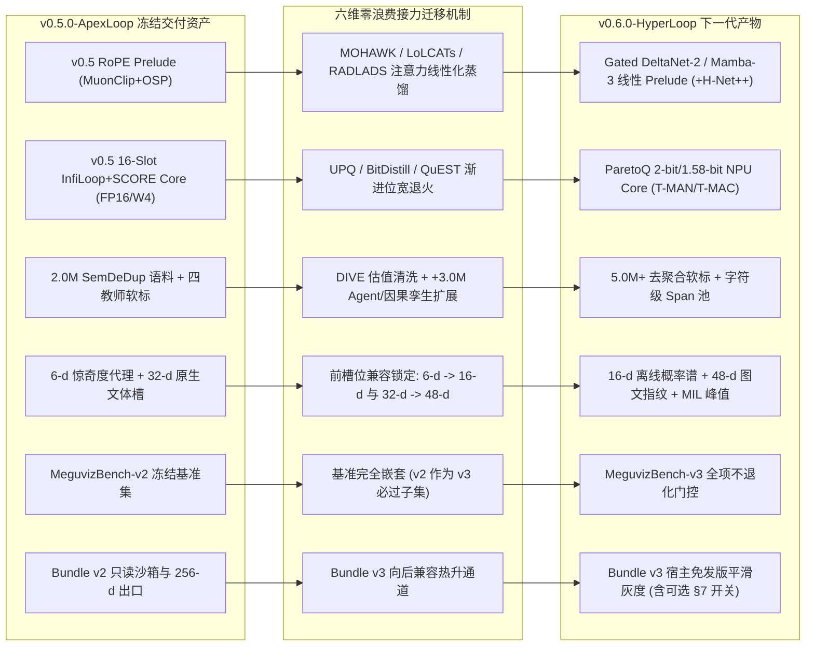
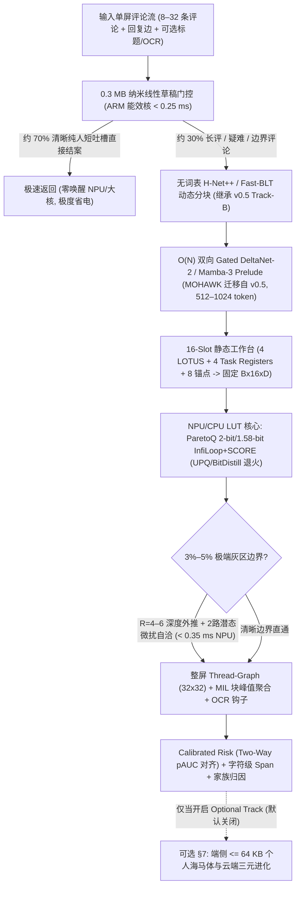
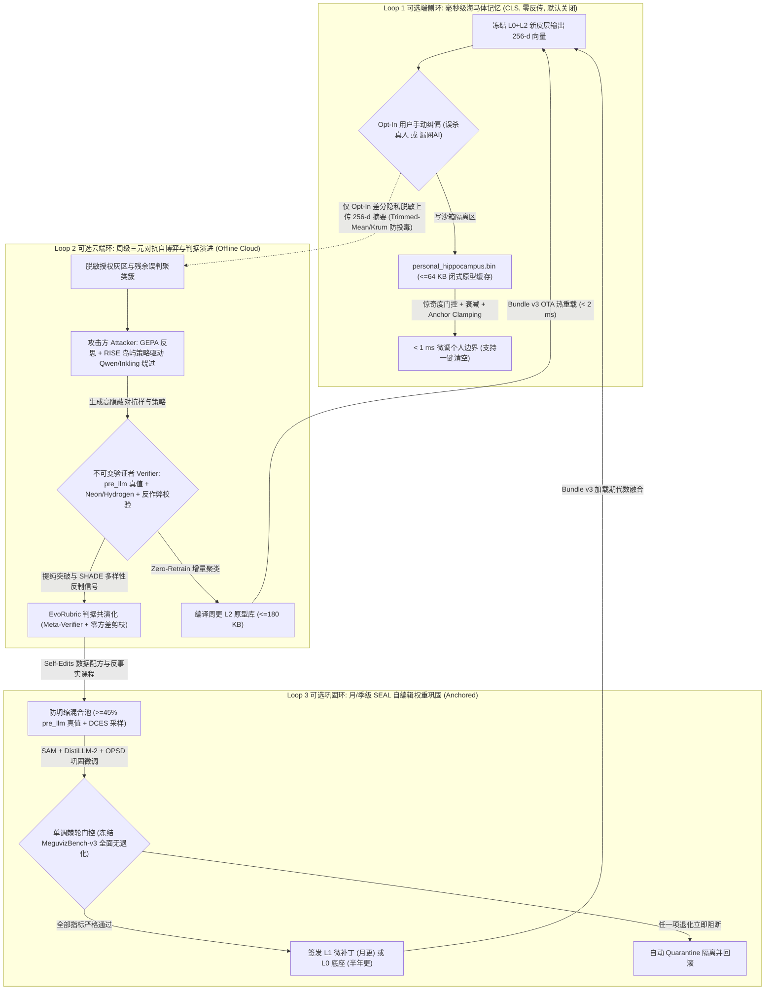

# MeguvizCAC v0.6.0-HyperLoop 下一代架构、极端低误报高召回、NPU/LUT 性能与两代衔接规划书

> **文档定位**：承接并无损复用 [roadmap-v0.5.0-research-plan.md](file:///D:/DevArea/MeguvizModel/docs/roadmap-v0.5.0-research-plan.md) 的权重、特征、语料与 `Bundle v2` 资产，在 **`v0.6.0-HyperLoop`** 主线实现 **“注意力->线性状态空间迁移（`MOHAWK/LoLCATs`）× 亚 2-bit NPU/LUT 极速核（`ParetoQ/UPQ/BitDistill/T-MAN`）× 极端低误报高召回专攻（`Two-Way pAUC / 16-d 概率谱 / MIL / R=4–6 外推自洽`）× `5.0M+` 因果估值语料”** 四位一体代际跃迁；同时将 **端云自学习与自进化体系** 作为完全解耦、默认关闭的 **可选增强模块（Optional Track）** 按需插拔。

---

## 一、`v0.5.0 -> v0.6.0-HyperLoop` 两代无缝衔接体系与代际跃迁门控

### 1.1 代际跨越核心门控指标（突出极端低误报高召回、校准收敛与短评/混写突破）

| 维度指标 | `v0.5.0-ApexLoop`（冻结端侧底座） | **`v0.6.0-HyperLoop`（下一代主线发布门槛）** |
| :--- | :---: | :---: |
| **手机端总模型增量体积** | `<= 5.0–6.5 MB`（`W4A16/W4A8` + `SegPQ`） | **`<= 2.8–3.5 MB`（`0.3 MB` 纳米草稿 + `ParetoQ/UPQ` 2-bit/1.58-bit + 无词表 `H-Net++`）** |
| **手机端侧推理延迟** | ARM 中核 `<= 1.80 ms/row`；GPU `<= 0.35 ms/row` | **ARM `SME2/T-MAC` `<= 0.55 ms/row`；手机 NPU (`Hexagon/ANE/T-MAN`) `<= 0.15 ms/row`** |
| **30 分钟持续刷评功耗** | `< 0.8 W` 零降频 | **`< 0.35 W`（`0.3 MB` 纳米草稿 + `L2D-FP` 拒识拦截 + NPU LUT，全 App 后台无感常驻）** |
| **上下文与模态处理上限** | 单条 `<= 192` token + 页面流无梯度 TTA | **$O(N)$ 线性 Prelude 支持 `512–1,024` token 整楼对话树 + 整屏 `16–32` 条 `Thread-Graph` + 轻量 OCR 钩子** |
| **全局精度目标** | `AUROC >= 0.975 / PR-AUC >= 0.965` | **`AUROC >= 0.985 / PR-AUC >= 0.978`** |
| **极端低误报高召回红线** | `R@P95% >= 85% / R@P99% >= 60%` | **`R@P95% >= 92% / R@P99% >= 75% / TPR@1%FPR >= 90% / TPR@0.1%FPR >= 60%`（`Two-Way pAUC` + 分级绝对锚定）** |
| **深度外推尾部单调铁律** | `R = 2 -> 4 -> 6` 全指标（含 `R@P99%`）无回撤 | **`R = 2 -> 4 -> 6` 及 2 路微扰自洽须严保 `R@P99%` 与 `TPR@0.1%FPR` 逐轮单调增益（严禁 `v0.4 R1` 式尾部崩塌）** |
| **校准与 `Split Conformal` 灰区率** | `@alpha=0.03 <= 18%`（`n>=1,500` Smooth PAVA, `T∈[0.9, 1.8]`） | **`@alpha=0.03 <= 10%`（`n>=3,000` 分长度×树深度 Smooth PAVA, `T∈[0.8, 1.6]` 直接烘焙，纯本地结案率 `>= 90%`）** |
| **外部全封存盲测（`OjinjinBench-v2/v3`）** | 纯文本 `>= 0.90` / 零 PII 语境 `>= 0.93`（硬负 `0%`） | **纯文本 `Hard F0.5 >= 0.94` / 零 PII 整屏语境 `>= 0.96` 且硬负误杀 `= 0%`（全面超越 `OjinjinNet` 全系）** |
| **短评 / 混写 / 误杀 / LOFO** | 结构化 `< 0.18 / M01–04 < 0.15 / LOFO >= 0.950` | **`ultra_short (<=20 字) R@P95% >= 72%` / 人机混写 `Char-Span F1 >= 0.85` / 结构化与多语真人 `< 0.10` / `LOFO >= 0.965`** |
| **端云自学习与自进化** | 预留 `Bundle v2` 只读沙箱与特征导出接口 | **完全解耦可选模块（Feature-Flag / Opt-In），静态生产部署默认关闭、零强制绑定** |

### 1.2 `v0.5.0 -> v0.6.0` 六维零浪费无缝衔接体系

`v0.5.0` 的研发与数据投入绝非一次性消耗品，而是通过以下 **六维继承管线** 100% 复利衔接至 `v0.6.0`（大幅节省重写权重与重洗数据的算力开销）：

| 衔接维度 | `v0.5.0` 预埋/交付资产 | `v0.6.0` 无损继承与升级路径 | 工程与精度复利收益 |
| :--- | :--- | :--- | :--- |
| **① 注意力 -> 线性 Prelude 迁移** | `v0.5` 训好的满血 `RoPE + RMSNorm + SwiGLU` Prelude（已用 `MuonClip/OSP` 消除离群峰） | 采用 **`MOHAWK`（矩阵定向 -> 隐态对齐 -> 权重迁移）**、**`LoLCATs`** 与 **`RADLADS`** 将 Softmax 注意力快速线性蒸馏为 **`Gated DeltaNet-2 / Mamba-3`** | 避免 `O(N)` 线性骨干从零多轮预训练，以不到 `15%` 算力即可继承 `v0.5` 全部中文梗与多语语义。 |
| **② 同构 `Core` 渐进位宽退火** | 两代共享 **`[B, 16, 384]` 静态工作台 + `InfiLoop + SCORE`** 拓扑，保留 `FP16/W4` 主检查点 | 采用 **`UPQ`（FP16 -> INT4 -> INT2）**、**`BitDistill`（`SubLN` + 多头注意力蒸馏）** 与 **`QuEST`** 逐阶降比特微调至 **`ParetoQ 2-bit / 1.58-bit`** | `Core` 推理流形无缝过渡，避免直接从零训 2-bit 的不稳定掉点（较从零降比特显著保留 `R@P99%`）。 |
| **③ 无词表 `Track-B` 平滑接力** | `v0.5 Phase-1` 积累的 `Mini H-Net / BLT` 字节分块消融脚本与对抗样本基准 | **`v0.6.0` 直接复用 `H-Net++ / Fast-BLT`** 接替 `SegPQ/Superword`，彻底去掉 `1.5 MB` 词表并免除重构下游工作台 | `Stage M1` 首周即可跑通端到端对比，研发周期压缩一半。 |
| **④ 特征槽与四教师数据复利** | `2.0M SemDeDup` 语料、四教师校准软标、`6-d` 离线惊奇度代理与 `32-d` 原生文体特征 | 严格保持槽位前向兼容扩展：**`6-d -> 16-d`（保留前 6 维再增 `Lastde++/BiScope/DDL`）**、**`32-d -> 48-d`（追加图拓扑与混写节律）**，旧 `2.0M` 软标经 `DIVE` 估值直接进入 `5.0M+` 池 | 训练与标注冷启动资产 **零丢弃 100% 复利增值**，四教师标定费用直接复用。 |
| **⑤ 基准嵌套铁律（单调防退化）** | 完全冻结隔离的 `MeguvizBench-v2`（Bili-Test / `H01–H09` / `LOFO`） | **`MeguvizBench-v2` 作为 `v3` 的强制嵌套必过子集**（`v2 ⊂ v3`），再追加 Agent Bot、混写 Span 与 `TPR@0.1%FPR` 专项集 | 绝对保证 `v0.6.0` 在追求极高召回与轻量化时，**绝不以牺牲任何一项 `v0.5.0` 真人防误杀成绩为代价**。 |
| **⑥ `Bundle v2 -> v3` ABI 兼容** | 冻结的 `Bundle v2` 解析协议、只读沙箱与 `256-d` L2 归一化特征出口 | `Bundle v3` 完全向后兼容 `v2` 字段，仅按需增加可选 `npu_lut_artifact`、`thread_graph_slot` 与可选 `§7` 开关（`enable_self_evolution=false`） | 宿主 App 与浏览器扩展无需重写底层调度框架，可实现 **`v0.5 -> v0.6` 同框分桶灰度 OTA 热切换**。 |

---

## 二、2025–2026 下一代前沿文献全景图

### 2.1 下一代架构、跨架构线性迁移与评论树图上下文
| 论文 / 模型 | 发表时间 / 编号 | 核心机制与关键发现 | 对 `v0.6.0-HyperLoop` 主线的迁移方案 |
| :--- | :--- | :--- | :--- |
| **Gated DeltaNet & Gated DeltaNet-2 / `FG²-GDN`** | ICLR 2025 – 2026.05（`arXiv:2605.22791`, `2604.19021`） | 融合 Mamba-2 自适应遗忘与 Delta 精确记忆编辑；2026 年提出通道级擦除门 $b_t$ 与写入门 $w_t$，实现近二阶细粒度坐标记忆更新，在长上下文多键检索大幅超越标准线性注意力。 | **替代 Softmax 成为 `v0.6.0` 双向 `O(N)` 线性 `Prelude` 主干**：让手机端能以近乎常数增量耗时一次读取 `512–1,024` token 整楼对话树。 |
| **`MOHAWK`, `LoLCATs` & `RADLADS`** | ICLR 2025 – 2026（Attention-to-Linear/SSM Distillation） | **`MOHAWK`**（矩阵定向 -> 隐态对齐 -> 权重迁移）与 **`LoLCATs / RADLADS`** 证实可在不到预训练 `15%` 的极低预算下把预训练 Softmax 注意力无损蒸馏迁移至线性注意力 / `Gated DeltaNet` / SSM 骨干。 | **两代架构衔接引擎（§1.2）**：直接将 `v0.5` 满血 `RoPE Prelude` 线性蒸馏为 `v0.6 Gated DeltaNet-2 / Mamba-3`，避免从零预训练。 |
| **Mamba-3 & RWKV-7 "Goose"** | 2025.03 / ICLR 2026（`arXiv:2603.15569`, `2503.14456`） | **Mamba-3** 引入推理优先的复数状态更新与 `MIMO` 表述，**状态体积减半且推理更强**；**RWKV-7** 以向量门控广义 Delta 规则打破线性注意力 $\text{TC}^0$ 状态追踪上限。 | 作为双向状态空间混合编码器的核心对照分支（`Bidirectional Mamba-3` / `Triplet-Block RWKV`），强化对反讽、双关的状态追踪。 |
| **`H-Net++` & `Fast BLT` (`BLT-D / BLT-S`)** | 2025.08 – 2026.05（Meta `BLT` 系列 `Fast BLT`） | 通过扩散目标与并行自投机分块将 `BLT` 字节推理内存带宽压低 **`50%+`**，结合 `ATDC` 课程压缩稳定收敛。 | **推动无固定词表架构转正（§3.2）**：彻底删去子词词表占用，原生对抗小语种、乱码伪装、Emoji 组合与跨语言混写。 |
| **Context Graph Bot Detection & *SocialGym*** | 2025 – 2026（社媒对话树与多智能体仿真） | 揭示 LLM 水军单句可完美拟人，但在多轮对话树呈“星状放射/缺乏真实反驳纵深”等结构异常；*SocialGym* 仿真生成逼真线程对话数据。 | **升级为 §3.3 整屏 `Thread-Graph` 图协同 + Agent 语料**：把回复拓扑、时间簇度、角色一致性直接编码入检测器。 |

### 2.2 极致端侧性能与渐进低比特迁移（亚 2-bit × LUT × NPU/`SME2`）
| 论文 / 框架技术 | 发表时间 / 编号 | 核心机制与关键发现 | 对 `v0.6.0-HyperLoop` 主线的迁移方案 |
| :--- | :--- | :--- | :--- |
| **`ParetoQ`** | NeurIPS 2025（Meta, `arXiv:2502.02631`） | 在统一训练配方下评估 `1-bit / 1.58-bit / 2-bit / 3-bit / 4-bit`，证实 **1.58-bit 三值与 2-bit 处于手机体积–精度帕累托最优前沿**（已接入 `torchao`）。 | **将主线核心权重下探至原生 `ParetoQ 2-bit / 1.58-bit`**：全模型压缩至 **`<= 2.8–3.5 MB`**。 |
| **`BitDistill`, `QuEST`, `UPQ` & `Bit-by-Bit`** | 2025.02 – 2026.04（`arXiv:2510.13998`, `2502.05003`, `2506.09104`, `2604.07888`） | **`BitDistill`** 借助 `SubLN` 与多头注意力蒸馏把 FP16 转换至 1.58-bit（**CPU 提速 `2.65×`、内存降 `10×`**）；**`QuEST`** 以 Hadamard 归一化与信任梯度估计稳定超低比特 QAT；**`UPQ`** 验证 **FP16 -> INT4 -> INT2** 无掉点渐进路径。 | **两代渐进压缩桥梁（§1.2）**：从 `v0.5` 同构 `16-Slot InfiLoop (FP16/W4)` 检查点平滑退火蒸馏至 `v0.6 2-bit / 1.58-bit`，护航极端召回不塌缩。 |
| **`T-MAC`, `T-MAN`, `LUT-LLM` & `LoopVQ`** | 2024.07 – 2026.11（`arXiv:2407.00088`, `2511.06174`; `T-MAN`; `LoopVQ` 2026.11） | **`T-MAC`** 用 ARM `tbl` 查表跳过位解包；**`T-MAN`** 用**两级 NPU 查表布局（解码最高 `>3×` 提速）**克服 Hexagon/ANE 非 GEMM 瓶颈；**`LoopVQ`** 面向循环层实现跨步联合矢量量化。 | **破解手机 NPU/CPU 亚 4-bit 算子瓶颈**：直接以 `T-MAC`（CPU）+ `T-MAN`（NPU）+ `LoopVQ`（循环量化）编排执行引擎。 |
| **Armv9 `SME2` (`MOPA`) + KleidiAI & 原生 NPU Delegate** | 2025 – 2026（Arm / ExecuTorch / LiteRT / MNN） | 搭载 `SME2` 的 Armv9 核心配 `KleidiAI` 在 ExecuTorch / LiteRT / MNN 上最高获单核 **`3.9×`** 加速；高通 Hexagon 与联发科 APU 原生支持 NPU Delegate。 | 将手机 CPU/NPU 推入 **`<= 0.15–0.55 ms/row`** 与 **`< 0.35 W`** 超低功耗区，实现无感常驻。 |

### 2.3 低误报高召回突破与下一代数据范式（Low-FPR Recall & Data Paradigms）
| 论文 / 方法 | 发表时间 / 编号 | 核心机制与关键发现 | 对 `v0.6.0-HyperLoop` 的迁移方案 |
| :--- | :--- | :--- | :--- |
| **`DetectAnyLLM` (`DDL`/`MIRAGE`) & `Glimpse`** | 2025 – ACM MM（`arXiv:2509.14268`; ICLR 2025 *Glimpse*） | 指出常规微调极易过拟合表层词频，导致遇到新款大模型时 `TPR@1%FPR` 暴跌；**`DDL`（Direct Discrepancy Learning）** 直学跨越 17+ 模型家族的本质概率分布差异；**`Glimpse`** 让闭源 API 信号得以适配白盒统计对齐。 | **§6.2 `16-d` 多观测者概率谱核心**：强化跨未知模型家族（LOFO）及严格 `1% / 0.1% FPR` 工作点下的隐蔽 AI 召回。 |
| **`Lastde / Lastde++` & `BiScope`** | 2024.10 – 2025（`arXiv:2410.08199`; NeurIPS *BiScope*） | **`Lastde++`** 将 Token 概率序列视为时间序列挖掘局部峰度/自相关动力学，强抗同义词与句式洗稿；**`BiScope`** 同时计算前向真实词交叉熵与**反向前驱词记忆交叉熵**，对短句续写与高拟真输出具备极高区分度。 | **离线集成进 `16-d` 蒸馏代理特征（§6.2）**：手机端 **0 额外因果大模型调用** 即可白嫖穿透洗稿与短句判别的前后向时间序列直觉。 |
| **Two-Way Partial AUC (`pAUC`), Neyman-Pearson & `MIL` Span (*MixDetect*/*PaLD*)** | 2025 – 2026（*DACTYL* / NIST 2025–2026） | 全域 AUROC 掩盖高置信区崩溃，主张以 **Two-Way Partial AUC (`FPR <= 1% / 0.1%`)** 与 **Neyman-Pearson 似然比最优边界** 指导优化；对于人机混写长评，全局平均会严重稀释局部 20% AI 润色段，须用 **多实例学习（`MIL`）** 峰值聚合与 Span 定位。 | **§6.1 & §6.3 精度与召回核心双引擎**：损失焦点 100% 对准 `0.1%–1% FPR` 极端头部区，并靠 `MIL` 彻底解决“长评局部夹带 AI 润色”漏杀。 |
| **`CORSAIR`, `DIVE + Minitron` & Disaggregated Labels** | 2025 – 2026 | **`CORSAIR`** 因果反事实最小编辑剥离学术词/格式捷径；**`DIVE`** 按梯度影响函数清理或反向修正污染尾部的脏伪标；**Disaggregated Labels** 用去聚合多视角软分布取代灰区粗暴硬二值标签。 | **§5 数据范式升维基石**：清洗 `5.0M+` 脏边界样本，让精度与灰区风险校准同时站上新台阶。 |

### 2.4 【可选模块前沿】自学习与自进化（Optional Track）
| 论文 / 框架 | 发表时间 / 编号 | 核心思想与关键机制 | 在 `v0.6.0` 可选模块（§7）中的映射 |
| :--- | :--- | :--- | :--- |
| **SEAL & Absolute Zero / R-Zero** | 2025.05 – 2025.08（MIT CSAIL `arXiv:2506.10943`; `arXiv:2505.03335`, `2508.05004`） | **SEAL** 自主生成 "Self-Edits" 更新配方；**Absolute Zero / R-Zero** 以 Challenger–Solver 自博弈围绕可验证真值自主挖掘难题。 | **§7.2 云端离线自编辑数据配方与零人工新增难题挖掘**（可选开启）。 |
| **SHADE, Triadic Co-Evolution & MAGIC / CEMMA** | 2026（SHADE 2026.09; Triadic ICML 2026; MAGIC/CEMMA 2026） | **SHADE** 揭示对抗洗稿伴随句长收缩与词汇多样性塌缩；**Triadic Co-Evolution** 引入三元校验防奖励黑客。 | **§7.2 云端三元对抗自博弈红蓝演化**，利用 `SHADE` 多样性塌缩反制信号让黑产“越洗越暴露”。 |
| **GEPA, EvoRubric & RISE / Proteus** | 2025.07 – 2026.09（ICLR 2026 Oral `arXiv:2507.19457`; EvoRubric 2026.05; `arXiv:2609.34920`, `2605.11891`） | **GEPA** 自然语言反思演化达 RL `35x` 效率；**EvoRubric** 通过 Meta-Verifier 与零方差剪枝共同演化判据；**RISE** 岛屿策略库演化。 | **§7.2 红队策略与 Rubric 自进化飞轮**，自动从残余误判簇中归纳新细则。 |
| **Titans / In-Place TTT / LaCT (CLS) & DCES / FedPACT** | 2025 – 2026.04（Google Titans/MIRAS, LaCT, TNT; DCES & FedPACT） | **CLS 互补学习系统**分司慢新皮层与快海马体；**DCES** 采样防模型坍缩；**FedPACT** + Trimmed-Mean / Krum 防拜占庭投毒。 | **§7.1 手机端 `<= 64 KB` 零反传海马体缓存** 与 **§7.3 四道防坍缩抗投毒安全锁**。 |

---

## 三、`v0.6.0-HyperLoop` 核心主线架构设计（线性 Prelude × 循环核心 × 评论树图）

为了打破 `v0.5.0` 纯单句 Transformer Prelude 的“二次方长度限制”与“孤立句信息熵下界”，`v0.6.0-HyperLoop` 实施**“纳米级草稿快筛 + 无词表 `O(N)` 线性状态空间 Prelude + 亚 2-bit `InfiLoop` 核心 + 整屏 `Thread-Graph` & `MIL` 精审协同”**架构：

### 3.1 双向 `Gated DeltaNet-2 / Mamba-3` 线性 Prelude（`MOHAWK` 无损迁移，支持 `512–1,024` token 整楼语境）
- **继承与跨越**：不从零预训练，直接用 **`MOHAWK / LoLCATs / RADLADS`** 将 `v0.5.0` 满血 `RoPE Prelude` 线性化蒸馏为 2 层 **双向 `Gated DeltaNet-2 / Mamba-3 MIMO`**。
- **线性红利**：把“主楼长文 + 前序 3 层热评 + 待测回复”整楼输入扩展至 **`512–1,024` token** 而计算与内存保持严格的 **$O(N)$ 线性增长**（长文耗时较 Softmax 降 `3x–5x`），借助 `FG²-GDN` 通道级擦写门精准锁定上下文人设连贯度与反讽前提。

### 3.2 无固定词表 `H-Net++ / Fast-BLT` 转正（消除跨语种与字符对抗边界）
- 接力 `v0.5.0 Track-B` 消融产物，正式采用并行扩散/自投机字节动态分块（内存带宽压降 `50%+`）：**彻底删除仍占 `~1.5 MB` 的词表查表矩阵**，把存储彻底让渡给权重推理核，同时从根源免疫生僻梗、零宽插空、跨脚本形近字与代码符号碎化。

### 3.3 `Thread-Graph` 整屏评论树图协同 + 轻量图文 OCR 钩子（打破单句 Bayes 极限）
1. **整屏对话树图协同注意力（`Thread-Graph`）**：将同屏 `8–32` 条评论构建成回复关系、楼中楼祖先、秒级突发同质簇与跨评复读边矩阵，在 `256-d` 出口执行 **`32×32` 轻量图消息传递（`< 0.05 ms`）**——孤立的一句“支持！”若单独判几乎不可分，但一旦呈星状并发、脱离主楼语义流或毫秒级跨贴复读，图网络瞬间联合拉响警报。
2. **多模态轻量语境钩子（Text-Image Consistency Hook, `< 0.3 MB`）**：直接读取客户端已有系统本地 OCR 与视频标签摘要——若评论与封面文字/视频实体发生典型视觉幻觉错位（如闭眼夸错主体），无需跑任何重型多模态大模型即可一击定位。

---

## 四、极致端侧性能与硬件协同（`ParetoQ / UPQ / BitDistill` × `T-MAC / T-MAN` × NPU/`SME2`）

| 加速层面 | `v0.5.0-ApexLoop` 技术方案 | **`v0.6.0-HyperLoop` 性能跃迁工程方案** |
| :--- | :--- | :--- |
| **权重压缩与渐进退火路径** | `SpinQuant` + `Static INT8` / `W4A16`（模型 `<= 5.0–6.5 MB`） | 由 `v0.5` 同构 Checkpoints 经 **`UPQ` + `BitDistill`（`SubLN`）+ `QuEST`** 渐进退火至 **`ParetoQ 2-bit / 1.58-bit` + `LoopVQ`**（全模型 **`<= 2.8–3.5 MB`**） |
| **手机 CPU 核内指令** | `ARM KleidiAI (SDOT/I8MM)` + `MNN / XNNPACK` | **ARMv9 `SME2 (MOPA)` + `T-MAC` 位级查表（`tbl` 零解包乘加）**，中端/旗舰 CPU 提速至 **`<= 0.55 ms/row`** |
| **手机 NPU / ANE 专用加速** | 主要跑 OpenCL/Vulkan GPU + iOS ANE `W4` | **引入 `T-MAN` 两级查表布局适配高通 Hexagon NPU / 联发科 APU + Apple ANE 2-bit/W4 调色板化**，消灭“NPU 反量化瓶颈”，达 **`<= 0.15 ms/row`** |
| **手机端单包内置级联防线（`<= 3.5 MB` 总红线）** | `1L Prelude` 早退拦截 `~55%`（`< 0.9 ms`） | **前置 `0.3 MB` 纳米线性草稿门控 + `L2D-FP` 可训练防误杀拒识头（仅 `+1 KB`）**：在 `< 0.25 ms` 内拦截 `~70%` 明显人类短句，仅放行 `~30%` 疑难/边界入 `<= 3.2 MB` `HyperLoop` 主干，总包严守 `<= 3.5 MB`、30 分钟持续功耗 **`< 0.35 W`** |
| **桌面/服务端可选双模型级联（不占手机包体积）** | 单模型直出或 `v0.5-Pro` | 继承自 OjinjinNet `Nano -> Pro` 与 `v0.4` 资产：桌面/服务端可选用 **`v0.4 1x5-e128 (6.9 MB)` 或 `v0.5-Mobile` 一级快筛 + `v0.6-HyperLoop / v0.5-Pro` 二级精审**（仅 `7%–12%` 转交二级）；**无论手机单包还是桌面双模型，拒识阈值与转交率均只在 `n >= 3,000` 独立验证集标定、外部盲测考卷全程封存** |

- **工程避坑关键（源自 `T-MAN` / `LUT-LLM` 与 `v0.4` R1 `17.82 ms` 实测教训）**：
  1. 严禁在骁龙 Hexagon / 联发科 APU 上把 2-bit 权重先反量化成 `FP16` 再算乘加；导出管线直接生成对齐 NPU 矢量带宽的**两级 LUT 重排矩阵**，用纯查表加法流换取最高 **`>3×`** NPU 提速与极低功耗。
  2. **真机先验测速门禁（Stage M0）**：吸取 `v0.4 R1` 训完导出才发现 1T 耗时超标 `6x` 的教训，`v0.6.0` 启动 `MOHAWK` 迁移与 `5.0M+` 训练前必须先过 **Stage M0 真机 NPU/SME2 合成权重微基准**，确认无隐性 FP16 回退与动态 Shape 抖动后方可入库重训。
  3. **大规模训练与渐进退火工程规范（继承 `v0.5.0 §10.6`）**：全阶段标配 **启动前 30s `--probe-vram` 最坏长序列（`1,024` token）峰值探针**、**静态分桶整图编译（`fullgraph=True`）+ 异步 Pair DataLoader**（避免 `v0.4 R3` 在 A100-80GB 上因 Python 步循环与主线程拼对导致的 `20–70%` GPU 利用率波动）、**`UPQ/BitDistill` 按总 STE 更新步数恒定化退火**（不随卡型/batch 缩水）、以及 **每阶检查点持久化云盘双写 SHA256 + 自动下载**（杜绝 `v0.4 R2` 丢权重事故）。

---

## 五、下一代数据范式升级（`5.0M+` 生态语料 × 因果反事实去偏 × `DIVE` 数据估值 × 去聚合标注）

`v0.6.0` 在完整继承 `v0.5.0` 的 `2.0M SemDeDup` 语料与四教师校准软标（`pre_llm` 锚定不稀释）基础上，围绕“高精度、零误杀、Agent 对抗”增量扩充为 **`5.0M+`** 高纯度生态池：

1. **`+3.0M` Agent-Era 跨平台生态语料扩展**：扩展至知乎/小红书/贴吧/Reddit/X/GitHub/YouTube/日韩技术区全脱敏零 PII 数据；借鉴 *SocialGym* 仿真与实盘采集补齐 **2026–2027 新一代 AI Agent 评论行为**（带记忆人设的跨贴养号水军、联网搜索 RAG Bot、思维链蒸馏低幻觉短评、多轮人机辩论树）。
2. **因果反事实最小编辑孪生对（Causal Minimal-Edit Twins & `CORSAIR`）**：针对技术评测、代码排错、评分表、文献引述等高误杀场景构造“同主题、同观点、同排版、仅切换人类自然韵律 vs LLM 生成因果路径”成对样本，强制模型只在同一对对照间拉大差值，彻底斩断“见列表/专业词就报 AI”的伪关联。
3. **`DIVE` 梯度影响力估值清洗 + *Minitron* 协同剪枝蒸馏**：通过 **`DIVE`** 计算训练切片在 `LOFO` 与 `TPR@0.1%FPR` 上的梯度影响得分，直接剔除或反转修正会推高高分端误杀的脏伪标样本；配合 *Minitron* 启发式宽度/深度裁剪，把四教师知识高密度压入 `<= 3.5 MB` 学生核。
4. **去聚合多视角软分布标签（Disaggregated Labels）+ 原生字符级 Span 真值**：对灰区短评停止强制 `0/1` 抹平，保留多教师/多人类视角分歧分布喂入尾部损失与 `Split Conformal`；全面升级提供**字符级精确人机协同切分 Span 区间真值**（如“人写 80% + AI 润色 20% 段落”）。
5. **从 `v0.4 -> v0.5` 继承的四道反噪声污染数据铁律（`5.0M+` 放量必守防线）**：
   - **高权保护桶白名单准入**：`structured_human_hard`、`pre_llm_human` 与 `TPR@0.1%FPR` 零误杀锚定池**严禁任何单模型/弱伪标自动划入**（根治 `v0.4` 12L 伪标将 `本鱼` 塞进结构化保护组的反噬），仅限年代真值（`pre-2022`）或经 `DIVE` 复核的双金标入桶；
   - **全库 `Label-Pair` 语义冲突扫描**：入库前对 `5.0M+` 语料与 `CORSAIR` 因果最小编辑对跑跨库近邻冲突检测，自动揪出“与高置信 AI 对近邻极相似但主库软标 `< 60`”的隐藏噪声簇交由四教师仲裁，且清洗规则必须经过 `pre_llm` 全量假阳性回扫（杜绝 `西本鱼跃 / 九漏鱼本鱼` 类粗正则误伤）；
   - **对比对非静默防泄漏审计**：所有反事实/最小编辑对强制经过 **精确 + `bge-m3 > 0.90` 余弦防泄漏双查**并输出逐类留存率报告（**严禁静默丢弃**，任一类别有效对 `< 20` 直接 fail-fast，杜绝 `v0.4 R2 A03` 静默减对回撤）；
   - **`Gold Retention >= 99%` 跨阶段留存断言**：在 `MOHAWK`、`UPQ/BitDistill` 退火与 `Two-Way pAUC` 任一子采样阶段，硬断言金标、因果最小对与极端难负样留存率 `>= 99%`（根治 `v0.4` `f77deaf` 分层截断丢金标隐患）。

---

## 六、精度与极端低误报高召回专项攻坚（突破 `Recall@P99%`、`TPR@0.1%FPR`、短评与混写天花板）

标准检测器往往能刷出不错的 `AUROC (0.95+)`，一旦严卡真实社区风控必需的 **`Precision >= 99%` 或 `0.1%–1% FPR` 极端低误报开关**，有效召回率就断崖下跌。`v0.6.0` 在不打破端侧 `<= 3.5 MB` 与 `<= 0.15 ms` 红线的前提下，部署 **五重精度与高置信召回倍增引擎**：

### 6.1 极端低误报直优目标：`Two-Way Partial AUC (pAUC)` × 分级绝对锚定双通道
- **根治梯度浪费与绝对校准残差**：`v0.4 R2/R3` 实证表明，纯排序/对比损失能拉大相对间距，却难以单独压平结构化真人（如评分表/词典引证）的最后 `~0.13` 绝对概率残差；而激进 `Top-Push` 若缺乏 logit 尺度正则，还会把校准温度推爆至 `T > 3.5` 导致 Conformal 灰区暴涨。
- **双通道聚焦极端工作点**：
  1. **排序/似然比通道**：主目标切换为 **`Two-Way Partial AUC` 损失**（将惩罚权重聚焦于 `FPR ∈ [0, 0.01]` 及 `0.1% FPR` 极端区）+ 近似 **Neyman-Pearson `Top-Push` 约束**，精准把 `TPR@1%FPR` 推上 **`>= 88%`**、`TPR@0.1%FPR >= 55%`、`R@P99% >= 72%`；
  2. **分级绝对锚定与温度健康锁**：并行施加两档主损失绝对压制（确证真人 `y <= 0.15` 强压 `relu(p - 0.10)^2` + 白名单结构化/技术/外语真人边界 `y <= 0.35` 柔压 `relu(p - 0.18)^2`）与轻量 logit 范数正则，确保模型在 `TPR@0.1%FPR` 拉高的同时维持健康温度 $T \in [0.8, 2.0]$ 与结构化真人得分 `< 0.15`。

### 6.2 离线 `16` 维多观测者概率谱蒸馏（继承并扩展 `v0.5` `6-d` -> `16-d`，端侧 0 大模型调用）
- **完全兼容接力**：保留 `v0.5` 离线的 `6` 维惊奇度代理曲率作为前 6 维基础槽，云端训练前再用参考因果模型组（与多家族外部教师日志）为全量 `5.0M+` 语料额外离线提取 **10 维顶尖防漏杀特征**（合并组成 **`16-d` 离线概率谱向量**），蒸馏注入线性前缀与 `LOTUS` 槽位：
  1. **`Lastde++`（`arXiv:2410.08199`）局部概率时间序列峰度/自相关**：捕捉经受同义词/语序洗稿后依然残存的局部 Token 似然节律波动，专克“深度洗稿逃逸”；
  2. **`BiScope`（NeurIPS）双向前后记忆交叉熵比**：同时度量前向生成概率与反向前驱词依赖记忆强度，专抓强上下文约束下的短句 AI 续写；
  3. **`DetectAnyLLM (DDL)` 跨模型本质差异得分 & `Glimpse` 闭源概率代理**：在 17+ 模型分布上校准本质机器偏离信号——**手机端运行期零因果大模型推理成本**，却继承了白盒时间序列检测器的最强召回锐度。

### 6.3 多实例学习（`MIL`）块/字符级峰值聚合（根治“长评夹带 20% AI”漏杀）
- **痛点根源**：当一位真实网友用自己的口癖写了 `80%` 内容、只让 AI 扩写润色了其中 `20%`（或夹带一段 AI 总结）时，传统 `[CLS]` 全局平均注意力会把 AI 信号稀释 `4x–5x`，导致长评整体得分掉到 `0.4` 以下而彻底漏杀。
- **双路 `MIL` 峰值融合**：借鉴 *MixDetect* / *PaLD* 与多实例学习，让 `Coda` 同步计算 **全局语用分 $s_{\text{global}}$** 与基于分段隐态的 **`LogSumExp / Top-K Noisy-OR` 局部最大可疑块峰值分 $s_{\text{MIL}}$**。
- **防误杀安全阀**：配套一个轻量化 **Span 覆盖度加权门控**——若仅有 1 个孤立短句像 AI（可能是真人显式引用一句名人/AI 语录），则抑制硬报警转标 `人机引用/少量混写`，只有当局部峰值高 **且** 可疑连续 Span 达到实质占比或缺乏引号语境时，果断触发高置信召回（推升混写 `Char-Span F1 >= 0.82`）。

### 6.4 `3%–5%` 极端灰区硬骨头三级精审：`SCORE R=4–6` 外推 × 潜态正交微扰自洽（`< 0.35 ms` NPU）
- 在一屏评论中，决定 `R@P99%` 与 `TPR@0.1%FPR` 最终胜负的往往只有落入最顶部边界灰区的 **`3%–5%`** 疑难评论。
- **微型高算力精审**：仅对这批 `3%–5%` 的极端边界样本，依托 **`[16, 384]` 极小静态工作台**，在手机 NPU 上并行跑完 **`R = 4–6` 步 `SCORE` 外推 + 2 路随机正交微扰前向自洽检验**（由于单条状态只有 `6,144` 浮点数，3 次重估 NPU 总耗仅 **`< 0.35 ms`**，均值摊到全屏几乎为 `0`）：
  - **两路外推同时收敛且与 `Thread-Graph` 邻居风格一致** -> 确认高置信隐蔽 AI，突破 `99%` 精度拦截门槛！
  - **多步震荡发散（高方差）** -> 自动识别为人类生僻表达/高度歧义样本，坚决守住 **`0.1% FPR`** 红线不误杀！

### 6.5 超短评（`<= 20` 字）四维信息补齐破局（目标 `R@P95% >= 68%`）
- 孤立一句 8–15 字短评在单句文本维度上已触及信息论 Bayes 下界；`v0.6.0` 通过四股互补信号合力突破：
  1. **`H-Net++` 字节级微节律**：不切碎生僻黑话/颜文字，完整捕捉标点停顿与 Emoji 组合概率异常；
  2. **双向 `Gated DeltaNet-2` 整楼前提对齐**：直接核验这条超短回复与前序 3 层楼中楼是否存在“语义滑坡、模板化强行共情或复述标题关键词”；
  3. **`Thread-Graph` 整屏行为共振**：检查同视频屏幕内是否有 2 条以上共享相似句式、低方差或星状爆发的短评集群；
  4. **封面/标题 OCR 错位检验**：即时捕捉不看上下文盲夸或关键词机械映射型短评。

### 6.6 极端低误报大样本分层校准与 `<= 10%` Conformal 灰区压缩（吸取 `v0.4 R1 54.4%` 灰区教训）
- **校准集规模与形态硬红线**：在 `0.1%–1% FPR` 工作点下，小样本校准集（如 `v0.4` 的 `n=169`）统计方差极大且硬阶梯 PAVA 会把不同样本压成相同平台值。`v0.6.0` 强制构建 **`n >= 3,000` 独立分层校准集**（按 `短/中/长评 × 孤立句/深楼对话树 × 平台域` 联合分层），采用 **Smooth PAVA（单调保形样条）+ 分层锐利温度烘焙（$T \in [0.8, 1.6]$）+ 轨迹速度 $\delta_t$ 条件 Conformal**，将 `@alpha=0.03` 灰区率压至 **`<= 10%`**（端侧纯本地高确信结案率 `>= 90%`），同时严格锁定 `0.1% FPR` 有限样本统计上界。

---

## 七、【可选模块（Optional Track）】端云分工自学习与自进化体系（默认关闭，按需插拔）

> **模块定位声明**：本节整套自学习与自进化能力在 `v0.6.0-HyperLoop` 中定位为 **可选增强分支（Feature-Flag: `enable_self_evolution=false` by default）**。高安全静态合规发布可完全屏蔽本模块，零算力、零网络、零权限侵入；仅在用户或企业工作流明确开启时挂载生效，且全部遵循端云分工与四道不可绕过的防坍缩/抗投毒硬锁。

### 7.1 手机端零反向传播自学习（CLS 互补学习系统：`personal_hippocampus.bin <= 64 KB`）
- **严禁端侧反向传播**：冻结的 `L0` 主干与签名 `L2` 原型库作为持久“新皮层”只读运行，绝不在手机端跑梯度反传，保证零额外发热、零全局漂移。
- **闭式纠偏 + Anchor Clamping 边界锁**：消费 `Bundle v2/v3` 暴露的 `256-d` 语义向量与 `32-d/48-d` 文体指纹，经 **惊奇度门控（Surprise Gate）** 写入沙箱隔离区 `personal_hippocampus.bin`（`<= 64 KB`，最多 `128` 槽位）；推理仅做 `< 1 ms` 余弦近邻修正 + 时间衰减，并施加 **全局锚定钳位** $\|\Delta \text{logit}\| \le \tau_{\max}$，确保多次误点也绝不致盲安全边界，随时一键重置。

### 7.2 云端三元对抗自博弈与判据自进化（`Triadic Co-Evolution` × `EvoRubric` × `SEAL`）
- **三元自博弈引擎**：以 **`GEPA`（`35x` 效率自然语言反思 + Pareto 演化）** 与 **`RISE` 岛屿策略库** 驱动红队绕过攻击，专门捕捉 **`SHADE`** 暴露的“对抗洗稿后词汇多样性/句长隐性塌缩”反制线索；收益完全由 **不可变 `pre_llm` 真值 + `Gemini 4 Neon & Hydrogen` + 自动化连贯校验器** 三方仲裁，彻底杜绝奖励黑客。
- **`EvoRubric` + `SEAL` 自动飞轮（内置 `pre_llm` 反例回扫护栏）**：每周对残余误判簇自动聚类归纳候选 Rubric 新细则 -> 经 **Meta-Verifier、零方差剪枝** 以及 **全量 `pre_llm` + `structured_human_hard` 自动假阳性回扫（FPR 增量必须 `<= 0.05%`，彻底拦截类似 `v0.4` 手工审计发现的 `西本鱼跃 / 九漏鱼本鱼` 类词面误伤规则）** 验证呈 Pareto 严格改进后，方可升级判据版本并自动转化为 `SEAL` Self-Edits 反事实合成配方编入周更 `L2` / 月更 `L1`。

### 7.3 五道硬性安全锁：防模型坍缩（Model Collapse）、防规则误伤与抗拜占庭投毒
1. **不可变真实锚定比例（Immutable Real-Human Anchor `>= 45%`）+ `DCES`**：每代自进化训练批强制锁死至少 `45%` 样本采自不可篡改 `pre_llm` 真人与金标库，配合 **DCES** 动态中心-边缘采样，阻断纯合成递归熵坍缩。
2. **只进不退单调棘轮门控（Monotonic Ratchet Gate，含 `R@P99%` 与外部盲测）**：自动产物须全部通过只读冻结 `MeguvizBench-v3`（含嵌套 `v2`、逐轮 `R@P99%` 单调性及校准灰区率 `<= 10%`）全指标门控，任一项退化立即自动阻断并 `Quarantine`。
3. **候选规则/配方 `pre_llm` 假阳性回扫锁**：任何 `EvoRubric` 新规则或 `SEAL` 数据清洗配方生效前须先在全量不可变 `pre_llm` 库回扫且 `FPR` 增量 `<= 0.05%`，杜绝词面快捷方式污染保护桶。
4. **拜占庭鲁棒隐私联邦原型聚合（Opt-In `FedPACT` + 差分隐私）**：严禁上传任何原文；仅允许上传加噪裁剪后的 `256-d` 原型偏移摘要，服务端以 **Trimmed-Mean / Multi-Krum + 全局新皮层锚点门控** 整批剔除 `20%–30%` 水军节点协同投毒。
5. **端侧双轨物理隔离与瞬时出厂重置**：个人海马体缓存与官方签名只读权重目录物理彻底隔离。

---

## 八、`v0.6.0-HyperLoop` 分阶段验证与定量 Go/No-Go 门控表

为保证可选自进化与主线发布互不干扰，门控拆分为 **主线核心（Track M）** 与 **可选扩展（Track O）** 两条独立流水线：

### 8.1 主线核心验证阶段（Track M — Core `HyperLoop` Release）

| 阶段 | 重点验证与两代迁移/精度/性能对比实验 | 定量晋级（Go/No-Go）门槛 |
| :--- | :--- | :--- |
| **Stage M0：NPU `T-MAN` LUT 与 `SME2` 真机先验微基准（先测速后重训）** | 吸取 `v0.4 R1` 1T 超标教训：用合成权重在真机 Hexagon NPU / Apple ANE / Armv9 `SME2` 实测 `Gated DeltaNet-2` 线性 Prelude、`ParetoQ 2-bit T-MAN` 两级查表核与 `0.3 MB` 纳米草稿，验证零 FP16 隐性反量化回退与静态分桶整图零抖动。 | **先验证 ARM CPU `<= 0.55 ms/row`、手机 NPU `<= 0.15 ms/row`、纳米草稿 `< 0.25 ms`、总包 `<= 3.5 MB` 且 30 分钟功耗 `< 0.35 W`** 后，方可启动百万级 `MOHAWK` 迁移训练！ |
| **Stage M1：线性 Prelude 迁移 + 无词表 `H-Net++` 消融** | 对比 **`MOHAWK / LoLCATs` 从 `v0.5 RoPE` 迁移的双向 `Gated DeltaNet-2 / Mamba-3`** vs 从零训练线性块 vs `Softmax Prelude`（`512–1,024` token）；评审 `H-Net++ / Fast-BLT` 转正；验证静态分桶整图编译（`fullgraph=True`）+ `--probe-vram` 满载训练效率。 | **`MOHAWK` 迁移以 `< 15%` 预算追平或反超重训；`1,024` token 线性 Prelude 较 Softmax 提速 `>= 3x`**；无词表分支删词表后跨语/混写超越 `SuperBPE >= +0.5% PR-AUC`；A100/H100 训练 GPU 利用率稳定 `>= 85%`。 |
| **Stage M2：`UPQ/BitDistill` 步数恒定退火 + `L2D-FP` 纳米级联压测** | 从 `v0.5` 同构 Checkpoints 经 **`UPQ + BitDistill (SubLN) + QuEST`** 按固定总 STE 步数预算渐进退火至 **`ParetoQ 2-bit / 1.58-bit` + `LoopVQ`**；在 `n >= 3,000` 独立验证集标定 `0.3 MB` 纳米草稿 + `L2D-FP` 拒识阈值（考卷封存）。 | **渐进降比特相对 `v0.5 FP16` 精度漂移 `< 0.003`**；全模型 **`<= 3.5 MB`**；纳米草稿拦截率 `~70%` 且高风险漏拦截率 `< 0.1%`；`R = 2 -> 4 -> 6` 外推 `R@P99%` 与 `TPR@0.1%FPR` 严格单调无回撤。 |
| **Stage M3：低误报高召回专攻 + `5.0M+` 反污染合库与盲测封板** | 执行四道反污染数据铁律（`Gold Retention >= 99%`、非静默防泄漏、保护桶白名单、`Label-Pair` 冲突扫描）+ `DIVE / CORSAIR` + **`Two-Way pAUC × 两档绝对锚定`** + `16-d` 离线谱蒸馏 + `MIL` 峰值 + `3%–5%` 灰区 `R=4–6` 自洽 + 整屏 `Thread-Graph` & 零 PII 视频回声/OCR + `n >= 3,000` Smooth PAVA 校准，于 `MeguvizBench-v3` 与全封存 **`OjinjinBench-v2/v3`** 终审封板。 | 全面零退化通过 **`MeguvizBench-v2`** 全部门禁，且达成：**`AUROC >= 0.985` / `PR-AUC >= 0.978` / `R@P95% >= 92%` / `R@P99% >= 75%` / `TPR@1%FPR >= 90%` / `TPR@0.1%FPR >= 60%` / `@alpha=0.03` 灰区率 `<= 10%` / `OjinjinBench-v2/v3` 纯文本 `Hard F0.5 >= 0.94`（零 PII 语境 `>= 0.96`，硬负误杀 `= 0%`） / `ultra_short R@P95% >= 72%` / `Char-Span F1 >= 0.85` / 结构化与多语真人 `< 0.10` / `LOFO >= 0.965`**。 |

### 8.2 【可选自进化模块】独立验证阶段（Track O — Optional Self-Evolution, 不阻塞主线发布）

| 阶段 | 重点验证内容与压力实验 | 定量晋级（Go/No-Go）门槛 |
| :--- | :--- | :--- |
| **Stage O1：端侧 CLS 海马体原型验证** | 在真实中端 Android / iOS 手机开启 `Feature-Flag` 运行 `<= 64 KB` `personal_hippocampus.bin`，评测高频率误杀纠偏与反复纠偏边界。 | 闭式写入 + 检索附加耗时 **`< 1.0 ms/row`**、零热降频；`Anchor Clamping` 保证连续误点后全局基准波动 `<= 0.002` 且一键清空 **100% 还原**。 |
| **Stage O2：3 代连续自进化防坍缩压力测试** | 离线连续运行 3 轮 `Triadic Self-Play + GEPA + EvoRubric + SEAL`，对比“无真实锚定对照组”与“锁定 `>= 45% pre_llm` + `DCES` 实验组”。 | 连续 3 代后词表与嵌入熵值保持不坍缩，冻结基准呈单调提升，**结构化真人误杀不反弹**、新红队突破样本召回持续上升。 |
| **Stage O3：拜占庭恶意假反馈投毒攻防仿真** | 在可选联邦原型汇聚仿真池中注入 **`20%–30%` 协同水军恶意节点**（蓄意颠倒 AI 与真人标签偏移矢量）。 | 开启 **Trimmed-Mean / Multi-Krum + 全局锚点距离剪枝** 后，聚合产物测试集 `PR-AUC` 与 `R@P99%` 偏移量 **`< 0.002`**，恶意簇拦截率 `>= 98%`。 |
| **Stage O4：周更 `L2` / 月更 `L1` 无人值守灰度演练** | 打通“灰区聚类 -> `GEPA / EvoRubric` 归因 -> `Neon/Hydrogen` 终审 -> 单调棘轮门控 -> OTA 灰度 -> 异常 `Quarantine` 回滚”全链路。 | 人工注入微弱回归坏补丁验证 **100% 自动熔断阻断率**；正常增量补丁端侧 `L2` 重载 **`< 2 ms`**、`L1` 加载融合 **0 时延增量**。 |
