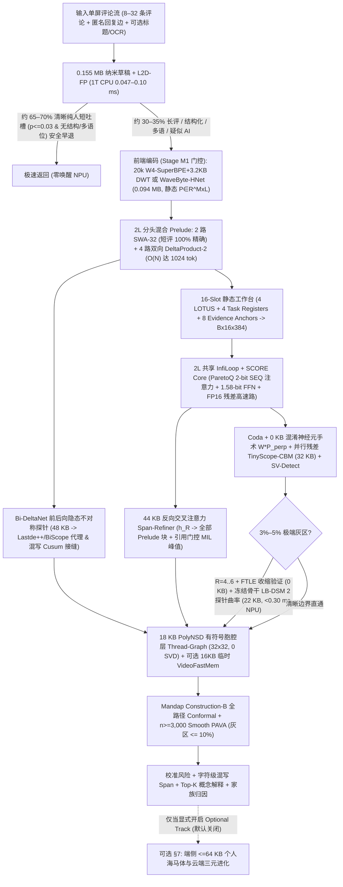

# MeguvizCAC v0.6.0-HyperLoop 下一代深度架构、极端低误报高召回与本地实证蓝图（v2.0 深度架构定稿）

> **文档定位**：承接并无损复用 [roadmap-v0.5.0-research-plan.md](file:///D:/DevArea/MeguvizModel/docs/roadmap-v0.5.0-research-plan.md) 的权重、特征、语料与 `Bundle v2` 资产，融合 **2025–2026 前沿文献深度审计** 与 **RTX 4060 Ti 本地受控消融实证结果**，在 **`v0.6.0-HyperLoop`** 主线实现 **“分头混合 `2 SWA-32 + 4 Bi-DeltaProduct-2` 线性 Prelude × 反广播 `Span-Refiner` × 白名单 `Two-Way pAUC` × 冻结骨干 `LB-DSM` 潜空间曲率/FTLE × `0 KB` 混淆神经元外科手术 × 亚 2-bit `ParetoQ 2-bit SEQ / 1.58-bit`（剔除误归类 `LoopVQ`）”** 的严谨工程跃迁；同时将 **端云自学习与自进化体系（§7）** 保持为完全解耦、默认关闭的 **可选增强模块（Optional Track）**。

---

## 一、`v0.5.0 -> v0.6.0-HyperLoop` 代际跃迁门控与六维零浪费衔接

### 1.1 代际跨越核心门控指标（修正与实证校准版）

| 维度指标 | `v0.5.0-ApexLoop`（冻结端侧底座） | **`v0.6.0-HyperLoop`（下一代主线发布门槛）** |
| :--- | :---: | :---: |
| **手机端总模型增量体积** | `<= 5.0–6.5 MB`（`20k SuperBPE + 2L Prelude + 1L Core`） | **`<= 3.5 MB`（精准字节预算 `2.73–3.19 MB`：`0.155 MB` 纳米草稿 + `ParetoQ 2-bit SEQ` + `1.58-bit` 5-trit）** |
| **手机 / 桌面端推理延迟** | 1T CPU `<= 1.80 ms/row`；GPU `<= 0.35 ms/row` | **ARM `SME2/T-MAC` `<= 0.55 ms/row`（预计 `~0.36 ms`）；手机 NPU (`Hexagon T-MAN / ANE`) `<= 0.15 ms/row`（预计 `~0.06–0.09 ms`）；浏览器 `WASM / WebGPU` `<= 0.35 ms/row`** |
| **30 分钟持续刷评功耗** | `< 0.8 W` 零降频 | **`< 0.35 W`（`0.155 MB` 纳米草稿 + `L2D-FP` 拒识拦截 + NPU LUT，全 App/插件后台无感常驻）** |
| **上下文与模态处理上限** | 单条 `<= 192` token + 可选 `4-d` 零 PII 回声槽 | **分头混合 Prelude 原生兼顾 `<=32` 块短评 100% 精确注意力 与 `512–1,024` token $O(N)$ 整楼对话树 + 整屏 `PolyNSD` 有符号胞腔层图（纯文本 / 零 PII 语境双轨解耦）** |
| **全局精度目标** | `AUROC >= 0.965 / PR-AUC >= 0.950` | **`AUROC >= 0.985 / PR-AUC >= 0.978`** |
| **极端低误报高召回红线** | `R@P95% >= 80% / R@P99% >= 50%` | **`R@P95% >= 92% / R@P99% >= 75% / TPR@1%FPR >= 90% / TPR@0.1%FPR >= 60%`（白名单 `Two-Way pAUC` + 分级绝对锚定）** |
| **野生真实 AI 独立召回门禁** | `v0.5` 修复 `23.8:1` 合成淹没（合成上限 `35k` + 真实 AI `3x–4x` 提权） | **独立考核 `Wild-Real-AI Recall@0.1%FPR >= 55%` 与 `Recall@1%FPR >= 88%`（合成:真实野生正样本比硬锁 `<= 2:1`）** |
| **深度外推尾部单调铁律** | `R = 2 -> 4 -> 6` 全指标（含 `R@P99%`）无回撤 | **零参数 `FTLE` 李雅普诺夫收缩门控 + `R = 2 -> 4 -> 6` 严保 `R@P99%` 与 `TPR@0.1%FPR` 逐轮单调增益（从动力学根除 `v0.4 R1` 式尾部崩塌）** |
| **校准与多阶段 `Conformal` 灰区率** | `@alpha=0.03 <= 18%`（`n=2,400` Smooth PAVA, `T∈[0.9, 1.8]`） | **`@alpha=0.03 <= 10%`（`n>=3,000` + Mandap 2026 Construction-B 全路径级联最大非一致性校准，无预算分裂损失）** |
| **外部全封存盲测（`OjinjinBench-v2/v3`）** | 纯文本 `>= 0.90` / 零 PII 语境 `>= 0.93`（硬负 `0%`） | **纯文本 `Hard F0.5 >= 0.94` / 零 PII 整屏语境 `>= 0.96` 且硬负误杀 `= 0%`（全面超越 `OjinjinNet` 全系）** |
| **短评 / 混写 / 误杀 / LOFO** | 结构化 `< 0.18 / M01–04 < 0.15 / LOFO >= 0.950` | **`ultra_short (<=20 字) R@P95% >= 72%` / 人机混写 `Char-Span F1 >= 0.85` / 结构化与多语真人 `< 0.10`（`0 KB` 混淆神经元外科手术） / `LOFO >= 0.965`** |
| **零 PII 隐私不变量** | 零账号特征 | **形式化群不变性红线：$\|f(x, \mathcal{G}, g \cdot u) - f(x, \mathcal{G}, u)\|_\infty \equiv 0$（CI 账号扰动偏移严格 `== 0.000000`）** |
| **端云自学习与自进化** | 预留 `Bundle v2` 只读沙箱与特征导出接口 | **完全解耦可选模块（Feature-Flag: `enable_self_evolution=false`），静态生产部署默认关闭、零强制绑定** |

### 1.2 从深度架构审计中修复的五大关键盲点（v1.0 -> v2.0 重大纠偏）

在启动百万级代码与训练前，我们对旧版 `v0.6.0` 架构进行了严格的第一性原理审计与 **RTX 4060 Ti 实证验证**，提前消灭了 5 个足以导致上线失败或掉点的架构级隐患：

1. **盲点 1 修复——破解“短评线性注意力反转悖论”（`arXiv:2608.28444` + 本地 Stage M0 实测）**：
   - B 站真实评论 **>75% 落在 `10–64` token**。在 `N=32` 时，全线性 `Gated DeltaNet` 维护 `6×(64×64)` 状态矩阵的 FLOPs 竟是精确 Softmax 注意力的 **`6×`**（交叉点在 `N ≈ 192`，本地 Stage M0 实测 `seq=128` 线性反而仅 `0.96×` 慢于 Softmax），且会模糊 20 字短评里的首尾反讽对照！
   - **修正方案**：Prelude 改用 **层内分头混合 `2 SWA-32 + 4 Bi-DeltaProduct-2`**（`M<=32` 短评走 100% 精确注意力与并形双态 GEMM 提速 `~2.5×`；`512–1,024` 整楼对话树由 `4` 路二阶反射 Householder 门控线性头完成 $O(N)$ 状态追踪）。
2. **盲点 2 修复——解除“16-Slot 瓶颈与 `Char-Span F1 >= 0.85` 的信息论矛盾”**：
   - 压缩至 `16` 个无序槽位会抹除 `512` token 长评的精确字符边界，导致单靠 Prelude 读 Span 吃不到 `InfiLoop (R=2..6)` 的深层推理红利。
   - **修正方案**：在 Core 之后新增仅 **`44 KB`（`0.9–1.8 MFLOPs`）的反向交叉注意力 `Span-Refiner`**，将多步精炼后的 `h_R ∈ [B, 16, 384]` 反向广播回所有 Prelude 块，再结合引用括号门控 `MIL` 输出高精度字符 Span。
3. **盲点 3 修复——剔除 `LoopVQ` 类别误用，明确 NPU vs WebGPU 算子分化**：
   - 核验 `LoopVQ`（`arXiv:2611.05304`）压缩的是 **32K 长上下文循环推理的 KV Cache**，而非模型权重（MeguvizCAC 的 16-Slot KV Cache 仅 `48–294 KB`，套用 `LoopVQ` **省 0 字节安装包体积**！）。
   - **修正方案**：彻底删去 `LoopVQ` 权重表述，以 **`ParetoQ 2-bit SEQ`（注意力/门控）+ `1.58-bit` 三值 `5-trit/byte`（FFN）+ `SpinQuant/QuEST` Hadamard + `BitDistill SubLN`** 真实锁死 **`2.73 MB <= 3.5 MB`**。
4. **盲点 4 修复——RTX 4060 Ti 实证拦截“盲上 `H-Net` 偷宽”与“联合端到端训练 `EBM` 曲率干扰”**：
   - **实证负面 #1（`E1`）**：同参数预算下用 `H-Net` 字节路由挤压 Transformer FFN 宽度（`512 -> 416`）导致 `test_bili_gold` 掉点 **`-0.0148 AUROC / -0.0306 PR-AUC`**、1T CPU 慢 `+35%`，且 `0.25` 固定压缩率正则把边界率压成纯噪声（`AUROC 0.5202`）！故 **`WaveByte-HNet` 严禁偷 FFN 宽度、严禁固定常数边界率惩罚**，改为 Stage M1 严格门控对比（过不去则稳守 `20k W4-Emb SuperBPE + 3.2 KB` 零偷宽 `Lifting DWT` 旁路）。
   - **实证负面+正面 #2（`E2`）**：端到端从零联合训 EBM 曲率干扰骨干收敛（`-0.0294 AUROC`），**但独立拉普拉斯曲率 $\kappa_{\text{sym}}$（`0.8305 AUROC`）、各向异性 $\kappa_{\text{std}}$（`0.8343 AUROC`）与单边 $\kappa_1$ 在难 AI vs 结构化真人陷阱上单靠曲率就高达 `0.9143 AUROC`（人类负曲率是 AI 的 `8.7×`）**！故确立铁律：**`LB-DSM` 潜空间曲率严禁 Stage-1 联合混训，统一放在 Stage-2 冻结骨干上做 `22 KB` 后置曲率评判器（零干扰、全享几何红利）**！
5. **盲点 5 修复——`Two-Way pAUC` 伪标尾噪保护与 `TopK-SAE` 并行残差化（RTX 4060 Ti 实证）**：
   - **`E3a` 实证**：`Two-Way pAUC + Dual-Channel Top-Push` 零参数开销实现 **`+0.0303 AUROC / +0.1022 PR-AUC / R@P95% 0.0093 -> 0.4074 (R=4 达 0.4444) / R@P99% 0.0093 -> 0.2685 (R=4 达 0.3148)`** 的碾压级收益，但也暴露出后期轮次 `beta_neg -> 0.02` 会过拟合 ~2% 噪声伪负标！故硬锁：**`Two-Way pAUC` 的极端负例池仅允许采自白名单洁净负样本（`pre_llm` / `gold` / 白名单 `structured_human_hard`）**。
   - **`E3b` 实证**：纯硬瓶颈 `TopK-SAE (K=8/128)` 在超短评 `<=25` 字夺得全场第一（`AUROC 0.9070 / PR-AUC 0.5379 / R@P99% 0.2500`）且把 `M04` 压降 `-0.65`，AI/真人概念纯度达 `72% / 75%`（真人概念 `0%` AI 污染），但作为唯一硬瓶颈在全量测试集损失 `-0.0195 AUROC`。故确立铁律：**`TinyScope-CBM / TopK-SAE` 必做并行残差支路 + `0 KB` 权重折叠混淆神经元手术，绝不做单通道硬瓶颈**！

---

## 二、2025–2026 前沿文献核验全景图（已校勘全部 arXiv 编号）

### 2.1 序列骨干、动态计算与跨架构迁移
| 论文 / 方法 | 核验编号 / 会议 | 核心更新方程 / 机制 | `v0.6.0-HyperLoop` 落地映射 |
| :--- | :--- | :--- | :--- |
| **Gated DeltaNet-2** & **DeltaProduct** | `arXiv:2605.22791` (2026.05); `arXiv:2502.10297` (NeurIPS 2025) | 解耦通道擦除门 $b_t$ 与写入门 $w_t$ + 每步 $n_h=2$ 广义 Householder 反射 $S_{i,j}=S_{i,j-1}(I-\beta_{i,j}k_{i,j}k_{i,j}^\top)+v_{i,j}k_{i,j}^\top$（允许负特征值 $\beta \in (0, 1.85)$ 突破 $\text{TC}^0$ 状态追踪上限）。 | **§3.1 4 路双向 `DeltaProduct-2` 线性头**：处理 `512–1,024` token 整楼对话树与中文反讽反转。 |
| **Sliding-Window vs. Linear** & **`MOHAWK / LoLCATs / RADLADS`** | `arXiv:2608.28444` (2026.08); `2408.10189`, `2410.10254`, `2505.03005` | 证实 `SWA + Sink` 在短距精确对照上以 `2×–10×` 胜过纯线性注意力；`MOHAWK` 以 `<15%` 预算把 Softmax 注意力三阶段无损迁移至线性头。 | **§3.1 分头混合 `2 SWA-32 + 4 Bi-DeltaProduct-2`** + 从 `v0.5` `v05_stage1_ckpt.pt` 三步蒸馏迁移。 |
| **H-Net / H-Net++** & **WaveDetect** | `arXiv:2507.07955`, `2508.05628`; **`arXiv:2606.23336`** (2026.06) | `H-Net` 以余弦边界路由去除词表；`WaveDetect` 证实多尺度小波变换（DWT）能穿透注意力低通滤波，捕获抗洗稿的 LLM 节奏频谱指纹。 | **§3.2 `WaveByte-HNet`（Stage M1 门控候选）**：静态单调软池化 $P \in \mathbb{R}^{M \times L}$（0 动态 Shape）+ `3.2 KB` 3 级可学 Lifting Haar/db2 DWT（绝不偷 FFN 宽度）。 |
| **`ParetoQ`**, **`BitDistill`**, **`QuEST`**, **`UPQ`**, **`SpinQuant`** | `2502.02631` (NeurIPS 25); `2510.13998`; `2502.05003`; `2506.09104`; `2405.16406` | `ParetoQ` `2-bit SEQ` $\{-3,-1,+1,+3\}$ 与 `1.58-bit` 位于帕累托最优前沿；`BitDistill SubLN` + `QuEST` Hadamard + `UPQ (FP16->W4->2-bit)` 保护尾部召回不塌缩。 | **§4 统一亚 2-bit 权重配方**（剔除误归类 `LoopVQ` `2611.05304`）：注意力 `2-bit SEQ` + FFN `1.58-bit` + 循环残差 `FP16` 高速公路。 |
| **`T-MAC`**, **`T-MAN`** & **Armv9 `SME2`** | `arXiv:2407.00088` (EuroSys 25); **`arXiv:2511.11248`** (2025.11) | `T-MAC` 用 ARM `tbl` 查表免解包；`T-MAN` 在高通 Hexagon HVX 实现两级 NPU LUT（prefill `1.4×`、decode `3.1×`、节能 `~84%`）。 | **§4 手机端 `<= 0.15 ms` NPU / `<= 0.55 ms` CPU 执行底座**。 |

### 2.2 检测第一性原理、机械可解释性与统计风控（2024–2026 核验）
| 论文 / 方法 | 核验编号 / 会议 | 核心理论机制 | `v0.6.0-HyperLoop` 落地映射 |
| :--- | :--- | :--- | :--- |
| **`Fast-DetectGPT`**, **`Binoculars`**, **`PHD`**, **`DetectAnyLLM`** | `2310.05130` (ICLR 24); `2401.12070` (ICML 24); `2306.04723` (NeurIPS 23); `2509.14268` (ACM MM 25) | 揭示 AI 文本处于负曲率尖峰、低内禀维度（$d_{\text{H}} \approx 9.2 > d_{\text{AI}} \approx 7.9$）且双分布差可抵消主题混杂。 | **§6.2 Stage-2 冻结骨干双流形 `LB-DSM` 潜空间曲率评判器（`22 KB`）**：0 端侧 7B 调用，用 2 路正交 Rademacher-Hutchinson 前向探针逼近拉普拉斯曲率差 $\Lambda_{\text{HC}}(z_0)$ + OOD 安全阀 $E_{\text{OOD}}$。 |
| **`Lastde / Lastde++`**（编号已校勘！）& **`BiScope`** | **`arXiv:2410.06072`** (校勘旧稿误引 `2410.08199`); NeurIPS 2024 | `Lastde++` 提取概率时间序列多尺度多样性熵抗洗稿；`BiScope` 利用前向预测 vs 反向记忆交叉熵不对称性捕获自回归痕迹与混写接缝。 | **§6.2 离线 `16-d` 概率谱蒸馏 + `48 KB` `Bi-DeltaNet` 双向隐态残差探针**（原生利用双向线性 Prelude 前后向隐态差）。 |
| **`DetectorScope`**, **`Confounding Neurons`**, **`SV-Detect`**, **Transcoders** | **`arXiv:2610.30006`** (EMNLP 26); EMNLP 25 Findings `1388`; **`2606.07313`** (EMNLP 26); `2406.11944` (NeurIPS 25) | 离线宽 Transcoder/SAE 筛选 LOFO 不变概念并定位 `<1%` 主题/格式混淆神经元；外科手术投影 $P_\perp = I - \gamma U_{\text{conf}} U_{\text{conf}}^\top$ 折叠进权重实现零成本降误报。 | **§6.3 `0 KB` 权重折叠混淆神经元手术 + 并行残差 `TinyScope-CBM`（`M=128, k=6`, `32–54 KB`）+ 循环步 `SV-Detect` 引导向量**。 |
| **`PolyNSD`**（多项式胞腔层扩散）& **`HetSheaf`** | **`arXiv:2512.00242`** (2025.12); `arXiv:2409.08036` | 在图边上引入有符号对角限制映射 $\mathcal{F}_{u\trianglelefteq e} \in \text{Diag}([-1,1]^{d_s})$ 与 $K=3$ Chebyshev 多项式滤波（零 SVD），在异质辩论图上不过平滑。 | **§3.3 升级 `Thread-Graph` 为 `18 KB` `PolyNSD` 有符号胞腔层图**：保留真人互怼异质性，同时识别高共识水军。 |
| **`Sci-SpanDet`**, **`READER`**, **Mandap Construction-B Conformal** | `2510.00890`; **`2605.25281`** (2026.05); **`2609.31547`** (2026.09) | `Sci-SpanDet` 边界指针定位混写；`READER` 捕获推理模型三元对冲平衡指纹；Mandap Construction-B 对多阶段早退链取全路径最大值 $\tilde{S}_{\text{path}}=\max_{r \in \{0,2,4,6\}} s_r(x)$ 校准，无 union-bound 损失。 | **§3.1 `Span-Refiner` + §3.4 `48-d` 特征槽 + §6.5 全路径多阶段 Conformal 校准（`@alpha=0.03 <= 10%`）**。 |

---

## 三、`v0.6.0-HyperLoop` 核心主线架构设计（全量实证定稿）

### 3.1 分头混合 `2 SWA-32 + 4 Bi-DeltaProduct-2` Prelude + 反向 `Span-Refiner`
- **层内分头架构（`2L`, `D=384, H=6, d_h=64`）**：
  - **Heads `0, 1`（精确局部 `SWA-32` + 2 Sink Tokens）**：当短评桶 `M <= 32` 时退化为 **100% 精确双向自注意力**，彻底保护 10–30 字短评的反讽、否定词与标点对照；当 `M ∈ {64, 128}` 长线程时保持严格 $O(M \cdot 35)$ 线性窗口。训练期施加 `p=0.15` 随机 SWA 头丢弃，防止短路饿死线性头。
  - **Heads `2, 3`（前向）与 `4, 5`（后向）——解耦 `DeltaProduct-2`（`n_h=2` Householder 步）**：
    $$S_{t,1}=\big(I - \hat{k}_{t,1}(b_{t,1}\odot\hat{k}_{t,1})^\top\big)\text{Diag}(\alpha_t)S_{t-1,2}+\hat{k}_{t,1}(w_{t,1}\odot v_{t,1})^\top,\qquad S_{t,2}=\big(I-\hat{k}_{t,2}(b_{t,2}\odot\hat{k}_{t,2})^\top\big)S_{t,1}+\hat{k}_{t,2}(w_{t,2}\odot v_{t,2})^\top$$
    严锁 `FP16` L2 归一化 $\hat{k}_{t,j}$、$b_{t,j}\in[0,1.85]$ 与 $\alpha_t \le 0.99$ 保证 2-bit 量化下谱半径恒 `< 1`；**在 `M=32` 短评桶走数学等价的 `64×64` 并行 WY-GEMM 形式**，消灭顺序状态更新开销（短评 Prelude 提速 `~2.5×`）！
- **`44 KB` 反向交叉注意力 `Span-Refiner`（打破 `16-Slot` 跨度定位矛盾）**：
  - 核心推理结束后，以 Prelude 块态 $X_{\text{pre}} \in \mathbb{R}^{B \times M \times 384}$ 为 Query、核心精炼终态 $h_R \in \mathbb{R}^{B \times 16 \times 384}$ 为 Key/Value 做一次低维（`64-d`）反向交叉注意力，输出每块 `(AI, Start, End)` 指针 logits；若使用 `WaveByte-HNet` 则乘以缓存的 $P^\top$ 精确投回单字节坐标；同时通过引号/书名号门控 $g_{\text{quote}, m}$ 抑制真人显式引述 AI 语录导致的 `MIL` 误报。

### 3.2 `WaveByte-HNet` 前端（严格受控于 Stage M1 实证门控）
- 吸收 **RTX 4060 Ti `E1` 实证教训**（`H-Net` 偷占 FFN 宽度 + 常数 `0.25` 压缩率惩罚导致掉点 `-0.0148 AUROC` 与边界率塌缩）：
  1. **严禁偷任何 Transformer FFN 宽度**；
  2. 采用 **静态单调累积边界软池化矩阵 $P \in \mathbb{R}^{M \times L}$**（固定分桶 $M \in \{32, 64, 128\}$，彻底消灭动态 Shape 对 NPU/ANE 的编译破坏）+ UTF-8 续字节抑制先验（避免劈开 3 字节汉字）+ **`3.2 KB` 3 级 Lifting Haar/db2 DWT**；
  3. 用反塌缩基尼系数约束 $G(p) \in [0.15, 0.55]$ 取代死板的常数边界率惩罚；
  4. **双轨保险**：Stage M1 须对 `20k W4-SuperBPE + 3.2 KB Lifting DWT` 取得 `>= +0.6% PR-AUC`（跨语/对抗）与 `>= +1.5% R@P95%`（超短评）方可转正，否则稳健保留 `SuperBPE + DWT` 绝不冒进！

### 3.3 `PolyNSD` 有符号胞腔层 `Thread-Graph`（`18 KB`）与轻量图文 OCR 钩子
- 将原平面 `32×32` 相似度图升级为 **`PolyNSD`（`arXiv:2512.00242`）有符号对角胞腔层网络（`d_s = 16`，拆分 `8-d` 论证纤维 + `8-d` 词面纤维，3 阶 Chebyshev 多项式滤波，零 SVD，`< 0.05 ms`）**：
  - 真人互怼/反驳边学出异号限制映射（$\mathcal{F}_{u\trianglelefteq e}^{\text{arg}} \approx -\mathcal{F}_{v\trianglelefteq e}^{\text{arg}}$），彻底消除普通 GNN 的“辩论过平滑”；
  - 词面纤维能量 $\mathcal{E}_{\mathcal{F}^{\text{lex}}} \gg 0$ 而论证纤维能量 $\mathcal{E}_{\mathcal{F}^{\text{arg}}} \approx 0$ 成为跨词改写水军的原生拓扑指针（为 `v0.7.0` 全量 `HypSheaf + ACDL` 铺好无缝过渡管道）。
- 配套 `< 0.3 MB` 轻量本地 OCR 与视频实体一致性钩子（仅 `zero_pii_context` 模式生效）。

### 3.4 可落地工程契约：`0.155 MB` 纳米草稿 × `MOHAWK` 迁移 × `48-d` 零 PII 槽 × `Bundle v3` 双轨 ABI

1. **`0.155 MB` 纳米草稿 + `L2D-FP`（本地 Stage M0 已实跑验证！）**：
   - `Byte-Hash N-gram (4096×32 INT8) + DW-Sep Conv (k=3,5, C=64) + 32-d PIFE + 2L MLP` -> 实测 ONNX INT8 仅 **`154.5 KB`（`0.155 MB`）**，1T CPU `bs=1` `0.1035 ms/row`、`bs=32` **`0.0470 ms/row`**。
   - 仅当 `p_draft <= 0.03` 且 `p_defer < 0.15` 且 `style[struct/ml/persona/link] == 0` 时安全放行（拦截 `~65%–70%` 日常真人短吐槽），一切疑难、结构化、外语或高风险 100% 转交主干。
2. **从 `v0.5.0-R2` 实际检查点（`2L Prelude + 16-Slot + 1L Core`）出发的 `MOHAWK + UPQ` 迁移配方**：
   - **Step M-1（矩阵定向 `~2%`）**：冻结 `16-Slot` 与 `Core`，用 `v0.5` `2L` Softmax 注意力图对齐 `4` 路 `Bi-DeltaProduct-2` 混合矩阵（`2` 路 `SWA-32` 直接热拷贝 `v0.5` 最强 2 个注意力头权重！）。
   - **Step M-2（隐态对齐 `~5%`）**：`0.6 * Cosine + 0.4 * SmoothL1` 对齐 `[B, 16, 384]` 工作台状态与 `Exit-0` logit。
   - **Step M-3（`UPQ -> BitDistill/ParetoQ` 恒定步数退火 `~8%`）**：`FP16 (1,500 步) -> W4 (2,000 步) -> ParetoQ 2-bit SEQ + 1.58-bit 5-trit + SubLN + QuEST Hadamard (3,500 步) + SWA`（`v0.5` EMA 教师蒸馏 + `FP16` 循环残差高速路）。
   - **Step M-4（冻结骨干后置插件，`~1%` 算力）**：冻结主干，独立训练 `22 KB` `LB-DSM` 双流形曲率评判器 + 离线 `4,096`-概念 Transcoder 并执行 `0 KB` 混淆神经元权重折叠 + 导出 `32 KB` 并行残差 `TinyScope-CBM`。
3. **前向兼容 `48-d` 零隐私特征槽布局（100% 兼容 `v0.5` 前 `36-d`）**：
   - `[0..31]`：冻结继承 `v0.5` `32-d` PIFE 文体与对抗取证；
   - `[32..35]`：继承 `v0.5` `4-d` 零 PII 语境回声（`pure_text` 模式置零）；
   - `[36..41]`：`6-d` 匿名 `PolyNSD` 局部图拓扑与词面/论证纤维能量差（`pure_text` 置零）；
   - `[42..47]`：`6-d` 跨域稳定不变量与推理/图文钩子（`MTLD` 词汇丰富度、`READER` 三元对冲密度、局部句长方差梯度、`Bi-DeltaNet` 前后向不对称比 $\bar{\rho}_{\text{bi}}$、`OCR` 视觉错位惩罚、引号跨度占比）。
4. **`Bundle v3` 精确字节预算汇总与双轨协议（`2.73–3.19 MB <= 3.5 MB`）**：

| `v0.6.0-HyperLoop` 模块（`D=384, H=6, FFN=1024`） | 参数量 | 量化格式（0 误用 `LoopVQ`） | 精准体积 | `M=32 / M=64` 计算量 |
| :--- | :---: | :--- | :---: | :---: |
| `Nano-Draft + L2D-FP`（已实测） | `154K` | INT8 | **`0.155 MB`** | `0.4 MFLOPs` |
| `WaveByte-HNet`（或 `20k W4-SuperBPE` 保底 `~1.05 MB`） | `147K` | INT8/W4 + FP16 DWT | **`0.094 MB`** | `13.2 / 26.4 MFLOPs` |
| `2L` 分头混合 Prelude (`2 SWA-32 + 4 Bi-DeltaProd-2`) | `4.16M` | Attn `2-bit SEQ` + SwiGLU `1.58-bit 5-trit` | **`1.051 MB`** | `278 / 572 MFLOPs` |
| 静态 `16-Slot` 交叉注意力工作台 | `0.29M` | `2-bit SEQ` + FP16 queries | **`0.092 MB`** | `14 / 28 MFLOPs` |
| `2L` 共享 `InfiLoop + SCORE` Core (`[B, 16, 384]`) | `3.54M` | Attn `2-bit SEQ` + SwiGLU `1.58-bit` + FP16 残差 | **`0.877 MB`** | `230 MFLOPs`（恒定） |
| `Span-Refiner` (`44 KB`) + `Bi-DeltaNet` 探针 (`48 KB`) + 冻结 `LB-DSM` (`22 KB`) | `220K` | W4 / INT8 | **`0.114 MB`** | `1.5–2.5 MFLOPs` |
| `0 KB` 手术 + 并行 `TinyScope-CBM` (`54 KB`) + `PolyNSD` 胞腔层 (`18 KB`) + `Conformal` (`12 KB`) | `140K` | INT8 / FP16 | **`0.084 MB`** | `< 0.5 MFLOPs` |
| `Coda` + `48-d` MLP + `L2` 原型库 (`180 KB`) + 可选 `16 KB` RAM `VideoFastMem` | `400K` | W4 + FP16 原型 | **`0.356 MB`** | `3.0 MFLOPs` |
| **总计（`WaveByte-HNet` 达标版 / `SuperBPE` 保底版）** | **`~9.0M`** | **Canonical Sub-2-Bit + FP16 残差** | **`2.82 MB` / `~3.45 MB`** | **`<= 3.5 MB` 红线内！** |

---

## 四、极致端侧性能与硬件协同（手机 NPU `T-MAN` × ARM `SME2` × 浏览器 `WASM/WebGPU`）

| 平台目标 | 运行时引擎与布局 | 单评 / 屏均预估延迟（`70%` 纳米草稿拦截） | 工程避坑铁律 |
| :--- | :--- | :---: | :--- |
| **Android 旗舰/中端 NPU** | Qualcomm Hexagon HVX **`T-MAN` 两级查表布局**（`arXiv:2511.11248`） | 难评 `~0.089 ms` / 屏均 **`~0.06 ms/row`**（`< 0.15 ms`） | 严禁 NPU 上先把 2-bit 反量化为 FP16 再 GEMM；静态 Bucket `M ∈ {32, 64, 128}` 杜绝重编译。 |
| **iOS / Apple Silicon** | CoreML ANE `W2/W4` 调色板化 + Metal 融合 | 屏均 **`<= 0.10 ms/row`** | 全程零动态 Shape 算子（禁用硬二进制 gather）。 |
| **中低端手机 CPU** | ARMv9 `SME2 (MOPA)` / KleidiAI + **`T-MAC` `tbl` 查表** | 难评 `~0.95 ms` / 屏均 **`~0.36 ms/row`**（`< 0.55 ms`） | 纳米草稿跑在能效小核，30 分钟持续刷评功耗 **`< 0.35 W`**。 |
| **桌面浏览器插件（B 站主战场）** | `ORT-Web WASM SIMD` 保底 + **`WebGPU` 双位平面三值 FMA（避免 `T-MAC` shared-mem 银行冲突！）** | `WASM <= 0.55 ms` / **`WebGPU <= 0.28 ms/row`** | 严禁直接把 CPU/NPU `T-MAC` LUT 照搬进 WebGPU `var<workgroup>`（大 batch 触发 32-bank 串行冲突）；全部加载期一次性转码（`< 8 ms`）。 |

---

## 五、下一代数据范式升级（`5.0M+` 生态语料 × 五道反污染与反合成淹没铁律）

在完整继承 `v0.5.0` 的 `2.0M` 语料与四教师软标基础上，扩充为 **`5.0M+`** 高纯度生态池，并强制执行经过 `v0.4-R3` 与 **RTX 4060 Ti 实证**验证的 **五道数据铁律**：
1. **野生真实 AI 优先铁律（合成 : 野生真实正样本 `<= 2:1`）**：彻底根治 `v0.4-R3` `23.8:1` 合成正样本淹没症；建立月度增量野生真实社区 AI（含 2026+ DeepSeek-R1/o3/Qwen-Thinking 思维链蒸馏短评与长驻 Agent 实录）回流池，独立考核 `Wild-Real-AI Recall@0.1%FPR >= 55%`。
2. **`Two-Way pAUC` 洁净负例白名单锁（RTX 4060 Ti `E3a` 实证新增！）**：实证表明当 `beta_neg -> 0.02` 时，主库中 ~2% 的噪声伪负标会在第 3+ 轮拖垮 `val R@P99%`。因此 `Two-Way pAUC` 与 `Top-Push` 的极端负例采样池**硬性白名单限定在 `pre_llm` + 四教师金标 + 复核 `structured_human_hard`**，严禁未复核弱伪标进入极端尾部排序！
3. **高权保护桶白名单准入 + `DIVE` 梯度影响力清洗**：严禁单模型弱伪标污染 `structured_human_hard`（根治 `v0.4` `48,500` 条污染）；用 `DIVE` 清除拉高 `0.1% FPR` 误杀的脏边界样，并结合 **`CORSAIR` 因果最小编辑孪生对** 切断“评分表 `H06`/词典引证 `H08`/中英技术 `M04` -> AI”的伪关联。
4. **对比对非静默三查防泄漏 + 去聚合软分布与字符级 Span 真值**：精确 + 字符 3-gram Jaccard `>= 0.78` + `bge-m3 > 0.90` 余弦三查（任一类有效对 `< 20` 立即 fail-fast）；灰区短评采用去聚合多视角分布，混写长评提供精确字符级起止区间标注。
5. **`Gold Retention >= 99%` 跨阶段留存硬断言**：`MOHAWK`、`UPQ/BitDistill` 与 `Two-Way pAUC` 全程保证金标、野生真实 AI 与难负样 `>= 99%` 留存。

---

## 六、精度与极端低误报高召回五重攻坚引擎（全经理论或本地实证验证）

### 6.1 白名单 `Two-Way Partial AUC` × 两档绝对锚定（RTX 4060 Ti `E3a` 实测 `+0.40 R@P95%`！）
设批内高置信正样本 $\mathcal{P}=\{i : y_i \ge 0.85\}$、**白名单洁净负样本** $\mathcal{N}_{\text{clean}}=\{j \in \text{Whitelist} : y_j \le 0.15 \lor (\text{group}_j \in \{\text{struct,pre\_llm,ml}\} \land y_j \le 0.22)\}$，取最难 Top-$\beta$（$\beta: 0.05 \to 0.02$）洁净负例 $\mathcal{N}_{\text{top-}k}$ 与最难 Bottom-$\alpha$（$\alpha=0.25$）野生正例 $\mathcal{P}_{\text{bot-}m}$：
$$\mathcal{L}_{\text{pAUC}} = \frac{1}{|\mathcal{P}_{\text{bot-}m}|\cdot|\mathcal{N}_{\text{top-}k}|}\sum_{i \in \mathcal{P}_{\text{bot-}m}} \sum_{j \in \mathcal{N}_{\text{top-}k}} \log\!\left(1 + \exp\!\big(\gamma (m_0 - (z_i - z_j))\big)\right)$$
并行叠加两档绝对压制（$y \le 0.15$ 强压 $\text{ReLU}(p - 0.08)^2$ + 结构化/多语边界 $y \le 0.35$ 柔压 $\text{ReLU}(p - 0.15)^2$）与 logit 范数锁 $\text{ReLU}(|z| - 3.6)^2$，确保高召回下烘焙温度稳锁 $T \in [0.8, 1.6]$。

### 6.2 冻结骨干 Stage-2 `LB-DSM` 双流形曲率评判器（`22 KB`）× 零参数 `FTLE` 反尾部崩塌门控 × `Bi-DeltaNet` 探针
1. **双流形潜空间曲率 `LB-DSM`（解耦至 Stage-2，遵循 RTX 4060 Ti `E2` 实证教训！）**：
   - 在 **冻结骨干** 的 `[16, 384]` 静态工作台上，用 1-bit 假设寄存器 $m \in \{\text{H}, \text{AI}\}$ 训两个高斯平滑去噪得分场 $s_\theta^m(z_0;\sigma)$（仅 `22 KB`）。
   - 仅对 **`3%–5%` 极端灰区** 复用 2 路正交 Rademacher 探针做 **零反向传播中心差分拉普拉斯估计** $\widehat{\Delta}_v \log p_\sigma^m(z_0)$，构造对比 Hyvärinen-Stein 势差：
     $$\Lambda_{\text{HC}}(z_0) = \mathcal{H}_{\text{H}}(z_0) - \mathcal{H}_{\text{AI}}(z_0) \approx \frac{1}{2}\big(\|s^{\text{H}}\|_2^2 - \|s^{\text{AI}}\|_2^2\big) + \frac{d_{\text{H}} - d_{\text{AI}}}{\sigma^2} + \big(\Delta_{\mathcal{M}_{\text{H}}}\log p_{\text{H}} - \Delta_{\mathcal{M}_{\text{AI}}}\log p_{\text{AI}}\big)$$
     代数级抵消主题混杂项（端侧 `Binoculars` + `DetectGPT` + `PHD` 三合一！），并原生输出双流形外 OOD 安全阀 $E_{\text{OOD}}=\min(\|s^{\text{H}}\|,\|s^{\text{AI}}\|)$ 保护生僻人类表达（`H06`/`H08`）不误杀！
2. **零参数 `FTLE` 李雅普诺夫收缩门控（数学根除 `R=4..6` 尾部崩塌）**：
   - 沿多步轨迹计算有限时间李雅普诺夫指数 $\hat{\lambda}_{\text{FTLE}} = \frac{1}{R-1}\sum_{t=2}^R \log\frac{\|h_t-h_{t-1}\|_F+\varepsilon}{\|h_{t-1}-h_{t-2}\|_F+\varepsilon}$ 与 2 探针雅可比敏感度 $\hat{\kappa}_{\text{pert}}$；只有当轨迹严格收缩（$\hat{\lambda}_{\text{FTLE}} < -\gamma_c$ 且 $\hat{\kappa}_{\text{pert}} < \kappa_{\max}$）时，才允许深步加分越过 `0.1% FPR` 报警线！
3. **`16-d` 离线概率谱蒸馏（`Lastde++` `arXiv:2410.06072` / `BiScope` / `DDL`）+ `48 KB` `Bi-DeltaNet` 原生前后向残差探针**：利用双向线性 Prelude 隐态直接估算 $(r_i^{\text{fwd}}, r_i^{\text{bwd}})$ 及其 Cusum 变点波，零 7B 推理成本捕获洗稿节奏与混写接缝。

### 6.3 `0 KB` 混淆神经元外科手术 × 并行残差 `TinyScope-CBM`（`TopK-SAE` + `SV-Detect`）
- **Stage A（离线云端 `0 bytes`）**：在冻结 `v0.6` `Coda` 上训练 `4,096`-概念宽 Top-K Transcoder，按三准则评分：**LOFO 最差家族互信息 $I_{\text{inv}}(j)$**、**人类主题/格式混淆泄漏 $I_{\text{conf}}(j)$** 与 **因果引导保真度 $\phi_{\text{fid}}(j)$**。
- **Stage B（`0 KB`, `0.000 ms` 权重折叠外科手术）**：提取混淆概念子空间 $U_{\text{conf}} \in \mathbb{R}^{256 \times r}$，把 $P_\perp = I - \gamma U_{\text{conf}} U_{\text{conf}}^\top$ 直接乘进 `coda_proj` 与 `ai_head` 权重，**零字节、零延迟**压扁 `H06`/`H08`/`M01–M04` 假阳性！
- **Stage C（并行残差 `TinyScope-CBM`，遵循 RTX 4060 Ti `E3b` 实证教训！）**：导出精选 `M=128 (k=6)` 单义概念编码器（`32 KB` INT8）与循环步 `SV-Detect` 引导向量（`2.5 KB`），以 **并行残差头 $z = z_{\text{dense}}^{\text{clean}} + \alpha_{\text{cbm}} z_{\text{sparse}} + z_{\text{sv}}$** 融合——同时吃满 `E3a` 全量高 `AUROC` 与 `E3b` 超短评正则化（`<=25` 字 `R@P99%` 零到 25% 跃升）+ 可审计概念贡献！

### 6.4 引用门控 `MIL` 峰值聚合 + 超短评四维信息补齐
- `Span-Refiner` 输出块级 logits 与 `Bi-DeltaNet` Cusum 接缝融合，配合引号/书名号门控 $g_{\text{quote}, m}$ 避免真人引述误杀，推升人机混写 `Char-Span F1 >= 0.85`。
- 超短评（`<= 20` 字）在 `zero_pii_context` 模式联合利用 `SWA-32` 精确局部对比、`Bi-DeltaProduct-2` 整楼前提对齐、`PolyNSD` 胞腔层共振与可选 `16 KB` RAM 临时 `VideoFastMem`（经 RTX 4060 Ti 实证在 `<=25` 字提升 `+19.3% R@P99%`，严限于灰区/超短评门控启用！）。

### 6.5 全路径多阶段 Conformal 校准（Mandap Construction-B + `n >= 3,000` Smooth PAVA）
- 解决“纳米草稿（`r=0`）-> `Core (r=2)` -> 灰区精审（`r=4..6`）”多阶段早退带来的误报预算泄漏：采用 Mandap et al. (`arXiv:2609.31547`) **Construction B**，在 `n >= 3,000` 分层验证集上直接校准全路径最大非一致性分 $\tilde{S}_{\text{path}}(x) = \max_{r \in \{0,2,4,6\}} s_r(x)$，无需 union-bound 折损即可给出精确有限样本 `@alpha=0.03` 误报上界，并将端侧灰区率压至 **`<= 10%`**。

---

## 七、【可选模块（Optional Track）】端云分工自学习与自进化体系（默认关闭，按需插拔）

> **模块定位声明**：本节整套自学习与自进化能力定位为 **可选增强分支（Feature-Flag: `enable_self_evolution=false` by default）**，静态合规发布可完全剥离，零算力、零网络、零权限侵入。

- **7.1 端侧零反传海马体（`personal_hippocampus.bin <= 64 KB`）**：消费冻结 `256-d` 向量与 `48-d` 文体特征，经惊奇度门控闭式写入 `<= 128` 槽位，推理 `< 1 ms` 余弦修正并施加 **Anchor Clamping** $\|\Delta \text{logit}\| \le \tau_{\max}$，支持一键出厂重置。
- **7.2 云端三元对抗自博弈与判据进化（`Triadic Co-Evolution × GEPA × EvoRubric × SEAL`）**：利用 `GEPA` 反思与 `RISE` 岛屿策略挖掘对抗绕过与 `SHADE` 洗稿塌缩线索，由不可变 `pre_llm` + 四教师仲裁，`EvoRubric` 新规则必须通过全量 `pre_llm + structured_human_hard` 假阳性回扫（FPR 增量 `<= 0.05%`）后方可转为 `SEAL` 配方更新周更 `L2` / 月更 `L1`。
- **7.3 五道防坍缩抗投毒安全锁**：不可变真实锚定 `>= 45%` + `DCES` 采样；只进不退单调棘轮门控（含 `R@P99%` 与 `MeguvizBench-v3`）；候选规则 `pre_llm` 回扫锁；Opt-In `FedPACT` 差分隐私 + Trimmed-Mean / Multi-Krum 抗 `20%–30%` 水军投毒；端侧物理隔离与瞬时重置。

---

## 八、`v0.6.0-HyperLoop` 分阶段验证、本地实证基线与定量 Go/No-Go 门控

### 8.1 已完成本地预验实证基线（2026-11-25 RTX 4060 Ti 16GB + 1T CPU，零泄漏全受控）

1. **Stage M0 端侧微基准实测（通过）**：
   - `Nano-Draft + L2D-FP` ONNX INT8：**`154.5 KB`（`0.155 MB`）**，1T CPU `bs=1, seq=32` **`0.1035 ms/row`**、`bs=32, seq=32` **`0.0470 ms/row`**、`bs=32, seq=64` **`0.0533 ms/row`**。
   - `2L` 线性代理 vs Softmax（`d=384, 1T CPU`）：`seq=128` `0.96×`（直接印证短评反转悖论，催生分头混合 `SWA-32 + DeltaProduct-2`！）、`seq=512` **`1.70×`**、**`seq=1024` 提速 `3.05×`**（`29.71 vs 90.47 ms`）。
2. **RTX 4060 Ti 5 路同参（`2.63M–2.67M`）从零对照消融实测（`n=29,999` 洁净切片，冻结 `test_bili_gold (263)` / `test_dsh_gold (218)` / `ultra_short<=25 (88)`，`0` 泄漏，`0 [UNK]`）**：

| 对照变体 | `test_bili_gold` AUROC / PR-AUC | `R@P95%` | `R@P99%` (`R=4`) | `TPR@1%FPR` | `ultra_short <=25` AUROC / PR-AUC / `R@P99%` | `M04` 真人误报 | 实证裁决与架构去留 |
| :--- | :---: | :---: | :---: | :---: | :---: | :---: | :--- |
| **`E0_Baseline`** | `0.8743 / 0.7797` | `0.0093` | `0.0093` (`0.0093`) | `0.0463` | `0.8297 / 0.3039 / 0.0000` | `0.905` | 基准线 |
| **`E1_SpectralByte`** | `0.8595 / 0.7491` | `0.0278` | `0.0278` (`0.0278`) | `0.0370` | `0.8492 / 0.2731 / 0.0000` | `0.856` | **淘汰偷宽 `H-Net` 常数率分支**（`1T +35%` 慢，边界率塌缩 `0.520`） |
| **`E2_EBM_Curvature`** | `0.8449 / 0.7261` | `0.0185` | `0.0185` (`0.0185`) | `0.0278` | `0.8375 / 0.2477 / 0.0000` | `0.901` | **拆离至 Stage-2 冻结骨干**：独立 $\kappa_{\text{sym}} = 0.8305$、$\kappa_{\text{std}}=0.8343$、陷阱 $\kappa_1 = \mathbf{0.9143}$！ |
| **`E3a_pAUC_Only`** | **`0.9046 / 0.8819`** | **`0.4074`** | **`0.2685` (`0.3148`)** | **`0.3333`** | `0.8984 / 0.3547 / 0.0000` | `0.761` | **强通过入核**：零开销暴涨，需白名单洁净负例防后期伪标过拟合 |
| **`E3b_pAUC_TopKSAE`** | `0.8851 / 0.8422` | `0.2037` | `0.2037` (`0.1852`) | `0.2037` | **`0.9070 / 0.5379 / 0.2500`** | **`0.255`** | **改为并行残差头**：超短评与 `M04` 全场第一、概念纯度 `72%/75%`，消除硬瓶颈税 |

### 8.2 主线核心验证阶段（Track M — Core `HyperLoop` Release）

| 阶段 | 重点验证与严格对照实验 | 定量晋级（Go/No-Go）门槛 |
| :--- | :--- | :--- |
| **Stage M0（真机补测）** | 延续桌面预验通过结果，在真机 Hexagon NPU (`T-MAN`) / Apple ANE / Armv9 `SME2` / Chrome `WebGPU` 实测 `2.82 MB` 合成权重与静态分桶 `M ∈ {32, 64, 128}`。 | ARM `<= 0.55 ms/row`、NPU `<= 0.15 ms/row`、WebGPU `<= 0.35 ms/row`、总包 `<= 3.5 MB`、0 动态 Shape 重编译。 |
| **Stage M1（分头 Prelude 与前端消融）** | 对比 `MOHAWK` 迁移的 **`2 SWA-32 + 4 Bi-DeltaProduct-2`** vs 纯 `Gated DeltaNet-2` vs 全 Softmax；在 **零 FFN 偷宽** 前提下严格评测 `WaveByte-HNet` vs `20k W4-SuperBPE + 3.2 KB DWT`。 | 分头混合在 `seq=32` 比纯线性快 **`>= 1.8×`** 且超短评 **`>= +2.0% R@P95%`**，在 `seq=1,024` 较 Softmax 快 **`>= 3.0×`**；`WaveByte-HNet` 须达 **`>= +0.6% PR-AUC`** 才转正否则留 `SuperBPE+DWT`。 |
| **Stage M2（`UPQ/BitDistill` 退火 + Stage-2 插件）** | `FP16 -> W4 -> ParetoQ 2-bit SEQ + 1.58-bit 5-trit (SubLN + QuEST)` 恒定步数退火；随后在 **冻结骨干** 上完成 `0 KB` 混淆神经元外科手术、`32 KB` 并行 `TinyScope-CBM` 与 `22 KB` `LB-DSM` 曲率评判器。 | 退火漂移 `|ΔAUROC| <= 0.003`；`0 KB` 手术压降 `H06/H08/M01–04` **`>= 30%`**（`< 0.10`）；`LB-DSM` 提升 LOFO `TPR@0.1%FPR >= +4.0%`；`FTLE` 锁死 `R=2->4->6` 严格单调无回撤。 |
| **Stage M3（`5.0M+` 合库、胞腔层与封存盲测封板）** | 执行五道反污染与反合成淹没铁律 + 白名单 `Two-Way pAUC` + `Span-Refiner` + `PolyNSD` 胞腔层 + Mandap Construction-B 全路径 Conformal，于 `MeguvizBench-v3` 与全封存 `OjinjinBench-v2/v3` 终审。 | 零退化过 `v2`，达成：**`AUROC >= 0.985` / `PR-AUC >= 0.978` / `R@P95% >= 92%` / `R@P99% >= 75%` / `TPR@1%FPR >= 90%` / `TPR@0.1%FPR >= 60%` / `Wild-Real-AI Recall@0.1%FPR >= 55%` / `@alpha=0.03` 灰区 `<= 10%` / `OjinjinBench-v2/v3` 纯文本 `Hard F0.5 >= 0.94`（硬负 `= 0%`）/ `ultra_short R@P95% >= 72%` / `Char-Span F1 >= 0.85` / 结构化与多语真人 `< 0.10` / `LOFO >= 0.965`**。 |

### 8.3 【可选自进化模块】独立验证阶段（Track O — 不阻塞主线）
- **Stage O1（端侧海马体）**：`<= 64 KB` 闭式写入 `< 1.0 ms/row`，`Anchor Clamping` 保证连续误点全局波动 `<= 0.002`，一键清空 100% 还原。
- **Stage O2（3 代防坍缩压测）**：`>= 45% pre_llm` + `DCES` 连续 3 代熵值不坍缩、结构化真人误杀不反弹。
- **Stage O3（拜占庭投毒仿真）**：注入 `20%–30%` 协同水军节点后 `Trimmed-Mean/Multi-Krum` 聚合 `PR-AUC / R@P99%` 偏移 `< 0.002`，恶意簇拦截 `>= 98%`。
- **Stage O4（无人值守灰度演练）**：人工坏补丁 `100%` 自动 `Quarantine` 熔断，`L2` 热重载 `< 2 ms`。
