# MeguvizCAC v0.7.0-OmniVeritas 下一纪元前沿构想书：多模态因果 × 自主 Agent / 协同水军 × 密码溯源与可解释社区真实性引擎

> **文档定位**：承接 [roadmap-v0.5.0-research-plan.md](file:///D:/DevArea/MeguvizModel/docs/roadmap-v0.5.0-research-plan.md)（`v0.5.0-ApexLoop` 单句端侧突破）与 [roadmap-v0.6.0-self-evolution.md](file:///D:/DevArea/MeguvizModel/docs/roadmap-v0.6.0-self-evolution.md)（`v0.6.0-HyperLoop` 线性状态空间 + 2-bit LUT NPU + `Thread-Graph`），面向 **2027+“个人化推理 Agent 与多模态自动化水军常态化”时代**，规划 **`MeguvizCAC v0.7.0-OmniVeritas`**。
>
> **核心范式跃迁**：当单一短评的语言流畅度彻底逼近人类、信息论上纯单句检测逼近不可分下界时，检测范式必须从 **“单条文本 AI 分类器”** 升维为 **“零隐私、多模态对齐、因果协同感知、密码溯源融合、且给出人类可核验 Span 证据链的端侧真实性引擎（Omni-Authenticity Engine）”**。

---

## 一、为什么需要 `v0.7.0-OmniVeritas`？——2027+ 三大范式天花板预测

在 `v0.6.0-HyperLoop` 达成 `AUROC >= 0.985 / R@P99% >= 75% / <= 3.5 MB / <= 0.15 ms NPU` 后，纯文本+单屏图协同检测器将面临三个无法仅靠“把模型再做大”解决的结构性天花板：

1. **短句与推理蒸馏的“单句信息论下界”**：2026–2027 年测试时推理增强模型（DeepSeek-R1/R2、o3/o4、Qwen-Thinking 等）与低延迟思维链蒸馏小模型能够写出几乎没有模板痕迹的 15–40 字自然短评（*READER*, `arXiv:2605.25281`），单句表层风格差异趋近于零，但它们在**“看视频的真实视觉感知 vs 仅读标题/字幕的 RAG 推理”**之间仍存在根本性因果裂缝。
2. **自主 Web Agent 与无重合词协同网络（Latent Paraphrase Swarms）**：新一代社媒水军不再复制粘贴同文案，而是由多智能体浏览器（Perception-Reasoning-Action 循环，*On the Internet, Nobody Knows You're an LLM Bot*, `arXiv:2606.30119`；*BotVerse*）驱动，对同一舆情/营销指令生成 **字面零重叠、语义论证骨架高度同构** 的多视频协同评论；反过来，B 站真实社区极度盛行 **“弹幕梗接龙 / 复制粘贴整活 / 前排打卡”**，朴素图相似度网络极易误杀真人玩梗潮！
3. **“黑盒概率分”的社区信任赤字与 C2PA 溯源断裂**：单纯给用户亮一个 `AI 概率 84%` 的红标无法解释原因，容易引发社区争议与误伤恐慌；同时，虽然 C2PA（内容来源与真实性联盟）密码凭证正随法规普及，但 `2026` 前沿审计（*Why the C2PA Specifications Fall Short*, `arXiv:2604.24890`；*Drowning in AI Slop*）已证实平台转码/复制粘贴会普遍剥离凭证——**必须把密码学溯源、统计神经检测与因果协同证据统一到一个可解释的分级信任账本中**。

---

## 二、三代演进全景图（`v0.5.0 -> v0.6.0 -> v0.7.0` 资产 100% 复利衔接）

```mermaid
flowchart LR
    subgraph V05["v0.5.0-ApexLoop (当前训练中)"]
        A1["24k SuperBPE + 1L RoPE/DWConv + 16-Slot + 2L Core"]
        A2["32-d PIFE + 4-d 回声 + 256-d L2 原型库"]
        A3["Bundle v2 (<=6.5 MB Edge-W4, <=1.8 ms 1T)"]
    end

    subgraph V06["v0.6.0-HyperLoop (下一代主线)"]
        B1["MOHAWK -> Gated DeltaNet-2 / Mamba-3 + H-Net++"]
        B2["48-d 零隐私特征 + 16-d 概率谱 + Thread-Graph + MIL"]
        B3["Bundle v3 (<=3.5 MB 2-bit LUT, <=0.15 ms NPU)"]
    end

    subgraph V07["v0.7.0-OmniVeritas (2027+ 前沿构想)"]
        C1["全模态因果对齐: 评论 x 字幕 x 弹幕流 x 关键帧视觉指纹"]
        C2["ACDL 因果协同检测: 剥离真人玩梗潮 vs 潜态改写水军簇"]
        C3["三层真实性账本: C2PA/Origin Lens + 神经因果 + 可解释证据卡"]
        C4["Bundle v4 (<=2.2 MB 1.58-bit/1-bit WGSL WebGPU + NPU <=0.08 ms)"]
    end

    V05 -->|"MOHAWK + UPQ + 特征槽兼容"| V06
    V06 -->|"复用线性骨干 + 跨模态轻量适配器 + Causal Graph"| V07
```

| 维度 | `v0.5.0-ApexLoop` | `v0.6.0-HyperLoop` | **`v0.7.0-OmniVeritas`（前沿远景目标）** |
| :--- | :---: | :---: | :---: |
| **核心定位** | 极速端侧单句 AI 检测器 | 整屏长上下文 2-bit 极低误报检测器 | **全模态因果 × 密码溯源 × 可解释真实性引擎** |
| **输入感知范围** | 单条评论（`<=192` tok）+ 标题回声 | 整楼树（`<=1,024` tok）+ 同屏图 + 封面 OCR | **评论 + 整楼树 + 视频字幕/时间轴弹幕流 + 关键帧微指纹（零重型 VLM）** |
| **协同与玩梗区分** | 无 | 静态 `32×32` `Thread-Graph` 相似度 | **`ACDL` 因果协同检测**：严区分 **有机玩梗/接龙** vs **隐性骨架同步水军** |
| **推理模型与 Agent 专攻** | 通用蒸馏 + 119 零泄漏对抗对 | `16-d` 概率谱 + 推理指纹特征 | **`READER` 推理拓扑探测 + `Agent-PRA` 多轮记忆刚性/立场漂移审计** |
| **输出可解释性** | 标量概率 + Conformal 3-Way | 概率 + 字符级 `MIL` 混写 Span | **人类可审阅证据卡**：精确高亮 AI 片段 + 归因类型 + 反事实最小改写依据 |
| **密码溯源整合** | 无 | 预留元数据字段 | **端侧 `Origin Lens / C2PA` 轻量验签 + 去凭证退化时的神经无缝接管** |
| **极端低误报目标** | `R@P99% >= 50–60%` | `TPR@0.1%FPR >= 60%`, `R@P99% >= 75%` | **`TPR@0.1%FPR >= 78%` / `TPR@0.01%FPR >= 45%`（万分之一误杀红线）** |
| **Conformal 灰区率** | `@alpha=0.03 <= 18%` | `@alpha=0.03 <= 10%` | **`@alpha=0.01 <= 8%`（99% 置信区间下仍保持 92%+ 本地直接结案）** |
| **端侧体量与延迟** | `<= 6.5 MB` / `<= 1.8 ms` 1T | `<= 3.5 MB` / `<= 0.15 ms` NPU | **`<= 2.2 MB`（`1.58-bit/1-bit` LUT）/ NPU `<= 0.08 ms` / 浏览器 `WebGPU <= 0.18 ms`** |
| **零 PII 隐私底线** | 零账号特征 | 零账号特征 | **形式化零 PII 不变性证明（账号元数据扰动输出偏移严格 `== 0.0`）** |

---

## 三、`v0.7.0-OmniVeritas` 六大核心技术支柱

### 支柱一：跨模态轻量因果对齐（Video–Danmaku–Subtitle–Comment Grounding，`< 0.6 MB`）
B 站场景的天然护城河在于：**每条评论都寄生在一部具体视频的视听语境中**，而绝大多数 LLM 刷评 Bot（即便接入网页抓取/字幕总结）只看得见“标题 + 简介 + 机器字幕”，看不见画面细节、剪辑反差与秒级弹幕玩梗。
- **零重型 VLM 架构**：绝不在用户设备跑多模态大模型！改为复用浏览器/App 已加载的 **4 路零额外流量本地上下文信号**：
  1. **视频字幕/简介关键实体锚点**（纯文本哈希投影）；
  2. **高能弹幕时间轴词云与梗热词分布**（反映真实观众在画面中实际看到的笑点/槽点）；
  3. **视频缩略图/关键帧超轻量化视觉语义哈希**（复用端侧极小 `< 0.4 MB` MobileCLIP-Tiny / Perceptual-Hash 摘要向量，可选开启）；
  4. **时间戳引用真实性校验**（如评论提到 `03:42 那个镜头太炸裂了`，自动核验该时间窗弹幕密度峰与字幕语境是否匹配）。
- **核心击杀点**：专门识破 **“只读标题/字幕就强行共情、对纯视觉梗毫无反应、或把字幕错字原样复述进评论”** 的 RAG 联网水军 Bot——这类 Bot 在纯文本域几乎与真人无异，但在跨模态因果对齐空间会瞬间暴露！

### 支柱二：推理增强模型（`READER`）与自主 Web Agent（`PRA`）指纹探测
随着 2026–2027 年 Reasoning LLM 与 Agent 浏览器普及，传统“看流畅度/看过渡词”已失效：
1. **`READER`（`arXiv:2605.25281`）结构化推理指纹分支**：捕获经过长思维链规划后压缩出的短评隐性特征——例如“高密度三元对冲平衡（先肯定、再限定、再升华）”、跨句信息熵过于平稳（缺少人类灵光一闪式跳跃或情绪跑偏）、以及对复杂视频争议点给出的**“教科书式公允结论”**。
2. **零隐私多轮对话树 `Agent-PRA` 刚性检测（参考 `arXiv:2606.30119` & *SocialGym*）**：不追踪账号历史，仅在**当前楼中楼 3–10 轮对话切片内**观测语义动态——真人被反驳时往往情绪波动、缩写省略、抓局部细节斗嘴；而人格化 LLM Agent 即使被挑衅也表现出特征性的**“礼貌降维回应 / 每轮重置论证框架 / 人设口癖周期性复现”**。

### 支柱三：因果协同不真实行为检测（`ACDL`）——严格剥离“B 站真人玩梗潮”与“隐性改写水军簇”
`v0.6.0` 的 `Thread-Graph` 解决了基础同屏复读检测，但在 B 站等强二次元/玩梗社区存在天然风险：**数千名真实网友同时刷“下次一定 / 泪目 / 好好好 / 复读热评梗”在表层图结构上酷似协同水军**！
- **`ACDL`（Adaptive Causal Coordination Detection，因果去混杂）**：
  - 将“视频热点事件 / 置顶梗 / 高能弹幕”显式建模为 **共同混杂因子（Confounder $Z_{\text{organic}}$）**；
  - **有机玩梗的特征**：高度锚定视频内的真实梗词/弹幕热词，伴随大量真人拼写变体、碎片化吐槽与表情包混杂，且**语义发散度高或完全显式复制**；
  - **隐性 AI 水军簇的特征**：表面**刻意规避字面重复**（低字符 Jaccard），但在 `256-d` 潜在论证空间呈现**异常高的“论证骨架余弦共振”**（例如 8 条不同措辞的评论全部沿着“痛点引入 -> 情感共鸣 -> 隐性引流/立场引导”同一隐轨迹生成）且与高能弹幕脱节。
  - 通过做因果残差剥离 $S_{\text{coord}} = \text{Sim}_{\text{latent}}(i,j) - \hat{\mathbb{E}}[\text{Sim} \mid Z_{\text{organic}}, \text{LexicalOverlap}]$，在 **零误杀真人接龙玩梗** 的前提下精准端掉高隐蔽多 Agent 矩阵！

### 支柱四：密码学溯源（`C2PA / Origin Lens`）× 无水印神经检测的“三层分级真实性账本”
面向法规与生态演进（参考 `arXiv:2604.24890` 与 *Origin Lens*），`v0.7.0` 彻底告别“单一模型硬猜”，建立端侧 **三层证据融合协议**：

| 信任层级 | 证据来源 | 端侧动作与展示 | 抗攻击与降级机制 |
| :--- | :--- | :--- | :--- |
| **Tier 1：密码/平台声明层** | C2PA / 平台官方 AIGC 显式标识 / 端侧 *Origin Lens* 轻量验签 | 验签通过直接标注 **`已声明 AI 辅助`** 或 **`已验证原生溯源`** | 凭证被复制粘贴/截图剥离时，自动无缝降级至 Tier 2，绝不因“无凭证”就判 AI！ |
| **Tier 2：多模态因果神经层** | `OmniVeritas` 线性骨干 + `MIL` Span + 跨模态对齐 + `ACDL` 协同残差 | 输出严格校准风险分 + 置信上界（`TPR@0.1%FPR` / `0.01%FPR` 锚定） | `Split Conformal (@alpha=0.01)` 严控误杀红线，绝不越界硬标 |
| **Tier 3：认知弃权与灰区解释层** | `R=4..6` 潜态微扰高方差 或 `L2` Mahalanobis OOD 越界 | 主动输出 **`信息不足 / 人类创意表达（保持中立）`**，不打负面标签 | 根除传统检测器“不懂就乱标 AI”的社区公害 |

### 支柱五：可解释证据卡与细粒度人机协同归因（Explainable Evidence Card）
让检测结果对普通网友、UP 主与审核员**完全透明、可复核、有分寸**：
1. **五类细粒度归因（取代粗暴二分类）**：
   - `Human-Organic`（原生人类表达）
   - `Human-Assisted / Polished`（人类主写 + 局部 AI 润色/扩写——展示精确高亮字符 Span，参考 *Sci-SpanDet* `arXiv:2510.00890`）
   - `Script / Plugin Bot`（自动化脚本 / 浏览器插件刷评）
   - `Autonomous Persona Agent`（带人设记忆的 LLM 交互 Agent）
   - `Coordinated Latent Cluster`（疑似多账号隐性改写协同簇）
2. **超轻量反事实与特征归因（`< 0.05 ms` 零额外前向）**：直接由 `LOTUS` 语用槽、`MIL` Span 指针与 `48-d -> 64-d` 特征贡献度生成 1–2 句人话解释（如：*“第 2 句呈现高度规整的总结句式且与高能弹幕语境脱节；未检测到账号级信息，仅供参考”*），把“黑盒审判”变成“白盒辅助视角”。

### 支柱六：全端极速 `Bundle v4`（`<= 2.2 MB` × `WebGPU WGSL 1.58-bit LUT` × `NPU <= 0.08 ms`）
- **浏览器端革命（针对 B 站插件主战场）**：编写原生 **WebGPU WGSL 1.58-bit/2-bit 查表（LUT）Compute Shader**，将 `T-MAC/T-MAN` 位级查表思想移植至浏览器 GPU 共享内存（Workgroup Shared Memory），在主流核显上实现 **`<= 0.18 ms/row`**、零后端 API、零隐私上传的实时整屏多模态+图协同检测；无 WebGPU 环境自动平滑回退 `WASM SIMD`。
- **端侧极简模型压缩**：在 `v0.6.0` `ParetoQ 2-bit` 基础上进一步结合 **混合精度 `1-bit / 1.58-bit`（敏感层 2-bit、冗余 FFN 1.58-bit）+ `LoopVQ` 跨步矢量量化**，在保留 `64-d` 跨模态/因果通道与 Span 指针头的前提下把全套运行时压进 **`<= 2.2 MB`**。

---

## 四、铁律与明确“不做清单”（Epistemic & Ethical Red Lines）

为防止技术演进滑向过度监控或伤害真实社区表达，`v0.7.0-OmniVeritas` 设立 4 条不可突破的工程红线：
1. **绝对零 PII 不变性红线**：严禁引入用户名、UID、B 站等级、粉丝数、IP 属地、注册时长或跨视频用户画像作为特征——任何“看号下菜碟”的捷径在架构层即被物理隔离，并纳入 CI 自动化扰动测试（输出漂移必须恒等于 `0.000000`）。
2. **禁止对“人机轻度润色”一刀切污名化**：必须区分“真人写主体 + AI 顺句/翻译（`Human-Assisted`）”与“全自动刷评/水军操纵”，UI 展示保持中立克制，不把非母语/表达困难用户的润色辅助误伤为恶意水军。
3. **禁止用纯合成数据主导流形**：永远坚持 `v0.4 -> v0.5 -> v0.6` 血的教训——野生真实数据 + 不可变 `pre_llm` 真人锚点占主权，外部基准封存隔离零泄漏。
4. **隐私计算本地闭环**：所有字幕/弹幕/关键帧指纹均只在用户本机内存瞬时计算、用完即毁，绝不上传任何用户浏览历史或评论原文。

---

## 五、`v0.7.0-OmniVeritas` 探索里程碑（`V7-R0` ~ `V7-R4`）

| 阶段 | 核心探索与原型验证内容 | 定量 Go / No-Go 晋级门槛 |
| :--- | :--- | :--- |
| **`V7-R0`：WebGPU 1.58-bit WGSL 与跨模态信号基准** | 原型实现浏览器 `WebGPU WGSL` 查表内核 + B 站本地字幕/弹幕流/封面指纹零流量提取器；验证不增加任何外部 API 调用与显著功耗。 | 主流笔记本核显 **`WebGPU <= 0.18 ms/row`**，`WASM SIMD` 回退 `<= 0.45 ms/row`；全包 **`<= 2.2 MB`**；零 PII 不变性测试 `diff == 0.0`。 |
| **`V7-R1`：视频-弹幕-评论跨模态因果对齐验证** | 构建 `100k+` 脱敏“真观众评论 vs 仅看标题/字幕生成的 RAG Bot 评论”双盲对照池，评测轻量跨模态适配器在短评上的增益。 | `<= 20` 字超短评 **`R@P95%` 较 `v0.6.0` 纯文本再提升 `>= +8%`**（冲击 **`>= 80%`**），同时对“纯文字槽点/玩梗”零误杀。 |
| **`V7-R2`：`ACDL` 因果去混杂压测（B 站玩梗潮抗误杀）** | 专门采集 B 站高并发“接龙 / 复制粘贴梗 / 前排打卡”真人屏样本 vs 多 Agent 零词面重叠改写水军簇，对比 `Thread-Graph` vs `ACDL`。 | 真人高并发玩梗屏 **FPR `< 0.05%`**；隐性改写水军簇集群召回 **`>= 92%`**。 |
| **`V7-R3`：`READER` 推理指纹 + `Sci-SpanDet` 证据卡对齐** | 收集 2026–2027 主流推理模型蒸馏评论与细粒度字符级混写样本，训练指针 Span 头与 5 类归因头，开展人类审阅者盲评。 | 人机混写 **`Char-Span F1 >= 0.88`**；推理模型专项 **`TPR@0.1%FPR >= 70%`**；人类盲评证据卡可理解度 `>= 90%`。 |
| **`V7-R4`：三层真实性账本 & 万分之一误杀封板** | 整合端侧 `Origin Lens / C2PA` 轻量验签 + `OmniVeritas` 全栈模型，在冻结 `MeguvizBench-v4`（嵌套 `v2 ⊂ v3 ⊂ v4`）与封存外部盲测集终审。 | `v2/v3` 全项零退化；全库 **`TPR@0.1%FPR >= 78%` / `TPR@0.01%FPR >= 45%`**；`@alpha=0.01` 灰区率 **`<= 8%`**；真实社区误报投诉趋近于零。 |
