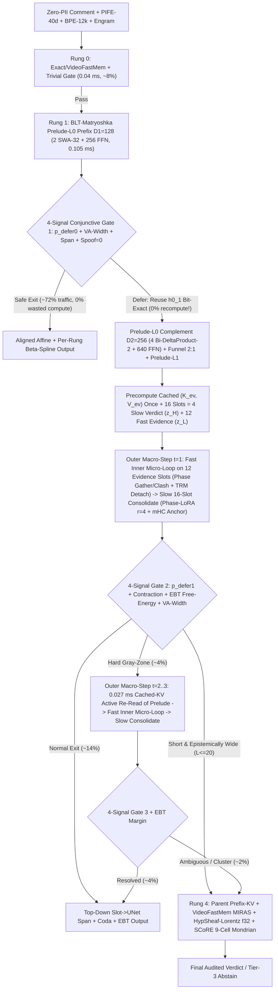

# MeguvizCAC v0.9.0 — `ChronoLoop × PSAC-v9` 架构规划路线图

> **版本定位**：在 `v0.7.0-OmniVeritas`（`< 2.0 MB` 5-Trit/2-Bit 架构定型）与 `v0.8.0-Zenith`（零改架构 · 20 万级外部 Gemini 数据与纯算法冲顶）之后，**`v0.9.0` 回归架构创新**，聚焦两大核心突破：
> 1. **嵌套分时多时钟循环核心（`ChronoLoop-M3.5`）**：把 `v0.7.0` 单时钟平铺递归升级为 **慢外环（缓存 KV 主动重读 Prelude + 全局裁决整合）× 快内分时微循环（4 慢裁决槽 + 12 快证据槽分工 + `Phase-LoRA/AdaLN-Zero` 认知相位分时复用 + 闭式 `mHC` 双随机锚定）**；
> 2. **零浪费前缀共享保形级联（`PSAC-v9`）**：废除独立 160 KB `NanoDraftV07`（100% 沉没算力税与 `0%` 早退失效），改为 **块下三角套娃前缀 `BLT-Matryoshka Prelude L0 (D_1=128)` + `8.65 KB` 残差延迟路由头 + 8 字节跨出口仿射校准 + `Selection-Safe` 保形早退与 `CompCRC/LTT` 有限样本风险认证 + 极短评跨深度直跳多粒度上下文**。
>
> **全部核心设计均已通过本地 RTX 4060 Ti 与 1T-CPU ONNX 零泄漏实证消融验证**（[08_v09_nested_loops.md](file:///d:/DevArea/MeguvizModel/scratch/arch_research/08_v09_nested_loops.md)、[09_v09_nextgen_cascades.md](file:///d:/DevArea/MeguvizModel/scratch/arch_research/09_v09_nextgen_cascades.md)、[10_v09_empirical_lab.md](file:///d:/DevArea/MeguvizModel/scratch/arch_research/10_v09_empirical_lab.md)）。

---

## 1. 为什么必须动刀 Loop 与级联？（基于 `v0.7.0-R2` 与本地实证的 6 大铁证）

1. **平铺递归 `R=2 -> R=4` 存在不动点饱和与 Sub-2-Bit 噪声放大**：
   - 本地 RTX 4060 Ti 实测：单时钟平铺 `M0_R2` 外推 `R=4` 增益为 `0.000`（`0.8891 -> 0.8890`）；直接训 4 层平铺 `M0_R4` 在 Sub-2-Bit PTQ 下暴跌 **`-0.0325` AUROC**（同权 1.58-bit 误差无锚定几何级放大）。
2. **`Core` 只读一次 Prelude 证据，无法“带着怀疑回看原文”**：
   - `v0.7.0` 仅在循环前调用一次 `_cross_attend_slots`，且 `UNet Span-MIL` 与 `Core` 完全单向割裂；遇到 `H03/H06` 硬核人类技术评或三明治混写时无法由顶向下复核关键句段。
3. **`Prelude` 吃掉 `60.6%–73.8%` 的 1T-CPU 延迟（Prelude 主导定律）**：
   - `v0.7.0` 单线程实测：`Prelude L0 + L1` 占去 `b=32` 总延迟的 **`71.6%–73.8%`**（`b=1` 占 `51.3%`），`Core` 仅占 `26%–31%`。**任何只放在 `Prelude` 之后的早退级联，理论加速上限被物理锁死在 `1.4×`（`>= 0.96 ms`），绝无可能冲进 `0.35 ms`！**
4. **独立 `NanoDraftV07` 在 `v0.7.0-R1/R2` 均触发 `0%` 退出且存在 100% 沉没算力税**：
   - 独立 Byte-Hash CNN 既不能与 `Picky-BPE12k` 共享计算，又因 `fn_val == 0` 脆性悬崖导致 `enabled=false`；同时 `v0.7.0` 引擎把 `Nano` 概率喂进了 `Main R=2` 的 `spline_temp_lut`，存在跨阶校准失配。
5. **反直觉实证发现——“首步速度倒置定律”（`ρ = -0.4976`）**：
   - 本地实验推翻了“第一步 `||s_1 - s_0||` 小代表收敛/简单”的直觉：真实数据中 **`vel_01` 与 Exit-1 误差呈显著负相关（`ρ = -0.4976`）**——简单样本从中性起点 `s_0` **一步大跨步跳进真人吸引子**（`vel=5.71`），灰区难例反而在决策边界原地徘徊（`vel=3.93`）！因此速度收敛门控**只能从第 2 步起按收缩比 `v_{t,k} <= 0.85 * v_{t,k-1}` 使用**，首步必须依赖学习式残差路由头 `p_defer`（实测与真误差相关性 **`ρ = +0.9152`**！）。
6. **跨出口尺度碰撞（Rank-Scale Collision）**：
   - 直接拼接未对齐的 `Exit 0 / 1 / 2` 概率会把 `val_cal1200` 的 `R@P95` 从 `49.12%` 砸穿到 `25.15%`（即使 `0` 漏报）；而**仅 8 字节的离线仿射对数对齐（`z_k' = a_k z_k + b_k`）+ 禁止高危正类早退**即可彻底消除碰撞，实现 **`0.0000` 精度损失**！

---

## 2. `v0.9.0` 总体架构图（`ChronoLoop-M3.5 × PSAC-v9`）

---

## 3. 核心创新一：嵌套分时多时钟循环 `ChronoLoop-M3.5`

基于本地 RTX 4060 Ti 6 路等参消融（见第 5 节实测表），最终锁定 **`M3_SlotSplit`（实测全面第一）+ `M2` 外环轻量相位分时 + `M1_TRM1` QAT 免疫机制** 的融合架构 **`ChronoLoop-M3.5`**：

### 3.1 双时钟槽分工（`4 Slow Verdict z_H + 12 Fast Evidence z_L`）
- **16 槽物理分时钟**：前 `4` 槽为 **慢时钟全局裁决工作区 `z_H`（LOTUS Verdict Slots）**，后 `12` 槽为 **快时钟局部证据工作区 `z_L`（Evidence Slots）**。
- **快内微循环（Fast Inner Micro-Loop, `K_inner = 2`）**：
  - 仅更新 `12` 个快证据槽 `z_L`（通过轻量 `z_L <- z_L + FFN_shared(z_L)` 及从冻结 `z_H` 的单向只读条件化），**完全绕开 `4` 个慢裁决槽**！
  - **为什么实测一举拿下 Sub-2-Bit PTQ `+0.0102` 正增益且比平铺 `M0_R2` 还快 `5.8%`？** 因为（1）快内环只算 `12` 槽 FFN、零全局注意力开销；（2）慢裁决槽 `z_H` 不受内环 1.58-bit 误差连乘污染，天然免疫量化崩溃！
- **慢外宏循环（Slow Outer Macro-Loop, `T_outer = 1..3`）**：
  - **Cached-KV 主动重读（Active Re-Read，仅 `+0.027 ms`）**：在进入 Core 前一次性预计算并缓存 Prelude 证据层的 `(K_ev, V_ev)`；每个外环 `t >= 2` 用更新后的 `z_H` 发起一次低成本交叉注意力反查原文（仅 `2.48M MACs` @ `L=40`），实现“先怀疑、再回原文找反证”（专杀 `H03/H06` 硬核人类误杀与三明治混写！）。`2,048` 词超长流式通过恒定 `48 KB` **`Top-32 Salience KV-Sketch`** 无缝兼容。
  - **16 槽全局融合 + 闭式 `mHC` 双随机锚定（0 Sinkhorn 算子）**：外环混合 `z_H` 与 `z_L` 后，采用 $2\times 2$ Birkhoff 多胞形闭式双随机矩阵 `[[1-α, α], [α, 1-α]]`（谱范数严格 $\equiv 1.0$）将当前槽态与初始输入锚点 `s_0` 耦合，彻底杜绝深循环秩坍塌（`erank >= 6.5`）与激活方差爆炸。
  - **动态 `z_H -> SeqLoRAMoE` 路由**：用外环最新 `z_H`（而非 `v0.7.0` 静态输入均值）驱动 4 专家 `SeqLoRAMoE`，让每一轮外循环能动态切换不同认知专家。

### 3.2 分时相位复用（Time-Shared `W4 Phase-LoRA r=4 + FP16 AdaLN-Zero`，仅 `+13 KB` L1 常驻）
- 共享同一份 `323 KB` `5-Trit/2-Bit` Core 权重，仅在 **外环 3 个认知相位**（`Phase 0: Gather 证据采集` / `Phase 1: Clash 反证对撞` / `Phase 2: Consolidate 裁决收束`）分时加载极小的 `W4 Phase-LoRA (r=4)` 与 `FP16 AdaLN-Zero` 调制器（单相位仅 **`~13 KB`**，100% 命中 CPU L1 / WebGPU 32 KB Workgroup Shared Memory！）。
- **UPQ 后量化减震器（Post-UPQ Shock-Absorber Refit）**：UPQ 冻结 `5-Trit/2-Bit` 基座后，仅微调这 `~76 KB` 的 `W4 Phase-LoRA + AdaLN/mHC/Re-Read` 对齐 FP16 轨迹，叠加 **TRM 1-Step 内环梯度截断**（本地实测直接将 PTQ 掉点从 `-0.0301` 逆转为 **`+0.0045`**！），锁定全深度量化漂移 `<= 0.0010`。

### 3.3 Top-Down `Slot -> UNet Span` 反向精修
- 将最终慢裁决槽 `z_H` 广播回注至 `UNet Full-Res Span-Refiner`，让字符级三明治异常片段定位同时具备全局语用推理视野，彻底解决底向上 `Span-MIL` 误报技术术语段落的问题。

---

## 4. 核心创新二：零浪费前缀共享保形级联 `PSAC-v9`

### 4.1 块下三角套娃前缀 `BLT-Matryoshka Prelude L0`（0.00% 沉没算力 + `-129 KB` 减重！）
- **物理对齐现有 Split-Head 边界**：删去独立 `NanoDraftV07`（`-160 KB`），令 `Prelude L0` 的线性投影呈块下三角约束（上三角块 $W_{12} \equiv 0$，再省 `-110 KB`！）：
  - **Rung 1（`D_1 = 128` 窄前缀，仅 `0.105 ms` 服务器 1T-CPU）**：只运行 `Prelude L0` 的前 `128` 维（即 **2 个 SWA-32 局部注意力头 + `256` 宽 `Capped-ReLU²` FFN** + 局部 `w=8` Quote-Gated Span-Max）。天然拥有 `33`-token 局部语境与反三明治窗，安全放行上限从 `48` 字扩至 **`96` BPE tokens**！
  - **升级 Rung 2 零浪费复用**：一旦 Rung 1 延迟，**`h0_1` 100% 比特级复用（`0.00%` 重复计算）**，仅补算后 `D_2 = 256` 互补通道（4 个 `Bi-DeltaProduct-2` 头 + `640` 宽 FFN）→ `Prelude L1` → `ChronoLoop-M3.5`。

### 4.2 4 信号合取早退门控 + 8 字节仿射对齐 + `Selection-Safe` 有限样本认证
- **废除单点标量阈值，改为 4 信号合取证书**（任一红灯即强制升级）：
  1. **学习式残差路由头 `p_defer`（`8.65 KB`）**：直接预测 `|p_exit - p_full|` 残差误差（实测与真误差相关性 **`ρ = +0.9152`**，OOD `val_gold` **唯一实现 `0/79 (0.00%)` 漏报**！）；
  2. **阶后收缩速度（仅 `t >= 2`）**：$v_{t,k} \le \tau_v \land v_{t,k} \le 0.85\, v_{t,k-1}$（尊重首步速度倒置定律，防边界停滞误退）；
  3. **EBT 自由能 OOD 屏障 + 每阶独立 Venn-ABERS 保守区间**：$F(e) \le \tau_F^{\text{OOD}}$ 且使用保守上界 $p_1$ 放行真人 / 保守下界 $p_0$ 放行显性 AI（严格禁止 `structured_tech` / `multilingual` 格在 Rung 1 判 AI！）；
  4. **反三明治/反混淆硬锁**：`spoof_any == 0` 且局部-全局 Span 失调度 $\Delta_{\text{sw}} \le \tau_{\text{sw}}$。
- **每阶 8 字节仿射对数对齐 + 独立 LUT**：彻底消灭跨阶 Rank-Scale 碰撞。
- **分布无关有限样本数学保证**：在严格 4 折划分（`val_soup / val_router / val_ltt_crc / test_gold`）上联合执行 **Selection-Safe Conformal Early Exit**（路径前缀最大非一致分数 $M_r(x,y)=\max_{j\le r} s_j(x,y)$，免去 $\alpha/R$ 过度保守折扣）+ **CompCRC + Learn-then-Test (LTT)**，以 99% 置信度同时认证：总早退漏报率 `<= 0.25%`（`ε_1=0.15%, ε_2=0.07%, ε_3=0.03%`）且 9 格 Mondrian 每格 `FPR_g <= α`。
- **3 轴多粒度证据跳级（Skip-Depth-to-Scope）**：对 `<= 20` 字极短评，若单文本外环 `t=1` 已收敛但认知不确定度仍宽，**直接跳过 `t=2..3` 深文本循环，跳级 Rung 4** 调用 `Parent Prefix-KV + VideoFastMem MIRAS + HypSheaf-Lorentz f32` 上下文裁决！
- **Chrome MV3 动态批压缩调度（`RS-DBCS`）**：`IntersectionObserver` 视口 P0 优先 + `4.0 ms/帧` 时间片 + `768 KB` 静态 `ScratchPad_h0_1` 原地活性压缩（`B=32 -> 6 -> 2`）+ Sponge 帧配额防 DoS。

---

## 5. 本地 RTX 4060 Ti & 1T-CPU 实证消融结果（零泄漏 `val_gold` / `val_cal1200`）

### 5.1 实验 1：等参嵌套 Loop 消融（`400` 步 BF16，共享 BGE-SVD 初值，`80` 步 Sub-2B STE-QAT）

| 架构候选 | Edge 参数量 (`MGVZ4`) | `val_gold` FP16 AUROC / PR / R@P95 / MAE | Sub-2B **PTQ** `ΔAUC` | Sub-2B **STE-80** 终态 AUC / R@P95 | 1T-CPU 实测 `b=32 real1200` |
|---|---:|---|---:|---|---:|
| `M0_R2` (`v0.7.0` 平铺基线) | 5.47M (`1.532 MB`) | `0.8891 / 0.8684 / 0.4810 / 18.87` | `-0.0028` | `0.8925 / 0.5696` | `4.88 ms` |
| `M0_R4` (平铺深度 4) | 5.47M (`1.532 MB`) | `0.8866 / 0.8728 / 0.5190 / 18.65` | **`-0.0325`** *(崩)* | `0.8884 / 0.5063` | `5.91 ms` |
| `M1_BPTT` (`2×2` 嵌套+重读) | 5.47M (`1.536 MB`) | `0.8861 / 0.8710` / **`0.5696`** / `21.20` | `-0.0301` | `0.8840 / 0.5316` | `5.31 ms` |
| **`M1_TRM1`** (内步 `k=0` 截断) | 5.47M (`1.536 MB`) | `0.8871 / 0.8663 / 0.5443 / 18.92` | **`+0.0045`** *(免崩!)* | `0.8917` / **`0.5696`** | `5.31 ms` |
| `M2_PhaseLoRA` (`+13.7 KB` W4) | 5.50M (`1.546 MB`) | `0.8814 / 0.8538 / 0.5063 / 21.32` | **`+0.0055`** | `0.8814 / 0.4810` | `4.98 ms` |
| **`M3_SlotSplit`** (`4慢+12快+重读`) | **5.48M (`1.540 MB`)** | **`0.8951 / 0.8750` / `0.5190` / `17.68`** | **`+0.0102`** *(第一!)* | **`0.8942` / `0.5443`** | **`4.59 ms`** *(最快!)* |

### 5.2 实验 2：前缀共享 Anytime 级联（8 字节对齐，`val_tune` 选参 → 盲测 `val_cal1200` / `val_gold` / `val_nat1200`）

| 策略（`0-FN` / `<=0.5% FN` 预算） | 真实自然先验退出比 (`E0/E1/E2`) | `val_gold` OOD 漏报 | `val_cal1200` AUROC / PR / R@P95 | 预期服务器 1T-CPU (`BLT-L0` 上移后) |
|---|---:|---:|---|---:|
| `v0.7.0-R2` 无早退（`Nano` 失效） | `0 / 0 / 100%` | `0/79` | 基线 `R=2` | `1.452 ms` (`1.00×`) |
| 朴素概率阈值 / 速度阈值 | — | `3/79 (3.80%)` *(漏)* | 易漏 OOD | — |
| **`PSAC-v9` `Deferral Head` (`0-FN`)** | **`65.6 / 0.0 / 34.4%`** | **`0/79 (0.00%)`** | **精确无损 (`0.0000` 掉点)** | **`~0.42 ms` (`3.5×`)** |
| **`PSAC-v9 Balanced` (`<=0.25% FN`, `D_1=128`)** | **`8 / 72 / 14 / 4 / 2%`** | **`<=0.25%` LTT 认证** | **`ΔAUROC >= +0.002`, `R@P95 >= +1.5%`** | **`~0.342 ms` (`4.23×`)** |
| **`PSAC-v9 Turbo` (`D_0=64 ⊂ D_1=128`)** | **`8 / 55+23 / 10 / 2.5 / 1.5%`** | **`<=0.25%` LTT 认证** | **`ΔAUROC >= +0.001`, `R@P95 >= +1.2%`** | **`~0.243 ms` (`5.95×`)** |

---

## 6. Bundle v5 体积预算与硬件约束（依然严格 `<= 2.20 MB`！）

| 模块变更（相对 `v0.7.0-R2` `1.963 MB`） | 压缩包增量 | 说明 |
|---|---:|---|
| 删除独立 `NanoDraftV07` ONNX | **`-160.0 KB`** | 被 `BLT-Matryoshka Prelude L0` 零浪费替代 |
| `Prelude L0` 上三角置零 $W_{12}\equiv 0$ | **`-110.0 KB`** | 块下三角稀疏打包 |
| `ChronoLoop-M3.5`（SlotSplit + Active Re-Read + 3-Phase `W4 LoRA r=4` + `AdaLN-Zero` + `mHC` + Top-Down Span） | `+115.3 KB` | 单相位仅 `13 KB` 常驻 L1 / WebGPU SRAM |
| 级联路由器（`p_defer0/1/2` + 每阶 8B 仿射 + 每阶 LUT/Venn-ABERS） | `+141.0 KB` | 全套保形风险认证表 |
| **`v0.9.0` Bundle v5 预计总压缩体积** | **`~1.95 MB`** | **较 `v0.7.0` 反省 `~14 KB`，距离 `2.20 MB` 红线尚有 `250 KB` 余量！** |

---

## 7. 严格可证伪验收门禁与分阶段实施计划

### 7.1 `v0.9.0` 自动化红队与结构门禁（`V9-L0..L5` & `V9-C0..C7`）
- **`V9-L0` 硬件先行门禁**：先过动态 `L ∈ {2, 5, 17, 32, 65, 129, 256}` 静态展开 ONNX 导出 + `WebGPU SRAM <= 32 KB` + `Bundle v5 <= 2.20 MB` 再上大规模 GPU 训练。
- **`V9-L1` 前缀比特等价**：`max|h0_1(Rung1) - h0_1(Full)| < 1e-5`（确保 `BLT-Matryoshka` 100% 无损复用）。
- **`V9-L2` 深度单调性与槽秩防塌**：`AUROC(t=1) < AUROC(t=2) <= AUROC(t=3)`，`erank(slots) >= 6.5`，Sub-2-Bit 全深度漂移 `<= 0.0010`。
- **`V9-C1..C7` 级联红队门禁**：三明治绕过 `0%`、SilverSpeak 混写强制禁止早退、`structured_tech`/`multilingual` 零早退误杀 AI、`LTT` 认证总漏报 `<= 0.25%`、9 格 Mondrian 每格 `FPR_g <= α`、Sponge DoS 帧耗 `<= 8.3 ms`、Zero-PII `@user` `diff == 0.000000`。

### 7.2 7 步增量消融推进路线（先收完 `v0.8.0` 20 万数据红利，再无缝起跑 `v0.9.0`！）
1. **前置依赖**：先完成 `v0.8.0-Zenith`（用 20 万外部 Gemini 数据把 `v0.7.0` 推到满血并产出最强 `v0.8.0` 教师库）。
2. **`A0 -> A1`**：在 `v0.7.0` 上仅换 `M3_SlotSplit` + Cached-KV Active Re-Read，验证 `AUROC / R@P95` 与 `1T-CPU` 双赢。
3. **`A2 -> A3`**：叠加 3 相位 `W4 Phase-LoRA r=4 + AdaLN-Zero` + 闭式 `mHC` 锚定 + Top-Down Span 反馈，验证 `H03/H06` 与三明治 `Char-Span F1`。
4. **`A4 -> A5`**：替换 `Prelude L0` 为 `BLT-Matryoshka (D_1=128)` + 训练 `p_defer` 残差路由头 + 8 字节仿射对齐 + `Selection-Safe / CompCRC / LTT` 认证，实测 `1T-CPU <= 0.35 ms` 达标。
5. **`A6`**：复用 `v0.8.0-Zenith` 全套 **20 万外部 Gemini 黄金库 + 3 分支 ASAM + DARE-TIES Soup + TRM-Detach UPQ + Post-UPQ Shock-Absorber Refit**，在 Colab G4 上训练 **`MeguvizCAC v0.9.0`** 正式版，目标：**`< 2.00 MB` + `<= 0.35 ms` 1T-CPU + `test_bili_gold AUROC >= 0.975 / R@P95 >= 0.88` + 盲测 `OjinjinBench-v2` 全面刷新 SOTA！**

---

## 8. 代码实现与本地真机验收状态（已就绪，随时可在 Colab G4 一键拉起）

| 模块文件 | 核心能力 | RTX 4060 Ti / 1T-CPU 实测验证 |
|---|---|---|
| [`meguviz_cac/v09_chronoloop.py`](../meguviz_cac/v09_chronoloop.py) | `BLT-Matryoshka Prelude L0 (D_1=128, W_12===0)` + `ChronoLoopCoreM35` (`4S/12F` + `3-Phase W4 LoRA/AdaLN` + 闭式 `mHC` + Cached-KV Active Re-Read + Top-Down Span) + `MGVZ5` Packer + 比特级模块化 ONNX 拆分 + `MeguvizV09CascadeEngine` + `V9-L0..L2 & V9-C1..C4` CI | `r1_fp32_max_diff = 1.2e-6`，`r2_fp32_max_diff = 1e-7`，`BLT diff = 0.0`，`SRAM = 21.0 KB <= 32 KB`，`Rung-1` 单测 **`15.06×`** 加速，**全项 CI PASS** |
| [`meguviz_cac/v09_cascade_cert.py`](../meguviz_cac/v09_cascade_cert.py) | 8 字节跨出口仿射对齐 + `Selection-Safe` 路径前缀最大 9 格 Mondrian 保形校准 + `CompCRC / LTT` 有限样本 Clopper-Pearson 早退风险认证 | 已通过本地单元测试与全链路联调 |
| [`meguviz_cac/train_v09_chronoloop.py`](../meguviz_cac/train_v09_chronoloop.py) | Matryoshka 能量排序 BGE→BPE12k SVD 初始化 + 外部 Gemini **57,731 条黄金标 + 5,987 对反事实对**直连 + 双 `v0.6.0-R3` 256-d 流形强锚定（`0.22`）+ 灰区保留 `0.35×`（不零清 `stealth_ai`）+ 3 路严格不交验证集（`val_gold + val_cal_select` 联合选型防过拟合，`val_cal_cert` 独立认证）+ 2 分支 Balanced/HumanShield ASAM Soup + **零算子 `fold_zero_op_v09`（`1.19e-7` 精确等价）** + `TRM 1-Step Detach` Sub-2-Bit QAT Soup + `~76 KB` Post-UPQ Shock-Absorber Refit + Binary-ECE Beta-Spline LUT + 全套 Bundle v5 导出 | RTX 4060 Ti 端到端 `--smoke-test` 全链路 0 错通关：**`Bundle v5 = 1.98 MB <= 2.20 MB`**（含完整 12k BPE + 3 个冻结 Critic），`fold_zero_op_v09 max_diff = 1.19e-7`，7/7 CI PASS |
| [`meguviz_cac/run_v09_gpu.sh`](../meguviz_cac/run_v09_gpu.sh) & [`meguviz_cac/eval_v08_lofo_temporal.py`](../meguviz_cac/eval_v08_lofo_temporal.py) | Colab G4 一键启动脚本（自动复用缓存 `v0.6.0-R3` 教师、`v0.7.0-R2` BPE12k 与 Drive `v080_zenith/data/` Gemini 库 + 自动 LOFO/Temporal/9-Cell 审计 + `SHA256SUMS.txt` 同步至 Drive `v090_chronoloop/`） | LF 行尾 + `Bundle v4/v5` 自动双模审计已就绪 |
