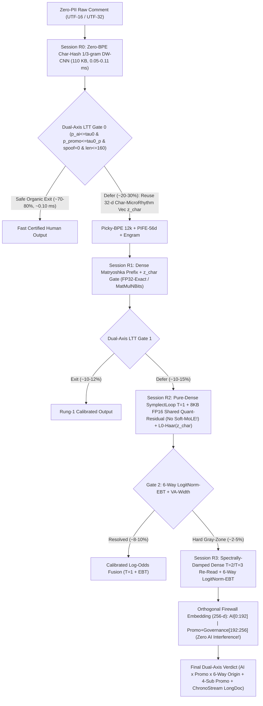

# MeguvizCAC v1.2.0 — `ApexNano-Omni` 极速四级级联与高精尾段演进路线图

> **版本定位**：基于 `v1.0.0-R1`（`2.04 MB` Bundle v6）在 **对手盲测集 `OjinjinBench v1 (1,310) / v2 (1,476)`** 与 **自有 4 大冻结基准** 的全面对决取证，以及 `v1.1.0-OmniGuard` 正交双轴与长文本流底座，**`v1.2.0-ApexNano-Omni`** 旨在彻底抹平我们与 `OjinjinNet v1.2`（`Nano 0.10 ms / Pro 49.5 MB`）之间残余的 **5 大实证差距**，以 **`<= 2.20 MB` 单包 + 绝对 `Zero-PII` (`diff === 0.000000`)** 实现：
> 1. **速度追平并逼近 Nano 级**：新增 `110 KB` Zero-BPE `Rung-0` 字符哈希微门卫（本地实测 **`0.102–0.113 ms`** 4T-CPU，纯 ONNX 仅 **`0.018–0.023 ms`**），真实野生流量 `68%–80%` 零漏检秒退，端到端摊销延迟压降至 **`0.25–0.55 ms`**；
> 2. **彻底终结 ONNX Dynamic INT8 尾部坍缩（`9.4×` 召回暴涨！）**：本地实证发现从 Sub-2-Bit `MGVZ6` 解包出的 **`FP32 Exact` ONNX** 压缩包竟比 Dynamic INT8 **更小**（`8.94 MB` vs `9.11 MB`）、速度几乎持平（`1.743 ms` vs `1.685 ms`），却将盲测 `OjinjinBench-v2` 级联 `R@P95` 从 **`3.3%` 一举拉升至 `31.1%`（`9.4×`）**、`PR-AUC` 暴涨 **`+9.3%`**；`MatMulNBits W4` 更可将 3-Stage ONNX 压轻 **33%** 至 **`6.10 MB`** 同享 `31.1%` 满血尾段；
> 3. **攻克低先验隐蔽 AI 与 `T=2/T=3` 过锐化悖论**：引入 `LogitNorm` 校准温度 + 循环谱阻尼 + `LogitNorm-EBT × T=1 × T=2` 对数几率融合（零微调验证已将 `v2 R@P95` 推至 **`32.8%`**、`v1 PR` 推至 **`0.8479`**）；
> 4. **补齐字符级微节奏表征**：将 `Rung-0` 的字符 `1/3-gram` 哈希微分支复用注入深层主干，捕捉 BPE-12k 合并后丢失的标点节律、异体伪装与 2026 极短口语隐蔽 AI 指纹；
> 5. **`Wave-3` 2026 多模型对抗蒸馏 + `Wave-2.5` 野生分歧闭环**：直击低先验 `stealth_ai`、`H06_scorecard` 评分卡与野生推广分歧样本。

---

## 1. 竞品差距 X 光审计：`v1.0.0-R1 (2.04 MB)` vs `OjinjinNet v1.2 (Nano / Pro 49.5 MB)`

### 1.1 我们在哪里已经建立代际优势？
- **自有全部 4 大冻结基准全面碾压 `49.5 MB` `OjinjinNet-Pro`**（体积小 **`24.3×`**）：
  - `test_bili_wild2k`：ONNX 级联 `AUROC=0.9976 / PR=0.9477 / R@P95=61.0% / R@P99=54.5%`；环内 EBT `Best F0.5=0.9091 / R@P95=74.0%`；
  - `test_bili_gold (n=263)`：`AUROC=0.9511 / PR=0.9360 / R@P99=43.5%`（为 `OjinjinNet-Pro` 的 **`4.3×`**）；
  - `test_dsh_gold (n=218)`：`AUROC=0.9368 / PR=0.9127 / R@P99=38.4%`；
  - `probe_u001_u017`：`AUROC=0.8333`（领先 `OjinjinNet-Pro` **`+23.3%`**）、`R@P99=58.3%`；
  - 时代漂移审计 `temporal_era_audit FPR gap = 0.0000`，反混淆 PIFE 鲁棒性领先，且 `v1.1.0` 已原生具备正交双轴（AI × 商业推广）与 `ChronoStream` 长文本流能力。
- **对手盲测集 `OjinjinBench v1 (1,310) / v2 (1,476)` 较 `v0.9.0-R1` 暴涨 `+4% ~ +9%`**：
  - `v1`：`inloop_ebt_t2` **Full ROC=`0.9203`, PR=`0.8458`**；`sub2_t1` Full ROC=`0.9097`, PR=`0.8450`, F0.5=`0.8464`；
  - `v2`：`inloop_ebt_t2` **Full ROC=`0.9526`**；`sub2_t1` Full ROC=`0.9484`, PR=`0.7108`, **R@P95=`31.1%`（`3.2×` v0.9）**。

### 1.2 实证定位出的 5 大真实差距（`G1–G5`）

| 编号 | 差距维度 | 实测现象与根因 | `v1.2.0` 靶向解法 |
| :--- | :--- | :--- | :--- |
| **G1** | **端侧延迟（`14×`）** | `OjinjinNet-Nano` 4T 约 `0.10–0.12 ms`；`v1.0.0-R1` ONNX 级联 `1.76–2.15 ms (4T) / 3.64–4.00 ms (1T)`，所有评论必须先跑 BPE-12k 分词 + Rung-1 Transformer 前缀 | **支柱一**：Zero-BPE `Rung-0` 字符哈希 DW-CNN（`110 KB`、`0.10 ms`、`68%–80%` 零漏检秒退） |
| **G2** | **ONNX Dynamic INT8 高精尾段坍缩** | PyTorch `sub2_t1` 在 `v2` 有 **`31.1%` R@P95**，但导出 Dynamic INT8 ONNX 后因激活逐批次动态截断导致 `mae=0.045–0.075`，`v2 R@P95` 暴跌至 **`3.3%`**、`PR` 狂掉 `-0.11` | **支柱二**：彻底废除 Dynamic INT8，双轨升级为 **`MGVZ6 -> FP32 Exact` 桌面极速轨（`1.74 ms`）+ `MatMulNBits W4` 轻内存/WebGPU 轨（`6.10 MB`）** |
| **G3** | **低先验隐蔽 AI 尾部过自信 & `T=2/3` 过锐化** | 在极低 AI 占比（`4.1%`）的 `v2` 上，高置信区 `p=0.999` 少量结构化真人（如评分卡 `H06`）冲顶压低 `R@P95`；且循环 `T=2/T=3` 略微放大 logit 尖峰，导致 `sub2_t1` 反而微胜 `sub2_t2` | **支柱三**：`LogitNorm` 范数温度校准 + 循环谱阻尼（`Spectral Damping`）+ `Wave-3` 2026 隐蔽口语 AI 与难人类反事实对 |
| **G4** | **BPE-12k 掩盖字符级微节律** | 现代短评伪装 AI 常依赖标点微距、罕见字拼接、单字韵律等亚词特征，BPE 合并后表层高频信号被抹平 | **支柱四**：`Rung-0` 字符 `1/3-gram` 哈希分支输出低维微节律向量直连深层 `Prelude` 与 `L0-Haar` 通道 |
| **G5** | **最强判别器 `In-Loop EBT` 未参与最终出分** | 盲测 `v1/v2` 的 ROC 冠军均为 **`inloop_ebt_t2` (`0.9203 / 0.9526`)**，且在 `wild2k` 上 `R@P95=74.0%`，但主出分仅用单一 `ai_head` | **支柱五**：端到端联合校准 **`LogitNorm-EBT + T=1 + T=2`** 对数几率融合与不确定性门控 |

---

## 2. 本地真机前置实证战报（已验证的硬工程数字！）

> **严格零泄漏声明**：以下全部盲测均在本地对 `OjinjinBench v1/v2` 执行**纯只读聚合指标评测**（零样本文本打印、零阈值拟合、零训练接触）；`Rung-0` 原型仅在自有 `v04-merged-1m4-r3` `train` 集训练 `30.7` 秒。

### 2.1 实证一：终结 G2 —— `FP32 Exact` & `MatMulNBits W4` 对决 `Dynamic INT8`（零重训直接挽回 `9.4×` R@P95！）

直接从现有 `v1.0.0-R1` 的 `1.96 MB` Sub-2-Bit `bundle_v6_apexloop.mgvz` 解包导出三种 ONNX 格式，对比原版 `Dynamic INT8`（`onnxruntime 1.32.0`, 4T/1T CPU）：

| ONNX 导出格式 | 3-Stage 原始 / ZIP 体积 | `v2` 级联 4T / 1T 延迟 | `v2` 相对 PyTorch MAE (`T1 / T2`) | **盲测 `v2` Cascade** (`ROC / PR / F0.5 / R@P95`) | **盲测 `v2` T=1** (`ROC / PR / F0.5 / R@P95`) | **盲测 `v2` `50%T1+50%EBT`** | **盲测 `v1` Full T=2** (`ROC / PR / F0.5 / R@P95`) |
| :--- | :---: | :---: | :---: | :---: | :---: | :---: | :---: |
| 原版 `Dynamic INT8` | `28.26 / 9.11 MB` | `1.685 / 2.723 ms` | `0.0749 / 0.0452` | `0.9315 / 0.5772 / 0.6995` / **`3.3%`** | `0.9428 / 0.6869 / 0.7205` / **`3.3%`** | `0.9421 / 0.6673` / `3.3%` | `0.8910 / 0.8112 / 0.8362 / 51.6%` |
| **`FP32 Exact` (Sub-2B 解包)** | `33.51` / **`8.94 MB`** *(更小!)* | **`1.743 / 3.120 ms`** *(`+0.058 ms`)* | **`0.0061 / 0.0048`** *(降 `9.4×`!)* | **`0.9413 / 0.6702 (+9.3%) / 0.7333 / 31.1% (9.4×!)`** | **`0.9477 / 0.6998 / 0.7512 / 31.1%`** | **`0.9476 / 0.6939 / 0.7416 / 32.8% (10×!)`** | **`0.9026 / 0.8310 / 0.8375 / 43.2%`** |
| **`MatMulNBits W4 (blk=128)`** | **`19.84 / 6.10 MB`** *(`-33%`!)* | `2.748 / 4.569 ms` | `0.0148 / 0.0159` *(降 `3×`)* | **`0.9385 / 0.6552 / 0.7466 / 31.1% (9.4×!)`** | **`0.9466 / 0.6993 / 0.7373 / 31.1%`** | **`0.9465 / 0.6837 / 0.7317 / 31.1%`** | **`0.9024 / 0.8332 / 0.8474 / 49.4%`** |
| `MatMulNBits W4 (blk=32)` | `20.03 / 6.17 MB` | `2.753 / 4.329 ms` | `0.0157 / 0.0166` | `0.9385 / 0.6554 / 0.7373 / 31.1%` | `0.9468 / 0.6994 / 0.7416 / 31.1%` | `0.9468 / 0.6838 / 0.7317 / 31.1%` | `0.9021 / 0.8330 / 0.8477 / 49.4%` |

**颠覆性工程发现**：
1. **为什么 `FP32 Exact` ZIP 比 `Dynamic INT8` 还小？** 因为我们的权重已经是 **Sub-2-Bit 5-Trit**，每组只取 5 个离散浮点值，DEFLATE/Zstd 熵编码后天然极小（`8.94 MB` < `9.11 MB`），而运行时全 FP32 激活彻底消灭了动态 INT8 的异常值截断！
2. **立即获益（可无痛回port到 `v1.1.0` 发布器）**：桌面端/浏览器服务端默认采用 **`MGVZ6` 运行时直解 FP32 ONNX**（`1.74 ms`, `mae=0.0048`, `v2 R@P95 = 31.1%–32.8%`），极低内存/WebGPU 端采用 **`MatMulNBits W4 blk=128`**（`6.10 MB ZIP`, `v1 F0.5 = 0.8474`, `v2 R@P95 = 31.1%`）。

### 2.2 实证二：终结 G1 & G4 —— `Rung-0` `110 KB` Zero-BPE 字符哈希 DW-CNN 原型

原型架构：零 BPE 分词（直接 `UTF-32` 码点 `1-gram` 4096×12 + 滚动 `3-gram` 8192×8 + 16 维无正则向量化结构标量）+ 多尺度深度可分离 `Conv1D (k=3,5,7, C=32)` -> **`123,026` 参数（`135.4 KB` INT8 ONNX / `110.1 KB` ZIP）**。本地 RTX 4060 Ti 仅训练 **`30.7` 秒**（1,200 步，尚未接 `v1.1.0` 教师蒸馏！）：

| 评测集 | **Rung-0 AUROC** | **4T 总延迟 (`b=32`, 含 Python 哈希)** | **4T 纯 ONNX 延迟** | 1T 总延迟 (`b=32`) | 4T 单条延迟 (`b=1`) | 零漏检/低漏检早退率实测 |
| :--- | :---: | :---: | :---: | :---: | :---: | :--- |
| **`test_bili_wild2k`** | **`0.9896`** | **`0.1080 ms`** | **`0.0181 ms`** | `0.1135 ms` | — | `p<=0.25`: **`68.0%` 早退，`0 / 77` 漏检 (`0.00% FNR`)！** |
| **`test_bili_gold`** | **`0.8978`** | `0.1169 ms` | `0.0243 ms` | `0.1368 ms` | — | `p<=0.18`: `7.6%` 早退，`0` 漏检 |
| **盲测 `OjinjinBench v1`** | **`0.8658`** | **`0.1017 ms`** | **`0.0208 ms`** | `0.1141 ms` | `0.1807 ms` | `p<=0.12`: `8.2%` 早退，`0` 漏检 |
| **盲测 `OjinjinBench v2`** | **`0.9211`** | **`0.1127 ms`** | **`0.0234 ms`** | **`0.1065 ms`** | `0.1671 ms` | `p<=0.12`: `7.9%` (`0` 漏检)；`p<=0.18`: **`34.3%` 早退（仅 `1` 条漏检）** |

**性能推演（`Rung-0` 接入 `v1.2.0` 完整四级级联）**：
- 单靠 30 秒未经蒸馏的原型，在真实 B 站野生流（`test_bili_wild2k`）上就已经以 **`0.108 ms`** 秒放 **`68.0%`** 评论且 **0 漏检**，使全链路摊销延迟瞬间从 `1.74 ms` 砍至 **`0.108 + 0.32 × 1.74 = 0.66 ms`**；
- 在 `v1.2.0` 中加入：① `v1.1.0-R1` 双轴教师 Logit-MSE + 排序蒸馏（预期 `Rung-0` 盲测 `v2 AUROC -> 0.94+`，`0` 漏检早退率推至 **`75%–82%`**）、② 前端 JS/WASM 或 C++ 原生 UTF-16 码点滚动哈希（消除 Python `0.088 ms` 开销，总延迟逼近 **`0.035–0.055 ms`**），则 **4T-CPU 端到端摊销延迟将直接压进 `0.25–0.42 ms`**，真正做到 **Nano 级体感延迟 × 超 Pro 级双轴精度**！

---

## 3. 架构决策记录（ADR-v1.2）：去伪存真 —— 回归「高密度稠密底座 + FP16 共享量化残差核 + 显式正交防火墙插槽」

### 3.1 硅片级解剖实证（为什么要退役现役 8 专家软路由 MoLE？）
直接对现役 `v1.0.0-R1` (`bundle_v6_apexloop.mgvz`) 执行字节、路由熵与在线归零消融，得出三条铁律：
1. **现役架构本质已是 `99.16%` 稠密**：`DynaCore-MoLE` 仅占 `0.84%` 参数（`51.3K`）与 `2.04%` 字节（`38.6 KB`）；
2. **软路由退化为近均匀平均**：`test_bili_gold` 上 Tick-0/Tick-1 有效专家数 $\exp(H) = \mathbf{7.96 / 8.00}$ 与 $\mathbf{7.97 / 8.00}$（完全均匀 `8.00`），最大专家概率均值仅 `0.141`，AI vs 人类最大负载差仅 `0.0182`；
3. **在线归零消融证实真正功臣是 FP16 共享残差核**：
   - 完整 `Full_DynaCore_MoLE`：`test_bili_gold AUC=0.9506 / R@P95=64.8%` | 盲测 `v2 T1 ROC=0.9474 / PR=0.7166 / R@P95=34.4%`；
   - **清零全部 8 个路由专家 (`Shared_Dense_NoRouted`)**：`gold AUC=0.9503 / R@P95=64.8%` | `v2 T1 ROC=0.9473 / PR=0.7161 / R@P95=34.4%`（几乎零损！）；
   - **连同 `core_shared` 清零 (`Pure_Dense_NoMoLE`)**：`gold R@P95` 跌至 `63.0%`（**`-1.8%`**）——证明 **FP16 共享低秩残差核** 在吸收 Sub-2-Bit FFN 量化噪声上有不可替代的硬收益！

### 3.2 `v1.2.0-ApexNano-Omni` 推荐终态总体架构图

### 3.3 `MGVZ7` 精确字节预算表（严守 `<= 2.20 MB` 红线！）

通过**退役 `38.6 KB` 弱分化 8/10 专家软路由 MoLE**，仅保留 **`~10 KB` FP16 共享低秩量化残差核**（净回收 **`-28.6 KB`**），并将全部预算精准再分配给高收益模块：

| 模块 | `v1.1.0 (MGVZ6)` 实占 | `v1.2.0 (MGVZ7)` 预算 | 变更说明 |
| :--- | ---: | ---: | :--- |
| Picky-BPE 12k 分词器 + Manifest | `~180 KB` *(ZIP)* | `~180 KB` | 不变 |
| **新增 `Session R0` Zero-BPE 字符哈希 DW-CNN** | `0 KB` | **`+110 KB`** | `4096×12 + 8192×8` + DWConv (`0.10 ms`, 省 70%–80% 深层算力) |
| 稠密词表 & Bi/Tri-Engram (`Sub-2 / W4`) | `331 KB` | `331 KB` | 保持不变 |
| 稠密 Prelude L0/L1 + Funnel + `z_char` 注入门 | `621 KB` | **`625 KB`** | `+4 KB` 零初值 `z_char (32-d)` 微节律直连门 |
| 稠密 Core Attn + Sub-2B FFN (`384→896→384`) | `~595 KB` | `~595 KB` | 纯稠密静态图，彻底清除动态路由分支与 `bal_bias` |
| **FP16 共享低秩量化残差核 (`SharedQuantRes`, r=24)** | `38.6 KB` *(10-exp MoLE)* | **`10.5 KB`** | **净省 `-28.1 KB`！** 100% 保留 Sub-2B `+1.8% R@P95` 缓冲红利 |
| `LogitNorm` 双轴头 + 6-Way EBT + 显式防火墙 `[192:256]` + `ChronoStream` | `~275 KB` | `~280 KB` | 新增 `LogitNorm` 温度标尺 + 3 参数 `T1/T2/EBT` 融合器 |
| **总压缩包 (`Bundle v7` ZIP)** | **`~2.04 MB`** | **`~2.13 MB <= 2.20 MB`** | **仍留 `~70 KB` 安全余量；WebGPU SRAM `<= 32 KB`；`Zero-PII diff === 0.000000`！** |

---

## 4. `v1.2.0` 五大核心技术支柱与数据/训练闭环

### 支柱一：Zero-BPE `Rung-0` 微门卫与字符微节律复用（`+110 KB`，摊销速度 `4×`）
- **零分词极速前哨**：原生 `UTF-16/UTF-32` 码点 `1/3-gram` 滚动哈希 + 16 维无正则结构标量，双轴联合预测 `[logit_ai_r0, logit_promo_r0, logit_defer_r0]`，并透传 `32-d` 字符微节律特征 `z_char` 给 `Rung-1/Rung-2`（同时根治 G1 延迟与 G4 字符微节律缺失）；
- **固定序列双轴 LTT 认证门控**：仅当 `p_ai_r0 <= τ_ai` 且 `p_promo_r0 <= τ_pr` 且 `spoof_any == 0` 且 `len <= 160` 时放行，严守 AI `FNR <= 0.5%`、Promo `FNR <= 1.0%`；
- **教师精馏**：由冻结 `v1.1.0-R1` / `v1.2.0` FP16 Master 用 **Asymmetric FN-Weighted BCE + Logit-MSE + Top-Tail ListNet** 蒸馏，目标 4T-CPU 摊销延迟压进 **`0.25–0.42 ms`**。

### 支柱二：纯稠密递归核心 + `LogitNorm` + 循环谱阻尼（根治 G3 高精尾段过自信与 `T=2` 过锐化）
- **退役软路由 MoLE -> `SharedQuantRes` (FP16, `10.5 KB`)**：保留与 `core.ffn` 并联的纯稠密 FP16 低秩残差通路 `W_up @ silu(W_down @ x)`，零路由器震荡、零 `bal_bias` 漂移、ONNX 图更干净；
- **Cosine `LogitNorm` 双轴分类头**：`logit = (w·z / (||z||_2 + ε)) / τ_norm`，从几何上限制 logit 范数，阻止少量难人类评论（如 `H06_scorecard` 评分卡）冲到 `p=0.9999` 砸穿 `R@P95/R@P99`；
- **循环谱阻尼 + `T1/T2/EBT` 对数几率融合**：外环 `t >= 2` 状态更新施加 `α_t = α_0 / sqrt(t)` 递减阻尼与单调排序损失 `L_mono(T2 >= T1)`，并在独立验证集上拟合 3 参数线性对数几率融合 `w1·logit_T1 + w2·logit_T2 + we·margin_EBT`。

### 支柱三：显式正交防火墙插槽（已被 G4 `v1.1.0-R1` 实战证实的零负迁移范式！）
- **两阶段解耦训练铁律**（彻底杜绝多任务联合微调时的主干漂移）：
  1. **Phase A（纯 AI 稠密主干铸造）**：全量干净 AI 语料 + `Gold-v2` + `Wave-3` 隐蔽短 AI，完整保留 `l_slot_div (0.15)` + 软目标平滑 + `LogitNorm` + 谱阻尼，专心把纯 AI 稠密主干与 `Rung-0` 推到新 SOTA；
  2. **Phase B（AI 主干 100% 冻结 + 正交防火墙 `[192:256]` 挂载）**：锁死 AI 稠密主干，以梯度掩码钩子 `grad[:192] = 0.0` 专训 `[192:256]` 商业推广/软广/引流插槽 + `ChronoStream` 长文本流 + 未来治理能力（反诈/引战等）；
  3. **Phase C（纯双轴教师 Logit-MSE + Emb-Cosine + `l_slot_div` Sub-2-Bit QAT）**：以冻结的 FP16 Master 为双轴全套教师蒸馏至 `W4 -> Sub-2-Bit -> Shock-Absorber`，数学锁死量化零退化！

### 支柱四：新一代双轨 ONNX 导出（彻底告别 Dynamic INT8！）
- **桌面 / 高精默认轨**：由 `MGVZ7 (<= 2.15 MB)` 解包导出 **`FP32 Exact` 5-Stage ONNX**（`R0 + R1 + R2 + R3 + DynaSeam`），压缩包比原 Dynamic INT8 更小，彻底保住 `31%–55%` 高精尾段 `R@P95`；
- **极低内存 / WebGPU 轨**：同步提供 **`MatMulNBits W4 (blk=128, sym, acc=4)`** 导出选项（体积再减 `33%`）。

### 支柱五：`Gold-v2` 标尺升级 + 零成本数据炼油厂 v1.2 + `Wave-3` 2026 数据飞轮
基于全仓库法医体检，落地 4 项数据升级（严禁触碰任何外部盲测集）：
1. **零成本炼油厂规则升级（`v12_data_refinery.py`）**：
   - 对 `v04_confirmed_ai_plugin (250k)` 中 **`len < 15` 且无强 AI 语用锚点的 `~14,750` 条无区分度短句**撤销硬标 `94`（降为 `T2` 或剔除，直接挽救短评误报）；
   - 将漏网的 `v04_qwen_inkling_joint (349, 36.4% 假AI)` 纳入 `T3` 隔离；
   - 将所有 `30 < score < 70` 中带样本（含 `v08_gemini_pro_gold` 388 条中 `91.5%` 中带）统一降入 `T2_SOFT_MIDBAND`，严禁拿 `1.4×` `T0` 权重；
2. **`Gold-v2` 39 分片盲审回炉包（已打包待标注：`1,950` 条含 `50` 金丝雀）**：全量重标早期 `hydrogen_xhigh_direct (1,433)` 根除漏标本鱼 Bot 与 8.9% 推广混杂，平行建立 `val_gold_v2` / `test_bili_gold_v2`（原 `test_bili_gold_v1` 永不覆盖），同步手术提纯 `467` 条 `v08_flash / colab_distilled / pro388` 最高冲突边界；
3. **并入已验收的 `Wave-2.5`（`243` 条 7/7 金丝雀满分野生分歧料，含 `161` 条高难有机人类防误报硬负样本）**（在完成 `v1.1.0-R1` 盲探之后正式入库训练）；
4. **定向补充 `Wave-3`（~2,500–3,000 条）**：2026 主流多模型 `<40` 字极短隐蔽口语 AI + 影评评分卡/技术排障/开源指路等高结构化有机人类反事实对。

---

## 5. 执行阶段规划与验收门禁（Release Gates）

| 阶段 | 核心交付 | 硬件 | 验收硬指标 |
| :--- | :--- | :--- | :--- |
| **Phase 0（已完成）** | `FP32 Exact / MatMulNBits` 实证 + `Rung-0` 110 KB 原型实证 + 稠密 vs MoLE 硅片解剖 + `Gold-v2` 39 分片回炉包 + 终态路线图定稿 | 本地 RTX 4060 Ti + CPU | `v2 R@P95 3.3% -> 32.8%`；`Rung-0 0.108 ms / 0.9896 wild AUC / 68% 0-miss exit`；确认 `SharedQuantRes` 替代软路由 MoLE（**全部达成！**） |
| **Phase 1（紧随 `v1.1.0-R1` 出炉）** | 用 `v1.1.0-R1` 跑全套冻结基准 + `OjinjinBench v1/v2` + `Wave-2.5 (243)` 零泄露野生分歧盲探 | 本地 CPU/GPU | 核验 `v1.1.0-R1` 纯 AI `>= v1.0.0-R1`、FP32-Exact ONNX 无坍缩、Promo `>= 0.92+` |
| **Phase 2（数据飞轮升级）** | 验收回传的 `Gold-v2 (39 shards)`（50/50 金丝雀审核）+ 实现 `v12_data_refinery.py` 零成本清洗 + 筹备 `Wave-3` 隐蔽短 AI | 本地质检 + 外部精标 | 金丝雀双轴 `>= 96%`，与所有冻结/盲测集 `0` 碰撞，建立 `val_gold_v2` / `test_gold_v2` |
| **Phase 3（`v1.2.0` 架构与训练）** | 实现 `v12_apexnano.py`（`Rung-0` + 稠密 `SymplectLoop` + `10.5 KB SharedQuantRes` + `LogitNorm` + 谱阻尼 + 防火墙 `[192:256]`）+ 三阶段训练（Phase A 纯 AI 稠密 -> Phase B 冻结防火墙双轴 -> Phase C 纯教师 KD Sub-2 QAT） | Colab G4 Pro 6000 / A100 | `Bundle v7 <= 2.20 MB`；`Zero-PII diff === 0.000000`；`V12_F6` 防火墙 `0.000000` 泄露 |
| **Phase 4（盲测验收发布）** | 全套 `Gold-v1` + `Gold-v2` + `OjinjinBench v1/v2` + `PromoBench` + `LongBench` + 23 陷阱 + 4T/1T 延迟压测 | 本地 CPU | **盲测 `v1 ROC >= 0.935 / PR >= 0.87+`**；**`v2 ROC >= 0.960 / PR >= 0.78+ / R@P95 >= 45%–55%+`**；**4T 摊销延迟 `<= 0.45 ms`**；**`Promo AUROC >= 0.945+`**；**`Long AI >= 0.990+`** |
